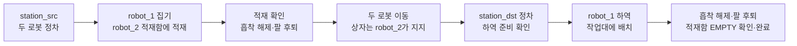

# ax-ws

**ax-ws는 중앙 운영 AI 에이전트의 상황 판단과 계획 제안을 중심으로, 가상 창고에서 두 로봇의 공동 운반을 조정하는 시스템을 개발하는 프로젝트다.** ROS 2 Jazzy와 Gazebo Harmonic을 기반으로 흡착 팔 로봇 `robot_1`이 물체를 집어 적재함 운송 로봇 `robot_2`에 싣고, 두 로봇이 목적지로 이동한 뒤 `robot_1`이 하역·배치하는 시나리오를 구현한다.

에이전트는 Fleet이 제공하는 로봇·작업·통로 상태와 예측 데이터를 종합해 상황을 요약하고, 작업 우선순위·통로 통과 순서·작업 보류·실패 복구 방안을 제안한다. 초기에는 협업 중인 두 로봇 중 누가 먼저 통로를 통과해야 공동 작업이 빨리 끝나는지 판단하는 데 초점을 둔다. Fleet은 제안의 유효성과 현재 상태를 검증해 운영에 반영하고, 로봇별 Task Executor와 제어부가 실행 및 최종 구동 차단을 담당하도록 설계한다.

개발 범위는 에이전트의 운영 판단을 로봇 모델·제어, 위치 추정·환경 인지, 물체 인식·조작, Fleet 작업 배정·자율주행과 연결하는 것이다. 규칙 기반 공동 운반을 먼저 검증하고, 에이전트 제안을 기록·평가하는 `ADVISORY` 단계를 거쳐 검증된 제안을 반영하는 `ASSISTED` 단계로 확장한다. AI 응답 지연·오류나 제안 검증 실패 시에는 규칙 기반 운영으로 복귀하도록 설계한다. 목표 구성과 역할별 계약은 [통합 상세설계](docs/design/DETAILED_DESIGN.md)에 정리한다.

현재 저장소는 AX_1 팔 로봇·AX_2 선반 로봇의 URDF와 ros2_control(gz_ros2_control) 기반 기본 제어, Gazebo 센서를 개발하는 단계다. 중앙 운영 AI 에이전트·두 로봇 협업·흡착 부착/해제·자율주행·최종 구동 차단은 후속 구현 대상이다. 실제 기구가 없는 가상 설계이며, 질량·관성·충돌 형상은 개발용 근삿값이다.

프로젝트·GitHub 저장소 이름: **`ax-ws`**. ROS 모델 이름은 `ax`, 패키지 이름은 기존 값을 유지한다. 로컬 작업공간은 `~/ax_ws`로 사용한다. 저장소를 받을 때 대상 폴더를 `~/ax_ws`로 지정하면 아래 명령을 그대로 사용할 수 있다.

[전체 문서 안내](docs/README.md) · [GitHub 업로드 전 점검](docs/validation/PREUPLOAD_REVIEW.md)

Claude 하네스 파일(`CLAUDE.md`, `.claude/`)은 로컬 작업 환경 전용이며 Git에 포함하지 않는다.

## 전체 시스템 구성도

### 목표 구성

아래는 두 로봇이 협업하는 **목표 설계**다. 각 블록의 현재 구현 범위는 아래 표를 참고한다.


[인터랙티브 전체 구성도](https://didgustmd23.github.io/ax-ws/overview.html) · [로봇 제어 구조](https://didgustmd23.github.io/ax-ws/internal.html) · [이미지 크게 보기 · WebP](docs/assets/diagrams/ax-system.webp)

웹 링크는 main 반영과 GitHub Pages 최초 배포 후 사용할 수 있다. 배포 전에는 [전체 구성도 HTML](docs/assets/diagrams/ax-system.html) 또는 [제어 구조 HTML](docs/assets/diagrams/ax-control.html)을 내려받아 브라우저로 연다.

<details>
<summary>구성도 웹 배포 설정</summary>

저장소의 **Settings → Pages → Build and deployment → Source**를 **GitHub Actions**로 선택한다. 이후 main에서 배포 파일이 변경되면 `Publish AX diagrams` 워크플로가 사이트를 갱신한다. 수동 실행은 main을 선택한다.

공개 대상은 `docs/assets/diagrams/`의 지정 HTML 2개와 WebP 1개다. `.archify/`의 작업 원본·JSON·검증 자료·글꼴은 Git과 Pages 배포에서 제외한다.

</details>

중앙 운영 AI 에이전트는 김성민이 수집한 상태를 바탕으로 **상황 요약 → 운영 판단 → 계획 제안**을 수행한다. 김성민은 제안을 검증해 작업 배정·통로 허가에 반영한다. 제안 검증 실패·AI 지연·오류 시에는 규칙 기반 운영으로 복귀한다. 양현승은 각 로봇의 최종 구동 경로에서 실행 허용과 정지를 강제한다. 이종수는 위치·환경·안전 판단을 제공하고 엄승연은 `robot_1`의 인식·조작을 담당한다. 상세 계약과 미정 수치는 [통합 상세설계](docs/design/DETAILED_DESIGN.md)를 따른다.

### 공동 운반 흐름



팔 동작 중 `robot_1` 주행과 적재·하역 중 `robot_2` 주행을 차단하는 것이 목표다. 두 로봇의 대형 유지 이동 여부는 미정이다.

### 현재 구현 상태

| 영역 | 현재 코드 | 목표·후속 구현 |
|---|---|---|
| 로봇 모델 | AX_1·AX_2 URDF, 단독/두 모델 생성, AX_1 RViz 집게 4종 선택 | 로봇별 가상 질량·충돌·최종 적재 공간 검증 |
| 기본 제어 | 로봇별 gz_ros2_control `controller_manager`, 바퀴 `diff_drive_controller`(`/cmd_vel` Twist 중계), 팔 `arm_controller`(JointTrajectoryController), primitive 손가락 위치 제어기 | 토크 정격·effort 확정, 안전 게이트·watchdog·최종 구동 차단 |
| 센서·상태 | 로봇별 전·후방 LiDAR·RGB/RGB-D·IMU, AX_2 접촉 센서 브리지, ros2_control 관절 상태·odom·이동 TF, 시간 브리지 | 작업 자세별 시야·접촉·주기·물리 동작 검증, 적재 판정 |
| 공구·조작 | Gazebo 기본 `primitive`, RViz 기본 비교용 `suction` 외형 | EPick 도입, 인식·집기 계획·실제 부착/해제·보유 판정 |
| 작업·주행 운영 | 두 로봇 협업 실행은 미구현 | Task Executor·Fleet·Nav2·통로 허가·중앙 운영 AI |

격리된 headless Gazebo에서 ros2_control 전환 전 구성으로 두 모델의 센서·상태·시간 토픽 30개 수신과 0.2 kg 검증 상자의 선반 접촉 전달을 확인했다. 전환 후에는 두 로봇의 제어기 활성, 관절별 명령 인터페이스 단일 점유, `joint_states`·`odom`·TF·`/clock` 발행과 주행 정지, 외부 하중 없이 자중에서의 자세 유지(단일 시험)를 확인했다(결과와 제한은 [인터페이스](docs/guides/INTERFACES.md) 참고). 어깨·팔꿈치·손목 effort를 개발용 잠정값(100·65·25 N·m)으로 올린 뒤 무부하 대표 자세는 정착·유지되지만, 실물 정격이 아니며 하한에 닿은 관절이 복귀하지 못하는 외부 물리 엔진 동작이 남아 있다. 작업 자세별 시야·측정 정확도·주기·하중 성능의 검증 완료는 아니며, RViz GUI 관절값은 Gazebo 물리 상태가 아니다. 2 kg 상자 운반은 검증 목표다. 현재 정적 COM 계산에는 지지 영역을 벗어나는 자세가 있으며, 충돌 없는 작업 범위·동적 안정성·실제 파지는 검증하지 않는다. [현재 인터페이스](docs/guides/INTERFACES.md)와 [물리 검사](docs/validation/PHYSICAL_PROPERTIES_REVIEW.md)에서 제공 범위와 계산 조건을 확인한다.

## 구성

| 경로 | 용도 |
|---|---|
| `src/ax_description/urdf/ax.urdf.xacro` | 차체·바퀴·팔·집게·라이다, v0.1 팔 질량·관절 속도 설정 |
| `src/ax_description/urdf/ax_2.urdf.xacro` | AX_2 차체·바퀴·선반·센서와 독립 가상 물리 특성 |
| `src/ax_description/urdf/sensors.xacro`, `config/sensor_mounts.yaml` | 두 로봇의 센서 구성과 개발용 장착 좌표 |
| `src/ax_description/worlds/ax_empty.sdf` | 센서·IMU·접촉 시스템을 공유하는 개발 월드 |
| `src/ax_description/config/arm_joint_limits.yaml` | 5축 속도·가속도 계획값. 현재 `arm_controller` 경로는 이 파일을 읽지 않으며 가속도를 강제하지 않음 |
| `src/ax_description/urdf/structure_demo.urdf` | 몸체와 팔만 있는 별도 연습 모델 |
| `src/ax_description/launch/display.launch.py` | RViz 수동 관절 표시 |
| `src/ax_control/launch/simulation.launch.py` | Gazebo 생성, 명령·센서 브리지, robot_state_publisher |
| `src/ax_control/ax_control/gripper_controller.py` | 집게 공통 명령을 양쪽 손가락으로 분배 |
| `tools/generate_physical_properties.py` | 질량·COM·관성·충돌 상자의 원본 계산 및 Xacro·JSON 생성 |
| `tools/check_static_stability.py` | 자세·공구·하중 가정에 따른 정적 COM 바닥 투영·지지 여유 계산 |
| `tools/check_joint_torques.py` | 개발 자세·경로의 팔 관절 정적 중력 토크(무부하·2 kg 가정)와 가속 참고치 계산. 모터 정격 아님 |
| `maps/warehouse_map.yaml`, `.pgm` | 기존 지도. 대응하는 창고 월드는 포함하지 않음 |
| [docs/guides/INTERFACES.md](docs/guides/INTERFACES.md) | 팀 연결용 링크·관절·토픽 표 |
| [docs/guides/GRIPPER_COMPARISON.md](docs/guides/GRIPPER_COMPARISON.md) | 집게 4종 선택·개폐 조작·시험 범위 |
| [docs/design/AX_5DOF_ARM_SPEC.md](docs/design/AX_5DOF_ARM_SPEC.md) | 실제 5축 로봇을 참고한 AX 자체 사양안·하중 목표·검증 기준 |
| [docs/validation/PHYSICAL_PROPERTIES_REVIEW.md](docs/validation/PHYSICAL_PROPERTIES_REVIEW.md) | 충돌 형상·가상 질량 분포 보완과 정적 지지 여유 계산 결과 |
| [docs/management/GIT_UPLOAD_POLICY.md](docs/management/GIT_UPLOAD_POLICY.md) | Git 업로드 제외·조건부 보관·필수 포함 파일 분류 |

## 설치와 빌드

대상: Ubuntu 24.04 / ROS 2 Jazzy / Gazebo Harmonic. GUI와 GPU LiDAR에는 디스플레이·렌더링 지원이 필요하며 WSL에서는 WSLg를 사용한다.

수신 팀원 PC에서 실행한다. rosdep 초기화가 되어 있다면 `sudo rosdep init`은 생략한다.

```bash
source /opt/ros/jazzy/setup.bash
sudo apt update
sudo apt install python3-colcon-common-extensions python3-rosdep liburdfdom-tools \
  python3-numpy python3-scipy python3-matplotlib
# rosdep 최초 사용 시에만: sudo rosdep init
rosdep update
cd ~/ax_ws
mkdir -p src/ax_description/config src/ax_description/meshes
rosdep install --from-paths src --ignore-src --rosdistro jazzy -r -y
colcon build --symlink-install --packages-up-to ax_description ax_control
source install/setup.bash
```

실행 의존성은 각 `package.xml`에 선언한다. Gazebo 시스템 플러그인은 Jazzy vendor 환경을 사용하므로 ROS setup을 먼저 적용한다.

Gazebo 메시 검색 경로는 `ax_description`·`robotiq_description`의 `package.xml` export에서 설치된 share 경로를 기준으로 등록한다. `model://...` 메시를 찾지 못하면 두 패키지를 다시 빌드하고 `install/setup.bash`를 적용한 뒤 simulation을 재시작한다. 사용자 홈 절대 경로를 환경 변수에 직접 넣을 필요는 없다.

simulation은 ros2_control 제어기를 사용하므로 아래 패키지가 필요하다(`ax_control/package.xml`에 선언). 2026-10-25 작업 PC에서 gz_ros2_control 1.2.20, ros2_control 4.48.1, ros2_controllers 4.42.1로 확인했다.

```bash
sudo apt install -y ros-jazzy-gz-ros2-control ros-jazzy-ros2-control ros-jazzy-ros2-controllers
for p in gz_ros2_control controller_manager joint_state_broadcaster diff_drive_controller \
         joint_trajectory_controller position_controllers; do ros2 pkg prefix $p; done
```

다른 PC에서는 `ros2 pkg prefix <패키지>`로 다시 확인한다. 설치 오류는 해결한 뒤 다음 단계로 진행한다.

## 실행

새 터미널마다 환경을 적용한다.

```bash
cd ~/ax_ws
source /opt/ros/jazzy/setup.bash
source install/setup.bash
ros2 launch ax_control simulation.launch.py
```

기본값은 월드 `empty`, AX_1 모델 `ax`와 기존 루트 명령 토픽이다. AX_2 또는 두 모델을 선택할 수 있다.

```bash
ros2 launch ax_control simulation.launch.py robot_model:=ax2
ros2 launch ax_control simulation.launch.py robot_model:=both
# GUI 없는 검증: 같은 명령에 gui:=false 추가
```

두 모델 모드는 `robot_1`·`robot_2`를 한 월드에 만들며 ROS 명령·상태는 `/ax/robot_i/`, TF 프레임은 `robot_i/`로 구분한다. 센서는 모든 모드에서 `/ax/robot_i/sensors/`를 사용한다. URDF는 `/tmp/ax_sim_*/`에 개별 생성한다. 별도 시뮬레이션을 동시에 실행할 때에는 ROS domain과 Gazebo partition을 함께 격리해야 한다. Ctrl+C로 종료한다.

RViz 구조만 별도로 확인할 때:

```bash
ros2 launch ax_description display.launch.py
# AX_2 외형·센서 확인
ros2 launch ax_description display.launch.py robot_model:=ax2
```

설계 기준 공구는 Robotiq EPick(컵 구성 미정)이며 아직 도입하지 않았다. RViz 기본 공구는 비교용 가상 4컵 흡착 헤드(`suction`)다. 표시 기본값일 뿐 흡착 부착·해제는 구현되지 않았다. 오픈소스 Robotiq 2F-85는 `gripper_model:=robotiq`(GUI의 `robotiq_85_left_knuckle_joint` 하나로 연동 개폐), 기존 임시 집게는 `gripper_model:=primitive`, 최대 450 mm 가상 평행 집게는 `gripper_model:=parallel_wide`로 선택한다. 실행을 종료한 뒤 다른 인자로 다시 시작한다. [집게 비교 안내](docs/guides/GRIPPER_COMPARISON.md)를 참고한다. Gazebo 실행은 기존 임시 집게(`primitive`)를 사용하며 공구 선택·흡착·Robotiq 물리 제어 통합은 별도 작업이다. Robotiq 원본·라이선스는 [패키지 안내](src/robotiq_description/README.md)를 참고한다.

Fixed Frame을 `base_link`로 설정하고 RobotModel을 추가한다. 이 GUI 관절값은 Gazebo 실측값이 아니다. 시뮬레이션 상태 확인을 위해 두 launch를 동시에 실행하지 않는다.

## 검사와 명령 예

```bash
xacro "$(ros2 pkg prefix --share ax_description)/urdf/ax.urdf.xacro" -o /tmp/ax_check.urdf
check_urdf /tmp/ax_check.urdf
ros2 topic list -t
ros2 topic echo /ax/robot_1/sensors/front_lidar/scan --once --qos-reliability best_effort
ros2 control list_controllers
ros2 topic pub --once /gripper/command std_msgs/msg/Float64 '{data: 0.015}'
# 팔: 일부 관절만 담은 궤적도 허용한다(rad, 4 s 동안 이동).
ros2 topic pub --once /arm_controller/joint_trajectory trajectory_msgs/msg/JointTrajectory \
  '{joint_names: [column_yaw_joint], points: [{positions: [0.3], time_from_start: {sec: 4}}]}'
ros2 topic pub -r 10 /cmd_vel geometry_msgs/msg/Twist '{linear: {x: 0.2}}'
```

명령 단위·범위는 [인터페이스 표](docs/guides/INTERFACES.md)를 따른다. 현재 명령 경로는 목표 범위를 검사하지 않는다. `/cmd_vel` 발행을 멈추면 0.5 s 뒤 바퀴 목표 속도가 0이 되며, 이는 안전 정지 기능이 아니다.

## 팀별 후속 연결

- 이종수: 로봇별 센서·광학 프레임을 사용한다. 전·후방 LiDAR·RGB-D·IMU·시간 브리지와 ros2_control 관절 상태·odom을 연결했으며 작업 자세별 시야·수신·추정 성능은 검증 대상이다.
- 엄승연: 팔은 `arm_controller` 궤적 토픽·`FollowJointTrajectory` action, primitive 집게는 `/gripper/command`(손가락 변위 m)를 사용한다. 관절 상태는 `joint_states`로 받는다. 역기구학·인식·집기 성공은 별도 구현 및 검증 대상이다.
- 김성민: 로봇별 `cmd_vel`(Twist)·`odom`·이동 TF를 `diff_drive_controller`로 구성했다. 공통 map 연결·Nav2·구동 차단 게이트는 후속 작업이다.
- 양현승: 실제 OBJ·단위·원점·관절 축표 확보 후 모델을 교체하고 재검증한다. 질량·관성·제어값·관절 제한은 실측 검증 전이다.

## 전달 파일

`src/`, `docs/`, `tools/`, README를 전달한다. 지도 사용 시 YAML과 PGM을 함께 전달한다. `build/`, `install/`, `log/`, `legacy_before_rename/`, `__pycache__/`, `.bak`, `Zone.Identifier` 부가 파일은 제외한다. CMake에서 참조하는 빈 `config/`, `meshes/`는 유지하거나 빌드 전에 위 mkdir 명령으로 만든다.

다른 팀원 PC에서 새로 빌드하고 모델 생성·명령 전달·센서 수신을 재현해야 인계 재현 확인이 완료된다. 현재 PC 검증과 다른 PC 재현은 구분한다.
