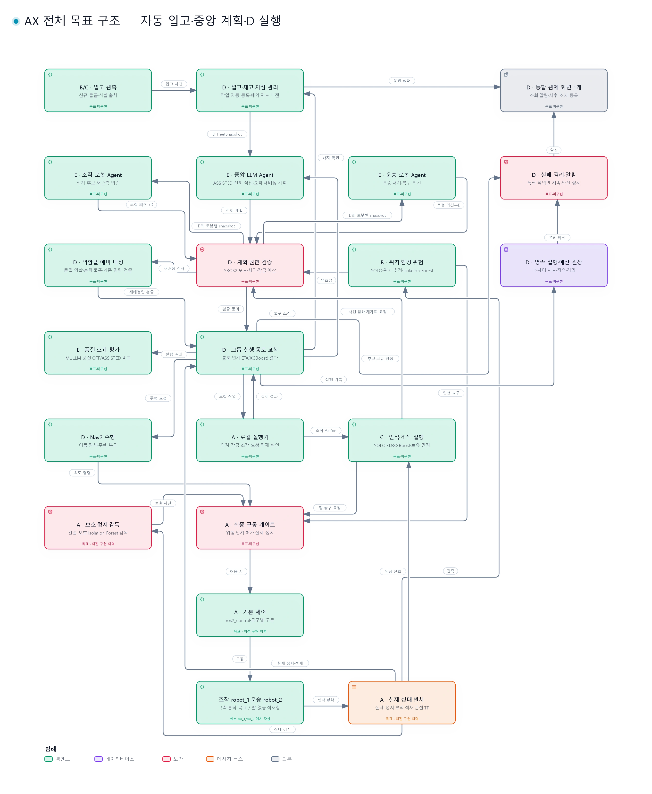
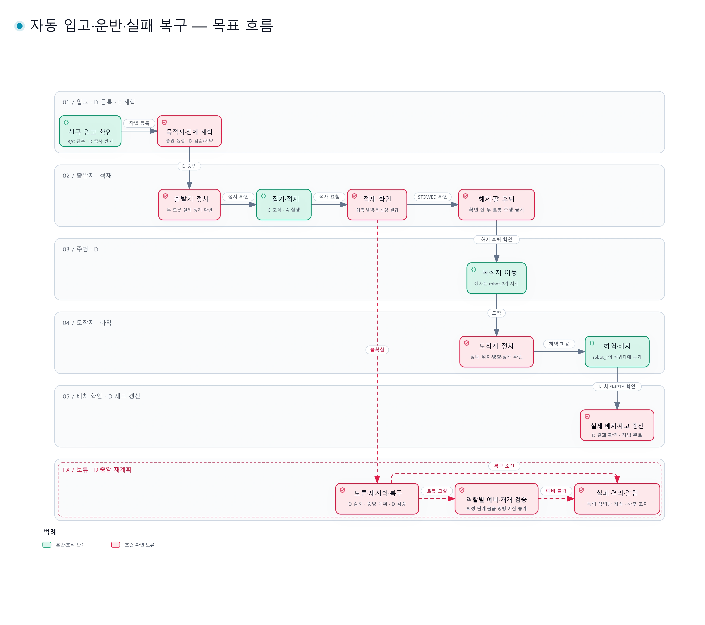

# ax-ws


**ax-ws는 입고 물품을 자동 확인하고, 중앙 LLM이 전체 운반 계획을 수립하며 Fleet이 검증·실행하는 가상 창고 운영 무인 시스템을 개발하는 프로젝트다.** ROS 2 Jazzy와 Gazebo Harmonic을 사용한다.

목표 동작은 다음과 같다. B·C가 입고를 관측하면 D가 중복 없이 작업을 생성한다. 중앙 LLM은 보관 규칙·가용 등록 위치·로봇 상태를 보고 목적지와 전체 계획을 생성하고, D가 용량·예약·권한·통로·예산을 검사해 실행을 조정한다. 조작 로봇이 집기·적재·하역하고 운송 로봇이 적재함으로 이동한다. 같은 역할의 검증된 예비 로봇 재배정도 목표 범위다.

기능 E에는 중앙·로봇별 Agent를 두며 전체 계획 책임은 중앙에 있다(ASSISTED 모드). D는 Nav2 주행을 직접 조정하고 A의 로컬 실행기에 작업을 전달한다. A는 최종 구동·차단, B는 위치·환경·위험, C는 조작 전략·보유 판정을 맡는다. 네 사람은 A~E의 같은 번호 세부 작업을 분담하며 기능과 개인을 일대일 고정하지 않는다.

최상위 목표는 완전 무인 운영이며, 설계에서는 이를 **운영 무인**으로 정의한다. 검증된 자동 복구가 실패·소진되면 작업을 종료·격리·알림 처리하고, 안전 조건을 확인한 독립 후속 작업만 계속한다. 사람은 사후에 원인 수정·물품 정리·재등록을 수행한다. 정상 입고는 물품별 사람 명령·승인을 요구하지 않는다.

규칙 기반 자동 입고·공동 운반부터 검증하고, SROS2+D 권한 검사 후 ADVISORY에서 중앙 계획을 평가한 뒤 ASSISTED로 확장한다. LLM 장애·계획 거절 시 유효한 규칙 경로가 있으면 사용하고, 없으면 유한 복구·실패 절차를 따른다. 관제 화면은 통합 1개이며 디자인은 추후 구체화한다.

[통합 상세설계](docs/design/DETAILED_DESIGN.md) · [팀 공통 일정·A1~E4 분담](docs/management/TEAM_SCHEDULE.md) · [전체 문서 안내](docs/README.md)

프로젝트·GitHub 저장소 이름: **`ax-ws`**. ROS 모델 이름은 `ax`, 로컬 작업공간은 `~/ax_ws`로 사용한다.

로컬 작업 지침(`CLAUDE.md`, `.claude/`, `AGENTS.md`, `.agents/`, `.codex/`, `.codex-harness/`)은 로컬 작업 환경 전용이며 Git에 포함하지 않는다.

## 현재 저장소 상태

현재 작업트리에는 **A1 모델·센서·시험 구성**이 구현돼 있다. AX_1 V2 관절 로컬 메시, 질량·관성 생성기, 고정 commit EPick description, AX_2 적재함 접촉 센서, 로봇별 namespace·TF와 공통 시험 launch를 제공한다. 관절 범위·자기 충돌·0~2 kg 관성 치구·유지·Action 취소 정지와 기하 TCP 보정을 검증했다. [A1 구현·제한·재현](docs/guides/A1_MODEL_ASSETS.md) · [검증 결과](docs/evidence/a1/). 실제 흡착 부착/해제·B1 보정/동기화·Nav2·Agent·A4 안전 게이트와 G1 관문은 별도 구현·검증 대상이다.

이전 개발 구성(AX_1·AX_2 모델, 로봇별 ros2_control 기본 제어, Gazebo 센서, 개발용 관절 보호 `arm_command_guard`)과 그 인터페이스·검증·팔 사양 문서는 커밋 [`4f85007`](https://github.com/didgustmd23/ax-ws/tree/4f8500755151b2fbcbf35ab9cbca13fb1d71cea9)까지의 Git 이력으로만 남긴다. 이전 구현은 G1(안전 게이트·최종 구동 차단)을 충족하지 않았으며, 이력의 코드·수치·시험 결과를 새 구현의 통과 근거로 쓰지 않는다. 경위와 조회 방법은 [이전 구현 기록](docs/management/TEAM_SCHEDULE.md#이전-구현-기록)을 따른다.

```bash
git show 4f85007:docs/guides/INTERFACES.md      # 이전 인터페이스 조회
git checkout 4f85007 -- src/ax_control          # 필요한 부분만 복원
```

<!-- a1-model-entry -->
## A1 모델 실행·검증

```bash
source /opt/ros/jazzy/setup.bash
colcon build --packages-up-to ax_description ax_interfaces ax_control
source install/setup.bash
ros2 launch ax_control simulation.launch.py
```

제어기(바퀴·팔)와 흡착 공구 경로는 A2 `ax_control`이 띄운다. `ros2 launch ax_description robot_test.launch.py`는 제어기 없이 모델·센서만 띄우는 시험용이다.

기본 모델 공구는 **다중 흡착판 · 12컵**(`tool:=epick`)이며 교체 공구는 **손가락 집게 · Robotiq 2F-85**(`tool:=robotiq`)다. `epick`은 기존 연결을 유지하는 호환 이름으로 실제 EPick 제품 형상을 뜻하지 않는다. `tool:=suction`은 기존 가상 4컵 헤드 비교용이다. [부품 이름·미리보기](src/ax_description/meshes/README.md)
원본 CAD·라이선스를 보존하고 [A1 안내](docs/guides/A1_MODEL_ASSETS.md)의 생성·시험 명령을 따른다.
[바퀴·시험 월드·런치](docs/guides/WHEEL_AND_LAUNCH_REPAIR.md) · [A1 시험 증거](docs/evidence/a1/).

### 통합 시험 월드와 다른 PC 실행

실행 월드는 현재 만든 창고 맵 `planned/ax_warehouse.world`(기준, 질감)와 같은 구조의 단색 보존본 `planned/ax_warehouse_plain.world`다.
선택 목록·출발 위치는 `src/ax_description/config/worlds.yaml` 한 곳에 있다. 빈 월드는 삭제했다.
`planned/ax_warehouse.world`는 44×16m의 두 창고, 폭 1.8m 연결 통로 3개,
출발 선반 6개·도착 선반 4개·크기별 동적 상자 143개를 포함한다. AWS 월드는 제거했다.
선택 실행: `ros2 launch ax_control simulation.launch.py world:=planned/ax_warehouse.world`.
단색 보존본: `world:=planned/ax_warehouse_plain.world`(바탕화면 도구는 `tools/desktop_session.py --world`).
기본 실행과 월드 선택 메뉴는 모두 현재 창고를 연다. 주행 시험의 빈 바닥은 테스트 때만 임시 생성한다.
모델별 스펙: [AX_1](docs/guides/AX_1_SPEC.md) · [AX_2](docs/guides/AX_2_SPEC.md).
부품 명칭과 최신 형상은 [부품 미리보기](src/ax_description/meshes/README.md)를 따른다.
다른 PC의 설치·빌드 절차는 [실행 안내](docs/guides/RUN_ON_ANOTHER_PC.md)를 따른다.
주행·팔을 키보드로 조종하는 방법은 [키보드 조종 안내](docs/guides/KEYBOARD_CONTROL.md)를 따른다.
별도 브라우저 창에서 마우스로 조종하려면 [리모컨 안내](docs/guides/REMOTE_CONTROL.md)를 따른다.
터미널 없이 실행·종료하려면 **[리모컨 폴더](remote_controller/README.md)의 `install.cmd`를 더블클릭**한다.
팀원 코드 인계는 [코드 읽는 순서·단위·생성 파일 안내](docs/guides/CODE_GUIDE.md)를 따른다.

```bash
bash tools/setup_jazzy.sh
source install/setup.bash
ros2 launch ax_control simulation.launch.py robots:=2 tool:=robotiq
```

## A3 모의 로컬 작업 실행기

`src/ax_task_executor/`는 김성민 담당 A3의 W0 실행기 골격·모의 서버 패키지다.
`CONFIRM_LOAD` Action의 시험 결과를 반환하고 Gazebo 표시등으로 보여준다.
실제 적재 관측·로봇 구동·운영 lease 검증은 포함하지 않는다.
[빌드·ros2 run 실행 안내](src/ax_task_executor/README.md) · [A3 K0 검토 기록(초안)](docs/guides/A3_K0_REVIEW.md).

W1 A4·B4 설치·빌드·A3 연결·A2/Gazebo 검증은 [W1 A4·B4 설치·검증 안내](W1_A4_B4_SETUP.txt)를 따른다.
실행 결과 요약은 [W1 A4·B4 검증 기록](docs/evidence/w1_a4_b4/W1_A4_B4_VERIFICATION_2026-11-13.md)에서 확인한다.

## B1 센서 전처리 (개발 중)

모델·제어 시뮬레이션을 실행한 뒤 별도 터미널에서 아래 명령으로 연결한다.
Gazebo와 같은 ROS 환경을 source하고 `tool`은 실행 중인 모델과 맞춘다.

```bash
source /opt/ros/jazzy/setup.bash
colcon build --packages-select ax_perception
source install/setup.bash
ros2 launch ax_perception sensors.launch.py tool:=epick
```

원본은 보존한다. 로봇별 `sensors/tool_tof`(계약 경로),
`sensors/{front,rear}_lidar/scan_filtered`, 카메라의 `processed/image_raw`,
RGB-D의 `processed/{image,depth_image,camera_info,points}`를 제공한다.
RGB-D는 같은 광학 frame·크기, 측정 시각 차이 0.03 s 이내의 묶음만 내보낸다.
깊이는 32FC1 m 기준 0.05~5 m 밖·무효값을 NaN으로 유지한다.
원본 측정 시각은 바꾸지 않는다. 수신 시각이 아닌 측정 시각 기준
0.5 s 초과 지연·0.05 s 초과 미래·역행·중복·잘못된 frame은 거절한다.
이 수치는 조정 가능한 개발용 초기 파라미터다.

`sensors/health`는 표준 DiagnosticArray 기반 개발용 진단 경로다.
2 s 수신 누락 시 STALE이며, 안전 허용이나 적재 완료를 의미하지 않는다.
ToF +inf/-inf는 원뜻을 보존하며 NaN은 유효하지 않은 측정이다.
처리 점군은 깊이와 CameraInfo로 재생성하며 X=오른쪽, Y=아래, Z=전방인
광학 좌표계다. 원시 Gazebo `points`는 축·투영이 CameraInfo와 다를 수 있어
3D 소비자는 `processed/points`를 사용한다. 단안·무왜곡·정렬 RGB-D만 지원하며
스테레오 투영 오프셋이나 비영 왜곡계수는 거절한다.
실물 내외부 보정과 소비자와의 최종 건강 상태 계약은 남아 있다.

## C1 상자 검출 (개발용 기준 모델)

초기 인식 기준은 0.2m 시험 상자였다. 현재 창고에는 다양한 크기의 상자가 있으며,
이들의 크기·색 구분이 기존 인식기의 학습·적재 가능 판정에 자동 반영되는 것은 아니다.
[YOLO11n](https://docs.ultralytics.com/models/yolo11/)을 사용하며 학습용 시뮬레이터 정답과
운영 영상 추론을 구분한다. 수집기는 임시 RGB-D 카메라로 보이는 상자 표면을 라벨링하고
카메라를 제거한다. 학습·검증·평가는 시점 영역을 나누며 상자 없는 영상도 포함한다.
로봇과 물체는 이동하지 않는다. 더 다양한 배경·가림·물품과 실물 영상은 추가해야 한다.

Ubuntu 작업공간 루트에서 실행한다. CPU 전용 환경을 별도로 만들며
시스템 ROS Python은 바꾸지 않는다. 버전은 설치 스크립트에 고정한다.

```bash
bash tools/setup_vision.sh
source /opt/ros/jazzy/setup.bash
source install/setup.bash
source .venv-vision/bin/activate
# 기존 ax_test 시뮬레이션 실행 중 수집 (출력 폴더가 이미 있으면 새 이름 지정)
python tools/collect_box_dataset.py
# 수집 완료 후 학습. 출력 폴더가 이미 있으면 --output으로 다른 이름 지정
python tools/train_box_detector.py
```

데이터는 `vision_data/box_v1`, 가중치는 `vision_models/box_v1/weights/best.pt`에 저장한다.
데이터 YAML의 영상 경로는 해당 YAML 기준 상대경로다. 데이터·학습 결과·가상환경은 Git에서 제외한다.
모델 가중치는 저장소에 포함하지 않으므로 다른 PC에서는 수집·학습하거나 별도 전달받아야 한다.
설치에는 네트워크와 venv 패키지 설치 시 sudo가 필요할 수 있다.

B1 전처리를 실행한 상태에서 같은 가상환경의 별도 터미널로 연결한다.

```bash
python src/ax_perception/scripts/object_detection.py \
  --weights vision_models/box_v1/weights/best.pt \
  --ros-args -r __ns:=/ax/robot_1 -p use_sim_time:=true
```

기본 입력은 로봇 namespace 아래 `sensors/front_rgb/processed/image_raw`,
출력은 `perception/detections` (`vision_msgs/Detection2DArray`)다.
클래스·신뢰도·픽셀 상자·원본 영상 시각을 보존하고 물리 물체 ID는 미확정으로 둔다.
3D pose나 입고 사건은 추정해서 발행하지 않는다. 진단은 `perception/detection_health`다.
입력이 오래되거나 잘못된 frame이면 거절하고, 누적 영상 대신 최신 영상만 처리한다.
CPU 기본값은 최대 2회/s이며 실제 속도는 PC 부하에 따라 달라진다.
수집 영상의 시뮬레이터 정답은 이 추론 노드에 전달하지 않는다.

## 전체 시스템 구성도

### 목표 구성

아래는 입고부터 재고 갱신까지 기능 A~E가 어떻게 연결되는지 보여 주는 **목표 설계의 간략 구조**다. 블록별 세부는 상세 기능 구성도를 본다.



[인터랙티브 전체 구성도](https://didgustmd23.github.io/ax-ws/overview.html) · [이미지 크게 보기 · WebP](docs/assets/diagrams/ax-system.webp) · [상세 기능 구성도](https://didgustmd23.github.io/ax-ws/functions.html) ([HTML](docs/assets/diagrams/ax-functions.html)) · [인터페이스 관계](https://didgustmd23.github.io/ax-ws/interfaces.html) ([HTML](docs/assets/diagrams/ax-interfaces.html)) · [lease·명령 확인 순서](https://didgustmd23.github.io/ax-ws/lease.html) ([HTML](docs/assets/diagrams/ax-lease.html))

웹 링크는 main 반영과 GitHub Pages 최초 배포 후 사용할 수 있다. 배포 전에는 [전체 구성도 HTML](docs/assets/diagrams/ax-system.html)을 내려받아 브라우저로 연다.

<details>
<summary>구성도 웹 배포 설정</summary>

저장소의 **Settings → Pages → Build and deployment → Source**를 **GitHub Actions**로 선택한다. 이후 main에서 배포 파일이 변경되면 `Publish AX diagrams` 워크플로가 사이트를 갱신한다. 수동 실행은 main을 선택한다.

공개 대상은 `docs/assets/diagrams/`에서 명시한 구성도 HTML 9개와 투명 WebP 9개다. `.archify/`의 작업 원본·JSON·검증 자료·글꼴은 Git과 Pages 배포에서 제외한다.

</details>

목표 구성도는 기능 A~E의 책임을 표시한다. 번호별 담당은 1 이종수·2 양현승·3 김성민·4 엄승연이며 [작업자 배정표](docs/management/TEAM_SCHEDULE.md#번호별-작업자-배정)를 따른다. 기간은 2026-10-28 ~ 2027-01-28(개발 2개월·시험 1개월)이며 주차 계획은 [달력 일정](docs/management/TEAM_SCHEDULE.md#달력-일정--2026-10-28--2027-01-28)을 따른다.

### 공동 운반 흐름

[](https://didgustmd23.github.io/ax-ws/transfer.html)

[인터랙티브 구성도](https://didgustmd23.github.io/ax-ws/transfer.html) · [HTML 내려받기](docs/assets/diagrams/ax-transfer.html) · [이미지 크게 보기 · WebP](docs/assets/diagrams/ax-transfer.webp)

팔 동작 중 조작 로봇 주행과 적재·하역 중 운송 로봇 주행을 차단하는 것이 목표다. 두 로봇의 대형 유지 이동 여부는 미정이다.

[최종 차단 권고 구조](docs/assets/diagrams/ax-safety.html) · [전체 구성도 목록](docs/README.md#구성도-모음)

## 구성

| 경로 | 용도 |
|---|---|
| [docs/design/DETAILED_DESIGN.md](docs/design/DETAILED_DESIGN.md) | 목표 설계·결정·계약·시험 요구 |
| [docs/management/TEAM_SCHEDULE.md](docs/management/TEAM_SCHEDULE.md) | A1~E4 작업 분해·담당·의존성·단계·이전 구현 기록 |
| [docs/design/INTERFACE_CONTRACT.md](docs/design/INTERFACE_CONTRACT.md) | 공통 인터페이스 계약(K0, 2026-11-08 승인) |
| `src/ax_interfaces/` | 공통 메시지·서비스·액션 타입(62개, K0 2026-11-08 확정). `colcon build --packages-select ax_interfaces` |
| [docs/management/GIT_UPLOAD_POLICY.md](docs/management/GIT_UPLOAD_POLICY.md) | Git 포함·제외 기준, 초안·이전 구현의 정리 원칙 |
| `docs/assets/diagrams/` | 공유 구성도 HTML·투명 WebP |
| `src/ax_description/meshes/` | AX_1·AX_2·상자 원본 OBJ·MTL과 분리 메시. [분리 메시 README](src/ax_description/meshes/parts/README.md) |
| `src/robotiq_description/` | 외부 Robotiq 모델 subset·LICENSE·원본 해시. [패키지 안내](src/robotiq_description/README.md) |
| `maps/warehouse_map.yaml`, `.pgm` | 기존 지도. 대응하는 창고 월드는 포함하지 않음 |

## 전달 파일

`docs/`, `src/`의 모델 자산과 공통 인터페이스 타입(`src/ax_interfaces`), `maps/`, README를 전달한다. 지도 사용 시 YAML과 PGM을 함께 전달한다. `build/`, `install/`, `log/`, `legacy_before_rename/`, `__pycache__/`, `.bak`, `Zone.Identifier` 부가 파일은 제외한다. 외부 라이선스·manifest를 함께 전달한다.

Archify는 `docs/assets/diagrams/`의 공유 HTML·WebP만 포함하고 `.archify/` 원본은 제외한다.
