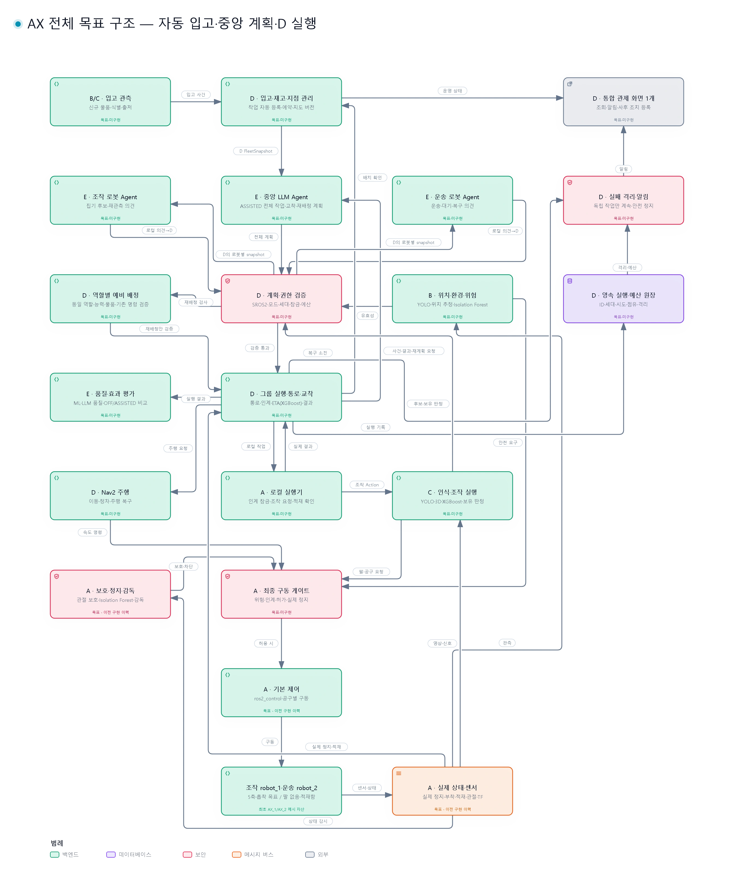

# ax-ws 문서 안내

현행 문서 정리 기준: 2026-10-27(작업트리). 프로젝트 표시명과 GitHub 저장소 이름은 **`ax-ws`**다. 로봇 모델 이름은 `ax`를 사용하고 로컬 작업공간 경로 `~/ax_ws`는 유지한다.

## 현재 상태와 문서 선택

- 저장소는 **설계·일정 단계**다. 작업트리에는 구현 소스가 없고 설계·일정 문서, 공유 구성도, 모델 자산만 있다.
- [통합 상세설계](design/DETAILED_DESIGN.md)는 목표 계약, [팀 공통 일정](management/TEAM_SCHEDULE.md)은 A1~E4 산출물·의존성·단계·검증을 관리한다. 번호별 담당은 확정했고 기간은 2026-10-28 ~ 2027-01-28(개발 2개월·시험 1개월)이다.
- 이전 개발 구성의 소스와 인터페이스·검증·집게 비교·팔 사양·외부 저장소 검토 문서, 검증 자료는 커밋 `4f85007` 이력으로만 남긴다. 이전 구현은 **G1 미충족** 상태였으며, 이력의 수치·시험 결과를 새 구현의 통과 근거로 해석하지 않는다. 경위와 조회 방법은 [이전 구현 기록](management/TEAM_SCHEDULE.md#이전-구현-기록)을 따른다.
- 설계는 본설계 하나, 전체 일정·업무 분담은 공통 일정 하나로 관리한다. 채택된 임시 초안은 흡수 후 제거한다.

## 전체 시스템 구성도

[인터랙티브 전체 구성도](https://didgustmd23.github.io/ax-ws/overview.html) · [HTML 내려받기](assets/diagrams/ax-system.html) · [이미지 크게 보기 · WebP](assets/diagrams/ax-system.webp)

## 구성도 모음

이미지를 누르면 GitHub Pages의 인터랙티브 구성도가 열린다. 배포 전에는 HTML을 내려받아 브라우저로 연다. WebP는 투명 배경이며, 아래 파일만 Git·Pages 공유 대상으로 사용한다. `.archify/`의 JSON·작업 원본·글꼴·검증 자료는 제외한다.

| 구성도 | 범위 | HTML | 투명 이미지 | Pages |
|---|---|---|---|---|
| 전체 시스템 | 자동 입고·중앙 계획·D 실행·역할별 예비·통합 관제 | [열기](assets/diagrams/ax-system.html) | [WebP](assets/diagrams/ax-system.webp) | [overview](https://didgustmd23.github.io/ax-ws/overview.html) |
| 공동 운반 | 입고·적재·배치·재고 갱신·실패 복구·예비 배정 | [열기](assets/diagrams/ax-transfer.html) | [WebP](assets/diagrams/ax-transfer.webp) | [transfer](https://didgustmd23.github.io/ax-ws/transfer.html) |
| 최종 차단 권고 | 중앙 계획→D 검증→A 최종 차단·주행/조작 경로 | [열기](assets/diagrams/ax-safety.html) | [WebP](assets/diagrams/ax-safety.webp) | [safety](https://didgustmd23.github.io/ax-ws/safety.html) |
| 패키지 구성 | A~E·공통 목표 패키지. 그림의 "현재 구현" 표시는 이전 구현(커밋 `4f85007`) 기준 | [열기](assets/diagrams/ax-packages.html) | [WebP](assets/diagrams/ax-packages.webp) | [packages](https://didgustmd23.github.io/ax-ws/packages.html) |
| 이전 로봇 제어 | 이전 구현(커밋 `4f85007`)의 팔 명령 보호를 포함한 제어 구성 기록 | [열기](assets/diagrams/ax-control.html) | [WebP](assets/diagrams/ax-control.webp) | [internal](https://didgustmd23.github.io/ax-ws/internal.html) |
| 문서 폴더 | 이전 문서 구성(커밋 `4f85007`) 기준. 현재 문서는 이 안내를 따름 | [열기](assets/diagrams/ax-docs.html) | [WebP](assets/diagrams/ax-docs.webp) | [documents](https://didgustmd23.github.io/ax-ws/documents.html) |

구성도는 개인 배정 없이 A~E 기능과 호출·관측 경계를 표시한다. Pages 링크는 main 반영 및 배포 후 갱신된다. 이전 구현을 그린 구성도는 기록용이며 현재 동작 설명이 아니다.

## 처음 읽는 순서

1. [프로젝트 README](../README.md): 목표·현재 저장소 상태·구성.
2. [통합 상세설계](design/DETAILED_DESIGN.md): 목표 설계·결정·계약·시험 요구.
3. [팀 공통 일정](management/TEAM_SCHEDULE.md): 작업 분해·담당·의존성·단계·이전 구현 기록.
4. [Git 업로드 기준](management/GIT_UPLOAD_POLICY.md): 포함·제외 파일과 이전 구현의 정리 원칙.

## 설계·일정·관리

| 문서 | 내용 | 상태 |
|---|---|---|
| [DETAILED_DESIGN](design/DETAILED_DESIGN.md) | 조작·운송 역할 협업 그룹, A~E 기능, 상태 머신·통신·검증 목표 | 운영 무인·자동 입고·중앙 전체 계획·D 실행·역할별 예비·인증/관제 목표. 구현 완료 아님 |
| [TEAM_SCHEDULE](management/TEAM_SCHEDULE.md) | 팀 공통 일정, A1~E4·공통 계약·통합/장시간 시험·완료 관문 | 1 이종수·2 양현승·3 김성민·4 엄승연. 2026-10-28 ~ 2027-01-28, 주차 계획은 초안 |
| [GIT_UPLOAD_POLICY](management/GIT_UPLOAD_POLICY.md) | 포함·제외 파일과 확인 방법 | build/install/log 제외, 모델 자산·외부 LICENSE 포함 |
| [plan.pdf · Git 이력 원문](https://github.com/didgustmd23/ax-ws/blob/560e57e38afae17e1e29b2387b63f60b2ddee219/docs/design/plan.pdf) | 최초 통합 상세설계 원문 | 현재 작업트리에서 삭제 상태, 저장된 커밋 참조 |

## 모델 출처

| 문서 | 용도 |
|---|---|
| [분리 메시 README](../src/ax_description/meshes/parts/README.md) | AX_1·AX_2·상자별 OBJ 분리, 재생성·좌표·원통 분리 규칙(도구는 커밋 `4f85007` 이력) |
| [Robotiq README](../src/robotiq_description/README.md) | 도입 commit·모델 전용 범위·원본 파일 해시·라이선스 |

문서의 설계 목표, 코드 반영, 정적 계산 통과, Gazebo 실행 통과는 서로 다른 상태다. 현재 작업트리에는 실행 가능한 구현이 없으므로 모든 기능은 새 구현과 검증 대상이다.
