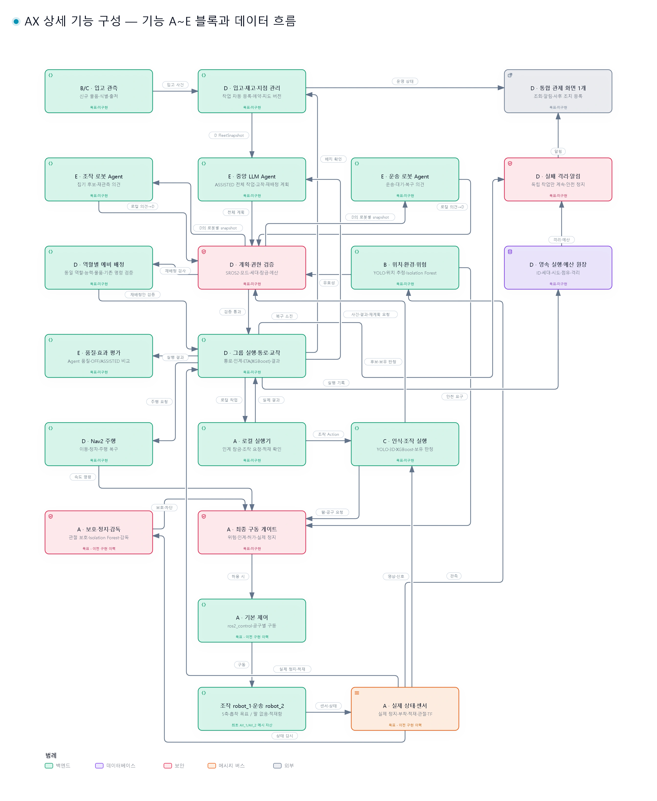
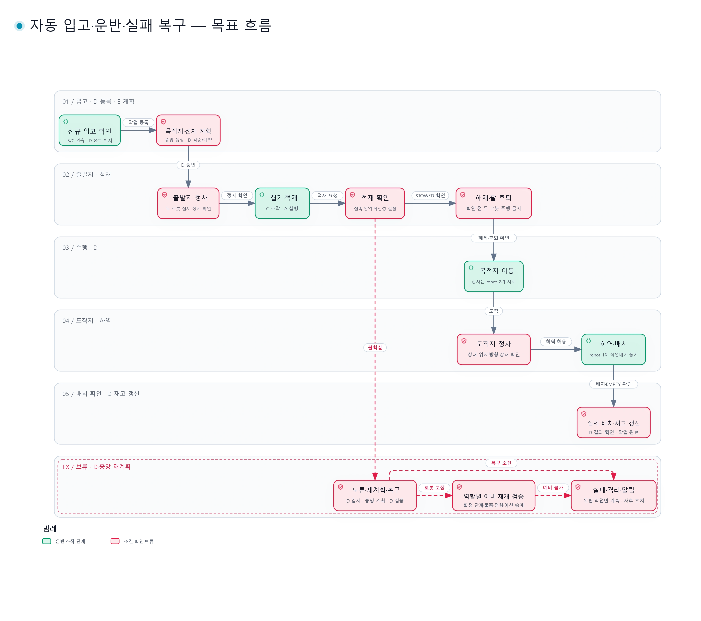
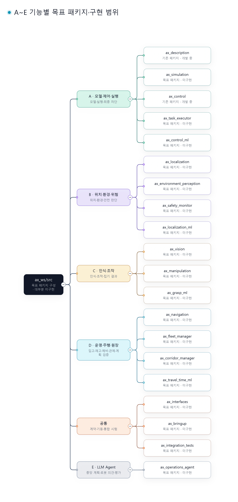

# AX 자동 운반 로봇 통합 상세설계

> 원문 PDF는 현재 작업트리에서 삭제 상태여서 저장된 커밋을 참조한다.
> 출처: [plan.pdf · Git 이력 원문](https://github.com/didgustmd23/ax-ws/blob/560e57e38afae17e1e29b2387b63f60b2ddee219/docs/design/plan.pdf), 통합 상세설계서 v1.0, 총 10쪽.
> 원문을 기준으로 내용을 재구성했으며, 프로젝트 표기를 `AX`, 패키지·경로·네임스페이스 표기를 `ax`로 통일했다.
> 이 문서는 목표 설계를 정리한 것으로 현재 코드의 구현 완료 상태를 의미하지 않는다. 인터페이스·수치·토픽 이름은 구현 검토용 초안이며, 실제 모델·센서·로봇 기구 검증 후 확정한다.

> 2026-10-22 설계 보완 결정(역할이 다른 협업 로봇 그룹, 적재 확인, 흡착, ros2_control 전환, 인계 구동 차단)과 2026-10-27 팀 결정(17절)을 반영했다. 각 절의 **결정**은 설계 기준이며 구현·검증 완료를 뜻하지 않는다. 수치·타입·enum 값 중 정하지 않은 것은 14절 미정 항목으로 관리한다.

## 구현 상태와 읽는 기준

**결정**은 목표 계약, **구현**은 소스 반영, **검증**은 명시된 조건의 시험 결과다. 이 세 상태를 같은 뜻으로 쓰지 않는다.

2026-10-27 기준 작업트리에는 기능 구현 소스가 없고 공통 인터페이스 타입 초안(`src/ax_interfaces`)만 있다. 이전 개발 구성(AX_1·AX_2 모델, 로봇별 ros2_control,
개발용 관절 보호 `arm_command_guard`; G1 미충족)과 그 인터페이스·검증·팔 사양 문서는 커밋 `4f85007`
이력으로만 남긴다. 작업트리에 남긴 모델 자산은 메시(`src/ax_description/meshes/`)·`src/robotiq_description/`·`maps/`다.
새 구현은 이 문서와 [팀 공통 일정](../management/TEAM_SCHEDULE.md)을 따르며, 이전 구현의 경위와 조회 방법은
[이전 구현 기록](../management/TEAM_SCHEDULE.md#이전-구현-기록)을 따른다. 이 문서의 목표 토픽을 이미 동작하는 API로 사용하지 않는다.

## 1. 목표와 개발 범위

4명이 ROS 2 Jazzy와 Gazebo Harmonic을 사용하여 **자동 입고·보관 위치 선택·공동 운반·재고 갱신**을 수행하는 가상 창고를 개발한다. 조작·운송 역할의 최소 2대에서 시작하고 역할별 예비 로봇 Fleet으로 확장한다. 개인 배정은 팀 공통 일정의 번호별 담당표를 따르고 기간은 2026-10-28 ~ 2027-01-28(개발 2개월·시험 1개월)이며 기존 16주 계획은 사용하지 않는다.

- 흡착 팔 로봇 `robot_1`과 적재함 운송 로봇 `robot_2`를 하나의 협업 그룹(예: `team_1`)으로 운영한다.
- 출발 작업대 `station_src`에서 도착 작업대 `station_dst`까지 인식 → 집기 → 적재 → 이동 → 하역 → 놓기의 공동 운반을 수행한다.
- 좁은 통로에서는 같은 그룹이어도 로봇별 배타적 진입 허가를 지킨다.
- 센서 끊김, 집기 실패, 주행 실패, 적재 이상에 대해 그룹 보류·복구·재개를 수행한다. 같은 역할·능력을 검증한 예비 로봇만 9.10절 조건으로 재배정한다.
- LLM 부재 시에도 승인된 작업·검증된 규칙 계획은 계속 실행할 수 있어야 한다. 규칙 계획이 없으면 유한 복구·실패 종료를 적용한다.
- 기본 기능 검증 후 ML과 기능 E의 중앙·로봇별 LLM Agent를 단계적으로 연결한다.

**운영 목표 — 결정:** 프로젝트의 최상위 목표는 완전 무인 운영이며, 이 문서는 이를 **운영 무인**으로 정의한다. 정상 작업·검증된 자동 복구·실패 종료에 운영 중 사람의
모니터링·승인·수동 복구를 요구하지 않는다. 복구 불가·예산 소진 시 해당 작업을 실패 종료·격리하고
알림을 남긴다. 안전 조건을 확인한 독립 후속 작업은 계속하며, 확인 불가 시 안전 정지를 유지한다.
사람의 원인 수정·물체 정리·재등록은 사후 처리다. 모든 작업의 성공을 보장하는 목표와 구분한다.
실패 종료·후속 작업·평가의 기준은 9.5절이다.

PPO/SAC 등 강화학습 기반 주행·배정은 현재 핵심 범위 밖의 확장 항목이다.

## 2. 핵심 설계 결정

| ID | 설계 항목 | 원칙 |
|---|---|---|
| DEC-01 | 전역 작업 상태 | D가 최종 소유 |
| DEC-02 | 실행 소유권 | D는 주행 목표·전역 단계·배정, A는 로컬 실행·실제 구동·정지 상태 소유 |
| DEC-03 | 안전 정지 | B가 위험 판단, A가 실제 정지·차단 |
| DEC-04 | 통로 관리 | B가 진입·이탈 관측, D가 허가 순서 관리 |
| DEC-05 | ID·좌표·단위 | `team_1`, `robot_1`, `robot_2`, `map`, 로봇별 `odom`·`base_link`, SI 단위 |
| DEC-06 | 종료 상태 | 완료·실패·취소·시간초과 구분 |
| DEC-07 | 집기 복구 | C가 전략·시도·보유 결과, A가 로컬 결과 전달, D가 공통 예산·복구 종료 관리 |
| DEC-08 | 구동 명령 | A가 안전 차단, D가 Nav2 주행, C가 조작 |
| DEC-09 | 물체 3D 좌표 | Depth + 카메라 보정 + TF 우선 |
| DEC-10 | 통로 이탈 | B의 완전 이탈 확인 전 허가 해제 금지 |
| DEC-11 | 기능 E의 Agent | 중앙이 전체 작업·복구 계획 수립, 로봇별 Agent는 로컬 의견. D가 인증·최신 상태로 검증·실행 |
| DEC-12 | AI 조합 | YOLO + XGBoost + Isolation Forest + LLM |
| DEC-13 | AI 실패 | 유효한 상태와 검증된 규칙 경로가 있으면 계속. 없으면 보류·유한 복구 후 9.5절 실패 종료 |
| DEC-14 | 로봇 구성 | 조작·운송 역할을 실제 robot_id와 분리. 최소 쌍은 robot_1/robot_2, 같은 역할의 검증된 예비 로봇 재배정 허용 |
| DEC-15 | 그룹 작업 | D가 그룹 작업·`transfer_id`·인계 상태를 관리하고 로봇별 하위 작업으로 실행 |
| DEC-16 | 적재 확인 | robot_2 접촉 센서 + 적재 영역 판정. robot_2 측 A가 결과 발행 |
| DEC-17 | 흡착 | 기준 공구 Robotiq EPick(컵 구성 미정). 접근 조건 확인 후 Gazebo 연결, 명시적 해제 요청으로 제거. 보유 판정은 지정 물체의 실제 부착 상태. 안전 정지 시 자동 해제 금지 |
| DEC-18 | 제어 프레임워크 | 두 로봇 모두 ros2_control + gz_ros2_control로 전환 결정. 이전 개발 구성에 적용(2026-10-25, 커밋 `4f85007` 이력, 로봇별 controller_manager, 이전 Gazebo 제어 플러그인 제거). effort 정격·안전 정지·최종 구동 차단은 미확정 |
| DEC-19 | 인계 구동 차단 | 인계 중 두 로봇 주행 금지. 상대 상태·허가 만료 시 기본값은 주행 금지 |
| DEC-20 | 운영 무인 | 운영 중 사람 개입 없이 정상 실행·유한 복구·실패 종료·격리·알림. 독립 후속 작업만 조건부 진행, 안전 미확인 시 정지 유지. 사람의 조치는 사후 처리(9.5절) |
| DEC-21 | 계획/실행 분리 | ASSISTED에서 중앙 LLM이 전체 계획(OFF·ADVISORY는 D의 검증된 규칙 계획), D가 계획 검증·예약·실행 조정, A/B/C가 실제 제어·관측·조작. 교착도 같은 경로 |
| DEC-22 | 자동 입고·지점 ID | 입고 감지로 작업 자동 생성. LLM은 허용된 등록 지점 ID를 선택, D가 예약·지도 버전·재고 관리 |
| DEC-23 | 인증·운영 모드 | SROS2와 D 검증 병행. D가 모드 원장 소유, 시작 전 설정·운영 중 자동 상향 금지·장애 시 하향 허용. 잠금·격리·예산 유지 |
| DEC-24 | 재배정·운영 가시성 | 역할별 예비 재배정에도 실행·예산 이력 승계. 관제 화면은 통합 1개, 정상 운영은 화면 조작 불필요 |

## 3. 아키텍처와 역할 분담

[](https://didgustmd23.github.io/ax-ws/functions.html)

[인터랙티브 상세 기능 구성도](https://didgustmd23.github.io/ax-ws/functions.html) · [HTML](../assets/diagrams/ax-functions.html) · 간략한 전체 구조는 [전체 시스템 구성도](../assets/diagrams/ax-system.html)

A~E는 기능 영역이다. 번호별 담당은 12절을 따르며 각자는 A~E의 같은 번호 작업을 맡는다.
세부 산출물·기간은 [팀 공통 일정](../management/TEAM_SCHEDULE.md#번호별-작업자-배정)에서 관리하며 기능 A~E와 사람을 일대일로 고정하지 않는다.
전체 계획은 ASSISTED에서 중앙 LLM(OFF·ADVISORY와 LLM 불가 시 D의 검증된 규칙 계획), 검증·배정·주행 및 단계 실행 조정은 D, 실제 로컬 실행·구동·최종 차단은 A다.
C가 조작 계획·결과를 소유하고 B가 위치·환경·위험 판단을 제공한다.

| 기능 | 범위 | 최종 소유 상태·책임 | 권한 경계 |
|---|---|---|---|
| A — 모델·제어·실행 | 로봇 모델, Gazebo, 기본 제어, Task Executor, 보호, 최종 구동 차단, 제어 이상 탐지(Isolation Forest), 공용 감독기·호스트 서비스 관리자 구성 | 로컬 조작 단계·결과, 실제 구동·정지 상태, 원시 부착·해제 신호, robot_2 적재 확인 발행 | 그룹 작업 배정·재배정 직접 수행 금지 |
| B — 위치·환경·안전 판단 | 센서, 보정, 위치 추정, TF, 환경·위험 관측, 환경 인지 YOLO, 위치 이상 탐지(Isolation Forest) | 위치 신뢰성, 안전 판단, 통로 진입·완전 이탈 관측 | 통로 진입 허가·해제 금지 |
| C — 인식·조작 | 물체 인식(YOLO), 3D 자세, 집기·배치 전략, 집기 성공 확률(XGBoost), 조작 결과 | 공구 보유·해제 판정 발행, 집기 후보와 실패 원인 | 그룹 작업 상태 직접 변경 금지 |
| D — 주행·운영 | Nav2, Fleet, 배정, 통로 허가, 인계 조정, ETA(XGBoost), Agent 제안 검증·보류·예산 원장 | 자동 입고·재고·위치 예약, 역할별 가용 로봇 풀, 전역 작업, 주행 목표·단계·결과, 배정 세대, 그룹 물체 상태, 통로 허가·점유, 제안 검증·보류·복구 예산·실행 원장, Agent 수신 세대·격리·shadow 판정 | 센서 관측값 임의 확정 금지, A 최종 구동 게이트 우회 금지 |
| E — LLM 에이전트 | 중앙·로봇별 Agent, 문맥 관리, 도구 선택, 계획·복구안 생성 | Agent 자신의 계획·요청·추론 상태. A~D의 실제 상태를 직접 덮어쓰지 않음 | 5.2절 금지 행동. 속도·관절·흡착·안전 해제 명령, 점유 중 통로 허가 회수 금지 |

A는 원시 부착·해제 신호를 제공하고 C는 이를 포함한 관측으로 공구 보유 판정을 발행한다.
D는 C의 보유 판정과 A의 적재 확인 등으로 그룹 물체 상태를 확정한다.
D가 영역별 출처·시각·revision·유효성을 유지해 FleetSnapshot을 생성하며, 누락 관측을 정상으로 채우지 않는다.

E의 요청은 D의 운영 조건과 A의 실행·안전 조건을 통과해야 한다.
E가 직접 실행 상태를 완료로 바꾸거나 통로 점유를 해제하지 않는다.
한 로봇의 일반 작업은 D가 주행·로컬 실행 사이에서 직렬화하고,
A의 Task Executor는 승인된 로컬 작업을 직렬화한다.
명령 우선순위는 9.3절을 따른다.

### 3.1 역할별 로봇과 Fleet — 결정

| 구분 | robot_1 | robot_2 |
|---|---|---|
| 역할 | 흡착 팔로 집기·적재·하역 | 적재함으로 상자 운송 |
| 팔·흡착 공구 | 있음. 기준 공구는 Robotiq EPick, 컵 구성 미정 (7.7절) | 없음 |
| 팔 카메라 | 2개 중 1개 RGB-D | 없음 |
| 흡착 공구 근접 거리 | 흡착 공구 전용 중앙 ToF 1개 (개발용 단일 광선 근사, 실물 미선정) | 없음 |
| 몸통 전방 카메라 | 2개 중 1개 RGB-D | 2개 중 1개 RGB-D |
| 라이다 | 전방 180° 1개, 후방 180° 1개 | 전방 180° 1개, 후방 180° 1개 |
| IMU | 몸통 1개 | 몸통 1개 |
| 적재 확인 | 해당 없음 | 적재함 접촉 센서 + 적재 영역 판정 |
| ros2_control | 바퀴·팔 궤적 제어, 팔·바퀴 관절 상태 발행, 흡착은 별도 구현 | 바퀴 제어, 바퀴 관절 상태 발행 |
| A 최종 구동 관리 | 적용 | 적용 |

RGB-D는 카메라 개수에 포함한다. 흡착 공구 중앙 ToF는 최종 접근 간격 측정용 개발 센서로, Gazebo 단일 광선으로 근사했으며 최종 실물 센서 선정이나 성능 확정이 아니다. 토픽·좌표·측정 범위·구독 계약은 새 구현의 공통 계약(K0)에서 정한다. 이전 개발 구성의 값은 커밋 `4f85007`의 `docs/guides/INTERFACES.md`에 있다. ToF 값은 접촉·흡착·보유 판정이 아니며, 이 판정들은 기존 계약대로 별도 구현 대상이다.

이전 개발 모델(커밋 `4f85007`)은 나머지 카메라를 RGB로 두고 `sensor_mounts.yaml`의 임시 장착 좌표·방향과 Xacro의 해상도·시야각·갱신율을 적용한다. 이는 최종 센서 상세 확정이 아니며, 특히 팔 카메라는 작업 자세별 시야·가림 검증 후 위치를 보정한다. robot_2는 AX_2 메시와 별도 가상 질량·관성을 사용하며 최종 차체·적재 공간·허용 하중은 검증 대상이다.

ros2_control 도입만으로 가속도·TCP 속도 제한, 안전 정지·watchdog, effort 피드백, 궤적 추종·하중 안정성이 완료됐다고 보지 않는다. 전환 시 기존 Gazebo 관절 제어 플러그인과 새 제어기가 같은 관절을 동시에 구동하지 않게 하고, 센서 브리지 전환과 구동 제어 전환을 구분한다.

### 3.2 공동 운반의 실행 경계

[](https://didgustmd23.github.io/ax-ws/transfer.html)

전체 단계는 3.3절을 따른다. 최소 역할 쌍의 구체 ID와 센서 구성은 3.1절의 예시다.
이동 중 물품은 운송 로봇 적재함이 지지하며 조작 로봇은 물품을 든 채 주행하지 않는다.
역할 쌍의 개별 이동·합류를 우선 검토하고 대형 유지 이동은 미정이다.

| 관리 단위 | 관리 내용 |
|---|---|
| 그룹 | 공동 작업 배정·우선순위·진행 단계·합류·복구·최종 완료 |
| 로봇 | 위치·경로·센서·안전·구동·오류·통로 점유 |
| 물체 | 현재 위치·공구 보유·적재함 적재·최종 배치 상태 |

그룹으로 묶어도 각 로봇의 정지·오류·위치를 하나로 합치지 않는다. 예비 재배정 후에도 로봇별 상태를 유지한다.

### 3.3 자동 입고·적재의 최소 구성과 흐름

최소 통합 구성은 조작 역할 1대와 운송 역할 1대, 입고/출고 작업대, 인계 위치, 단일 통로와
통로 밖 대기 지점, 식별 가능한 상자 1종, 통로를 일시적으로 막는 장애물 1개다. 이는 확장 가능한 Fleet의 최소 시험 구성이다.
실제 환경 치수·상자·허용 하중은 검증 설정으로 정하며 예비 로봇 시험에서는 같은 역할의
추가 로봇을 명시한다. 로봇 수와 검증한 역할 조합을 회차별로 기록한다.

1. B·C가 등록 입고 구역의 신규 물품을 감지·식별한다.
2. D가 입고 사건·물품 ID를 대조하고 중복 없이 작업을 자동 등록한다.
3. ASSISTED에서는 중앙 LLM이 보관 규칙·가용 적재 위치·로봇 능력·통로 상태를 보고 목적지 ID와 전체 작업 계획을 생성한다. OFF·ADVISORY에서는 D의 검증된 규칙 목적지·계획을 쓴다.
4. D가 계획을 검증하고 위치 예약·역할별 로봇 배정을 기록한다.
5. D가 Nav2로 접근·정차를 조정하고 A의 실제 정지·인계 잠금을 확인한다.
6. D→A 실행기→C 조작 경로로 인식·집기·적재한다. 실제 적재·해제·팔 철수 후에만 운송한다.
7. D가 로봇별 통로 허가를 관리해 운송·도착 정차를 조정하고 A·C가 하역·배치한다.
8. 실제 목적지 배치·해제·팔 철수·운송 적재함 EMPTY를 확인한 뒤 D가 작업 완료·재고 위치를 갱신한다.

정상 입고는 물품마다 사람의 명령·승인을 요구하지 않는다. 사전 보관 규칙과 등록 장소가 필요하며,
명시적인 사람의 운반 요청도 같은 검증 경로를 사용하는 추가 입력으로 지원할 수 있다.
OFF·ADVISORY에서도 입고 작업은 자동 생성하고, 검증된 규칙 목적지·계획을 사용한다.
없는 규칙·모호한 물품은 추측 실행하지 않고 9.5절의 유한 복구·실패 처리를 따른다.

물체 상태는 AT_SOURCE → HELD_BY_ROBOT_1 → STOWED_ON_ROBOT_2 → HELD_BY_ROBOT_1 →
AT_DESTINATION이다. 상태 이름의 robot_1/2는 최초 역할 예이며 실제 robot_id·배정과 결합한다.
조작 로봇은 물품을 든 채 주행하지 않는다. 목적지에서도 정차 보정 후 인계 잠금을 건다.
최소 단일 상자만으로 LLM 효과를 주장하지 않으며 복수 유효 목적지·후보·우회 분기의 평가 조건을 별도로 둔다.

## 4. 역할별 ML·DL 기능

### 4.1 A: 로봇 제어 이상 탐지

- 모델: Isolation Forest.
- 입력: 목표·실제 속도, 관절 각도 오차, 명령 지연 등. 모터 effort는 실제 제공 여부·단위·유효성이 확인된 경우에만 사용한다.
- 출력: 이상 점수, 이상 플래그, 모델 가용성.
- 역할: 정상 분포에서 벗어난 동작을 탐지하는 진단 보조.
- 제한: 물리적 안전 한계와 B의 정지 판단을 대체하지 않는다.
- 평가: 바퀴 미끄러짐·관절 떨림·응답 지연을 주입하여 탐지율, 오탐률, 지연 측정.

### 4.2 B: 환경 인지·위치 이상 탐지

- 환경 인지 모델: YOLO11n.
- 검출 대상: 상자·로봇·사람 형태의 이동 장애물.
- 안전 거리는 라이다 등으로 구하며 YOLO 검출 결과만으로 충돌 거리를 결정하지 않는다.
- 위치 이상 모델: Isolation Forest.
- 위치 이상 입력: 위치 분산, 센서·odometry 불일치, TF 지연 등 사용 가능한 특징.
- 실제 위치 추정은 SLAM Toolbox/AMCL이 담당한다.

### 4.3 C: 물체 인식·조작

- 모델: YOLO11n/s + XGBoost.
- YOLO로 운반 대상 검출 후 Depth, 카메라 내참수, TF 변환으로 3D 목표 좌표 계산.
- 집기 후보는 먼저 도달 가능성·충돌 검증을 통과해야 한다.
- XGBoost가 검증된 후보의 성공 확률을 추정하여 비교한다.
- 입력 예: 물체 크기, 상대 거리, 접근각, 집게 벌림, 목표 편차, 물체 종류.
- 평가: Precision/Recall/mAP, 집기 성공률, 평균 재시도 횟수, 집기 시간, 예측 확률 보정 상태.

### 4.4 D: 이동시간 예측

- 모델: XGBoost Regressor.
- 입력: 경로 길이, 회전 수, 적재 상태, 통로 대기열, 이전 대기시간, 장애물 밀도 등.
- 출력: ETA.
- 용도: 예상 운반시간 비교 및 배정 판단 참고.
- 예측 오류·입력 결측 시 기존 방식으로 복귀.
- 평가: MAE, RMSE, 전체 작업 완료시간.

## 5. LLM 계획·로봇별 Agent·중앙관제

### 5.1 운영 모드·인증 — 결정

D가 OFF·ADVISORY·ASSISTED를 영속 관리한다. 시작 전에 설정하고 운영 중 자동 상향하지 않는다.
장애 시 자동 하향은 허용하되 진행 중 실행·보류·잠금·수신 세대·예산·격리는 초기화하지 않는다.
모드 하향은 미래 계획 반영 제한이며 실행 중 동작의 무조건 취소가 아니다.

| 모드 | 계획과 실행 |
|---|---|
| OFF | 자동 입고·검증된 규칙 계획. Agent 반영 없음 |
| ADVISORY | 중앙 LLM 계획을 생성·기록·평가하지만 실제 작업·목적지는 규칙으로 결정 |
| ASSISTED | 인증·검증을 통과한 중앙 계획과 허용된 로봇 Agent 제안만 D가 반영·실행 조정 |

Agent별 ACTIVE·QUARANTINED·RECOVERY_SHADOW는 D 소유 수신 상태, REASONING·FALLBACK 등은
E의 추론 처리 상태다. 모드와 섞지 않는다. 격리된 Agent가 모드 변경으로 복귀하지 못한다.
SROS2로 노드·통신 권한을 강제하고 D가 인증된 발신자와 sender_agent_id·세션·세대·대상·허용 행동을
대조한다. E의 연결 어댑터는 자신의 자격 증명을 사용한다. 실제 인증 검증 전 ASSISTED는 금지한다.
SROS2 기반 설정·감독은 A4, D 권한 검사는 D4, 추론 어댑터의 자격 증명 연결은 E3 작업이 맡는다. Topic 분리·모의 인증만으로 실제 인증 통과를 주장하지 않는다.

### 5.2 중앙 계획과 로봇별 의견 — 결정

ASSISTED에서는 Agent 중 중앙 Agent를 전체 계획의 단일 생성 주체로 둔다. OFF·ADVISORY와 LLM 불가 시의 실행 계획은 D의 검증된 규칙 계획이다(5.1절). 입고·재고·로봇·통로·예측을 포함한 D의
FleetSnapshot으로 목적지·단계 순서·역할 배정안·대기/우회·복구·예비 재배정 계획을 만든다.
로봇별 Agent는 배정 단계 안에서 조작/운송 상황을 해석하고 후보 선호·재관측·로컬 복구 의견을
D에 보낸다. 전역 순서 변경은 중앙의 재계획과 D 검증을 거치며 로봇 간 직접 실행 협상은 금지한다.
논리적 역할은 중앙·조작 로봇·운송 로봇이며, 예비 투입 시 실제 robot_id·배정 세대·Agent 권한을 결합한다.
예비 Agent 생성·문맥 이관의 세부 방식은 미정이다.

| 항목 | 계획 생성 | 승인·실행 |
|---|---|---|
| 입고·목적지·전체 단계 | 중앙 LLM이 등록 보관 규칙·유효 지점·가용 로봇 안에서 생성 | D가 ID·지점 용도·용량·예약·능력·안전·인계·예산 검사 |
| 집기 후보 선호 | 로봇 Agent가 C의 유효 후보 ID 안에서 의견 | C 최종 선택. 의견 부재·만료 시 C 기본 전략 |
| 교착·복구·예비 재배정 | 중앙 LLM이 D의 사건·최신 snapshot으로 계획 | D가 9.9~9.10절 조건으로 검증·실행 |
| LLM 무응답·계획 거절 | 검증된 규칙 계획/복구가 있으면 D가 명시적 대체 | 없거나 소진 시 9.5절 실패 종료·격리·알림 |

중앙 계획은 plan_id·plan_revision·snapshot_id·task_id, 단계 키와 의존 관계, 허용 operation,
등록 지점·물품·역할/로봇 참조, 전제조건·실패 분기·종료 조건을 구조화한다. 정확한 타입은 7절에서 확정한다.
D 검증기는 순환 대기·없는/권한 밖 도구·지점·물품, 지지 없는 해제·물품을 든 주행, 인계 상호 배제 위반,
실행 중 단계 변조, 무한 반복·예산 우회, 용량·상태 버전 불일치를 거절한다. 수락한 계획은 영속화한다.
전송 전과 단계 실행 직전에 실제 상태·조건을 재검증하고, 결과를 중앙에 전달해 필요 시 유한 재계획한다.
재계획이 실제 중복 실행이나 승인 없는 새 예산을 만들지 않게 7.9~7.10절을 적용한다.
최신성이 불명확하면 승인하지 않는다. 계획 검사 통과가 실제 성공이나 안전 계층을 대체하지 않는다.

허용 제안 종류는 ASSIGN_TASK·DEFER_TASK·RECOMMEND_RETRY·RECOMMEND_REASSIGN·
RECOMMEND_PRIORITY_CHANGE·REQUEST_HOLD·REQUEST_RESUME_REVIEW·PREFER_CANDIDATE·NO_ACTION이다.
전체 계획 제출·등록 지점 이동/대기 제안도 별도 종류로 추가하고 enum 매핑은 인터페이스에서 확정한다.
LLM이 관절 궤적·바퀴 속도·원시 흡착 명령·안전 해제·점유 중 통로 허가 회수를 직접 내리는 것은 금지한다.
허용 도구에 없는 미분류 복구는 설명할 수 있지만 실행할 수 없다. Agent별 금지 행동은 다음과 같으며,
D 검증기는 이에 해당하는 계획·제안을 거절한다.

| Agent | 금지 행동 |
|---|---|
| 공통 | 근거 없는 작업 완료 처리, 안전 보류 무시, 보유·적재·완료 판정의 직접 확정 |
| 중앙 | 역할·능력이 다른 로봇을 기능 대체로 배정, 점유 중 통로 허가 회수 |
| 조작 로봇 | 토크·관절 제한 변경, 내부 제어 경로 우회, 영상만으로 흡착 성공 확정 |
| 운송 로봇 | 적재 불명확 상태의 출발, 무허가 통로 진입, 운반 중 임의 하역 |

형식 오류·지연은 출력 폐기·품질 지표·FALLBACK으로 처리한다. 반복 시 일정 기간 사용 제한·재평가한다.
권한·근거·대상·만료 위반은 발신자 위반으로 누적하고 기준 초과 시 격리한다. 어느 오류도 실행하지 않는다.
품질 장애와 의미 위반의 기준·시간·횟수는 시험 전에 고정한다.

### 5.3 제안 접수 예산·격리와 shadow 검사

D는 서로 다른 두 종류의 제한을 관리한다.

| 제한 | 집계·소진 처리 | 격리 해제와의 관계 |
|---|---|---|
| 작업별 보류 접수 예산 | recovery_context_id의 그룹 전체·Agent별 누적 상한. 동일 근거 재전송은 기존 hold_id로 합침. 소진 시 새 Agent 보류 제안 거절 | 원장은 유지. 예산 소진만으로 Agent를 격리하지 않으며 해제 후에도 남은 예산 범위에서만 접수 |
| 발신자 위반·빈도 제한 | 근거 없는 요청·권한 위반·빈도 초과를 발신자별 집계. 기준 초과한 해당 Agent만 QUARANTINED | 검증을 통과하면 새 수신 세대의 위반 건수·빈도 창을 시작. 과거 이력과 작업별 누적 예산은 유지 |

그룹 상한 소진 시 세 Agent의 새 REQUEST_HOLD를 거절하되 특정 Agent를 임의로 격리하지 않는다.
D의 독립 모순 검사와 A·B의 안전 채널은 계속 동작한다. 거절된 Agent가 요청 빈도 제한도
위반하면 그 발신자만 격리한다. 따라서 정상적인 예산 소진이 즉시 재격리를 만들지 않는다.

QUARANTINED에서 D가 점검을 시작하면 해당 Agent만 RECOVERY_SHADOW로 전환한다.
시스템의 기존 운영 모드는 유지하지만 이 Agent의 제안은 운영에 반영하지 않는다.
shadow 제안은 실제 보류 접수 예산·운영 위반 건수에 계상하지 않고 별도 시험 건수·
지연·비용·검증 시간 예산으로 기록한다. 실제 안전 상태로 가장한 시험 입력은 실행 계층으로 보내지 않는다.

격리 해제의 검증 대상은 다음처럼 나눈다. 두 결과를 서로의 통과 근거로 쓰지 않는다.

| 검사 대상 | 사례 입력 주체·내용 | 판정 |
|---|---|---|
| D 제안 검증기 | D 계약 시험 하네스가 격리된 검증기 사본에 권한 밖 대상·만료 snapshot·분류된 실패의 미분류 승격 제안을 직접 주입 | 3종 모두 거절해야 함. Agent가 이 출력을 생성하는 시험이 아님. 현재 검증기·계약 버전의 선행 검사로 유지 |
| 격리된 Agent의 출력 | D의 shadow 평가 하네스가 실제 기록 또는 명시적 모의 snapshot을 Agent에 제공. Agent가 직접 제안을 생성하며 격리 원인이 된 조건을 포함 | 개발용 초깃값은 연속 10건의 형식·권한·근거·상태 검사 통과. 허용 제안 또는 근거 있는 NO_ACTION만 통과. 잘못된 제안은 D가 거절했더라도 Agent 검사에서는 실패 |

시험 제안·모의 snapshot은 운영 상태나 실행 채널에 주입하지 않는다. Agent 출력 검사에서
실패하면 연속 건수를 0으로 되돌리고 검증 예산 소진 시 격리를 유지한다. 충분한 제안이
없으면 미완료다. 최종 건수·시간·비용 한도는 시험 전에 고정한다.

통과하면 D가 새 agent_receive_generation을 기록하고 ACTIVE로 전환한다.
기존 hold_id는 9.6절로만 처리한다. 작업별 상한이 이미 소진됐으면 다른 허용 제안은
받되 새 보류는 예산 사유로 거절한다. 새 복구 문맥·초기 예산은 기존 작업 정상 종료와
미해결 사건·예약 없음이 확인된 새 운반에만 발급하며 격리 해제로 생성하지 않는다.

### 5.4 추론 실행 구성

하나의 LLM 추론 서버를 중앙·로봇별 Agent가 공유하는 방안을 우선 검토한다. 최초 쌍은 3개
논리 Agent이며, 예비 활성화·복수 그룹에 따른 Agent 수·권한·문맥 이관 방식은 별도 확정한다.
각 Agent의 문맥·상태·도구 허용 목록은 분리한다. 모델·실행 장치·동시 요청 수와
지연 예산은 미정이며, 서버 공유가 세 Agent의 실시간 응답을 보장하지는 않는다.
외부 API와 로컬 추론 서버 중 어느 것을 쓸지는 미정이다. 외부 API를 사용할 경우
전송할 상태·이미지·로그 필드, 제외할 정보, 보관·인증 정책을 채택 전에 확정한다.

Cosmos는 후보 모델이며 채택·실행 성능·파인튜닝 여부를 확정하지 않았다. 모델·프롬프트·도구 스키마를
교체 가능하게 두고 한국어 지시·구조화 계획·시각 근거·금지 행동·지연을 평가한다.
직접 팔 행동 생성은 현재 상위 계획 경로에 포함하지 않는다.

### 5.5 중앙관제 — 결정

중앙관제는 중앙 LLM·D 운영 시스템·통합 관제 화면으로 구성한다. 화면은 하나이며 지도·작업/재고·
로봇/예비 상태·Agent 계획/검증 결과·교착·실패·격리·알림·재배정을 패널/탭으로 조회한다.
사람 개입·성공률·자동 종료·SAFE_STOP·리셋/재기동·Agent 격리를 표시하고 미수집을 0과 구분한다.
조회·알림·사후 조치 등록 중심이며 정상 운영은 화면 조작을 요구하지 않는다. 등록만으로 성공 처리·
잠금 해제·예산 재발급하지 않고 D가 실제 상태와 권한을 확인한다. 화면/조회 API는 D, 추론 상태는 E,
공통 계약은 K0 공동 책임이다. 관제 운영 기능은 D2, 원장·검증/알림은 D4, 추론 상태 제공은 E1~E3 작업이 맡으며 담당자와 세부 연결은 공통 일정에서 관리한다.
비상 정지·최종 차단은 화면·LLM과 독립적으로 동작한다. 화면 정지 버튼·기술·레이아웃·색상은 미정이다.

## 6. 통신·명명·시간·좌표 규칙

| 방식 | 사용 목적 | 원칙 |
|---|---|---|
| Topic | 주기적인 상태·센서·관측 데이터 | 상태는 Reliable, 센서 QoS는 해당 도구 관례 적용 |
| Action | 수행 시간·취소·결과가 있는 이동·집기·운반 | 목표·피드백·결과·취소 제공 |
| Service | 짧은 요청·응답 | 통로 허가 요청 등 |
| TF | 좌표 프레임 변환 | `map → robot_N/odom → robot_N/base_link` |

- robot_id는 실제 로봇을 식별한다. robot_1·robot_2는 최초 조작/운송 쌍의 예이며 역할·능력·가용성·배정 세대는 별도 필드다.
- 시계 용도: ROS 노드는 use_sim_time=true를 유지한다. 센서 시각·물리 성능 평가·물리 진척(교착 판정의 단계 전이 없음 시간)은 ROS sim time, LLM·통신·lease·복구·대기·재시작 예산 감시는 별도 OS 시계 CLOCK_BOOTTIME을 쓴다. 최신성·재시작·감시 세부 규칙은 7.6절을 따른다.
- 거리 m, 속도 m/s, 각도 rad, 각속도 rad/s.
- 오래된 위치·통로 관측값은 유효한 상태로 취급하지 않는다.
- Gazebo 실제 위치는 평가 정답에만 사용한다. 단, 아래 예외를 둔다.
- 공유 작업 위치는 `map` 기준으로 표현한다. 정차 pose(로봇 차체), 물체 pose(상자), 공구 목표 pose(흡착 공구 `epick_tcp` 기준)를 구분한다. C가 센서 관측을 TF로 변환해 실제 집기 목표를 계산하는 방식을 권장한다.

> **제한적 예외:** 초기 가상 시스템에서는 robot_2의 적재 영역 판정에 한해 Gazebo 객체 위치 사용을 허용한다. 이는 시뮬레이터 정답 기반 상태 확인이며, 카메라 기반 인식 성능으로 평가하지 않는다.

- robot_2 측 A가 접촉·영역 판정을 결합한 적재 확인 결과를 발행한다.
- D는 이 결과를 이용해 그룹 물체 상태와 작업 단계를 관리한다.
- 센서 기반 관측과 정답 기반 판정을 구분할 수 있도록 결과에 출처를 표시한다.
- 이 예외를 C의 일반 물체 위치 계산이나 주행 위치 추정으로 확대하지 않는다.

네임스페이스:

```text
/ax/fleet/{tasks,teams,robot_status,corridor,agent}
/ax/robot_1/{executor,safety,localization,navigation,manipulation,ml}
/ax/robot_2/{executor,safety,localization,navigation,manipulation,ml}
```

아래는 목표 인터페이스다. 원문의 접두사 혼재를 정리하고 현재 결정의 생산자·소비자·갱신 경로를 반영했다. 정확한 절대 경로·타입은 구현 전에 확정한다.

| 인터페이스 | 형태 | 생산자 → 소비자 |
|---|---|---|
| `/ax/fleet/agent/snapshot` | Topic | D → Agent |
| `/ax/fleet/agent/{sender_agent_id}/proposal` | Topic | 인증된 Agent 어댑터 → D. 경로만으로 인증하지 않음 |
| `/ax/fleet/agent/decision` | Topic | D → Agent/로그 |
| `/ax/robot_N/executor/...` 역할별 하위 Action | Action | D → A |
| `/ax/robot_N/safety/state` | Topic | B → A/D |
| `/ax/robot_N/safety/actuation_state` | Topic | A → B/D |
| `/ax/robot_N/localization/health` | Topic | B → A/D |
| `/ax/robot_N/perception/corridor_observation` | Topic | B → D |
| `/ax/robot_N/manipulation/execute` | Action | A → C |
| 로봇별 Nav2 이동 Action | Action | D 주행 관리자 → Nav2. 속도 출력은 A 최종 구동 게이트 통과 |
| `/ax/fleet/corridor/request_entry` | Service | D 서버 / 주행 관리자 클라이언트 |
| 조작 후보 snapshot | Topic | C → D(Agent용 snapshot에 포함). 7.13절 |
| 시간 유효성 | Topic | A 공용 감독기 → D·A 실행 계층. 7.6절 |
| 입고 사건·보관 위치·재고 | Topic + 짧은 등록/조회 Service | B/C → D 사건, D → Agent/화면의 버전 있는 상태 |
| D 유효성·C lease | 요청/응답/철회 Topic | A↔D challenge heartbeat, C↔A lease. 7.11절 |
| 실패·정지·사후 알림 | Topic + 영속 로그/조회 | 각 관측/실행 주체 → D/관제. 9.5절 |

## 7. 메시지·서비스·액션 계약

아래는 현재 결정에 맞춘 목표 계약이다. 타입·enum·프레임·시간 조건을 확정해 구현하며 현재 동작하는 API와 구분한다. 공유 Topic·Service·Action의 이름·QoS·최신성·소유 작업 초안은 [공통 인터페이스 계약](INTERFACE_CONTRACT.md), 타입 정의 초안은 `src/ax_interfaces/`를 따른다.

### 7.1 그룹 작업과 역할별 하위 Action

D가 그룹 작업·배정·주행 단계를 관리하고 Nav2를 직접 호출한다. 로봇별 A는 잠금·조작·적재 확인 등
로컬 역할별 Action 서버다. A→C ManipulateObject를 호출하며 A→D 주행 Action 순환을 만들지 않는다.
모든 실제 구동은 A의 최종 게이트를 거친다.

| 식별자·필드 | 의미 |
|---|---|
| team_id·task_id·object_id·receipt_event_id | 협업 그룹·작업·물품·중복 방지 입고 사건 |
| robot_id·role·assignment_id·assignment_generation | 실제 로봇·능력/역할·배정·세대. 재배정·재시작을 구분하며 이전 배정의 결과가 현재 배정을 덮어쓰지 못하게 검사(TC-03) |
| source_location_id·destination_location_id·location_revision·map_revision | 등록 지점·좌표 버전 결합 |
| transfer_id·root_execution_id·execution_id·step_key | 인계·상위/하위 논리 실행·불변 단계 |
| budget_grant_id·허용 하위 시도 목록 | D 승인 재시도 범위. 7.10절 |
| 선택적 candidate_preference | 7.13절의 비동기 의견 |

Goal은 위 식별자·목표·예산을 결합한다. Result/Feedback은 phase·progress·종료/실패·보유/적재 상태와
시도별 사용량·미확정 시도를 전달한다. C의 NEED_REOBSERVATION_MOVE는 C→A→D로 보고하고 로컬
Action을 종료한 뒤 D가 이동을 조정한다. 물품 지지·팔 안전·정지·잠금·예산을 먼저 확인한다(9.7절).
완료·실패·취소·시간초과를 구분하며 최종 enum 값·구체 Action 이름은 미정이다.

### 7.2 SafetyState.msg

발행자 B.

```text
Header header
string robot_id
uint8 level
string reason_code
bool sensor_valid
bool localization_valid
float32 recommended_max_linear_speed
```

`level`: `CLEAR=0`, `SLOWDOWN_REQUIRED=1`, `STOP_REQUIRED=2`, `UNKNOWN=3`.

보완 결정: 위 원문 필드에 더해 전진·후진·회전 허용 여부, 선속도·각속도 상한, 전방·후방 센서 유효성을 표현한다. 전체 정지(`STOP_REQUIRED`·`UNKNOWN`)와 상태 만료는 방향별 허가보다 우선한다. 후방 센서 이상 시 해당 로봇의 후진을 금지한다. 필드 이름·타입·만료 시간은 미정이다.

### 7.3 CorridorObservation.msg / CorridorState.msg

| 메시지 | 필드 |
|---|---|
| Observation, B 발행 | `header`, `corridor_id`, `robot_id`, `observation`, `position_valid` |
| State, D 관리 | `header`, `corridor_id`, `state`, `owner_robot_id`, `active_grant_id`, `revision` |

- 관측 enum: `OUTSIDE=0`, `APPROACHING=1`, `INSIDE=2`, `UNKNOWN=3`.
- 통로 상태 enum: `FREE=0`, `RESERVED=1`, `OCCUPIED=2`, `BLOCKED_UNKNOWN=3`.

### 7.4 RequestCorridorEntry.srv

- 서버 D.
- Request: `corridor_id`, `robot_id`, `request_id`.
- Response: `granted`, `grant_id`, `reason_code`, `corridor_revision`.

동일한 `request_id` 재전송은 중복 허가를 생성하지 않는다. 취소·시간초과가 발생해도 점유 여부를 확인하지 않은 채 허가를 해제할 수 없다.

### 7.5 ManipulateObject.action

- 클라이언트 A(robot_1), 서버 C.
- Goal: task_id·object_id·operation(PICK/PLACE)·target_pose와 7.1절 실행/배정 ID·D 예산·lease 초기화 정보·선택적 후보 선호도. 초기 Goal만으로 물리 시도를 허가하지 않는다.
- Result: success·error_code·object_held·attempt_count·시도별 사용 보고·미확정 시도. 재관측 이동 필요 시 NEED_REOBSERVATION_MOVE.
- Feedback: phase·progress·시도별 사용량·상태. 실행 중 lease는 별도 C↔A Topic, 철회 Topic+Action cancel을 사용한다(7.11절).

`target_pose`는 6절의 pose 구분(정차·물체·공구 목표)에 맞춰 의미를 확정한다. 결과의 `object_held`는 C가 제공하는 공구 보유 상태이며 전체 적재 상태를 대신하지 않는다.

흡착 실행 흐름: C의 흡착·해제 요청 → A의 실행 허용 검사 → 흡착 제어 노드 → Gazebo 플러그인 연결·해제 실행 → 실제 부착 상태 확인 → 결과 반환. 흡착 ON 요청, 실제 부착 완료, 유지, 실제 해제 완료를 구분한다. 안전 정지 시 흡착을 자동 해제하지 않으며 내려놓기 조건을 확인한 해제 절차를 사용한다.

### 7.6 Agent 계획·제안·snapshot 계약

AgentProposal·전체 계획·AgentDecision·FleetSnapshot·RobotTaskStatus·LocalizationHealth·LoadState·
입고/재고/지점 상태를 공통 타입으로 작성한다. 전체 계획의 구성 요소는 5.2절, 제안 필드는 아래 표,
보관/예약은 7.12절을 따른다.
상태·계획·제안의 정확한 타입과 enum 숫자는 아직 미정이며 공개 후 숫자를 재사용하지 않는다.

제안에는 sender_agent_id를 넣고 중앙·robot_1·robot_2 Agent별 수신 경로를 분리한다.
D는 등록된 발신 주체와 sender_agent_id·agent_session_id·agent_receive_generation을
대조한다. 이 필드는 LLM이 생성하지 않고 신뢰된 Agent 어댑터가 부여한다.
Topic 이름 분리나 메시지의 자기 신고 ID만으로 발신자를 인증했다고 간주하지 않는다.
인증 방식은 SROS2 기반 권한과 D의 필드·대상 검사를 함께 사용하는 것으로 결정했으며,
검증 전에는 ASSISTED로 제안을 반영하지 않는다. 개발 모의 시험은 신뢰 입력과
위조 입력을 명시적으로 주입하며 실제 발신자 인증 검증으로 보고하지 않는다.
수신 경로·등록 주체가 불일치하거나 확인할 수 없는 제안은 거절한다.

Agent 제안은 기존 AgentProposal에 맞춰 `target_robot_id`를 사용한다.
관측·실행 상태의 기존 `robot_id`는 변경하지 않고 검증된 대상과 대응시킨다.
Agent 제안의 필드는 이 표를 기준으로 하며 조건부 필드가 불필요한 제안에는 생략을 허용한다.

| 구분 | 필드 |
|---|---|
| 공통 | sender_agent_id, agent_session_id, agent_receive_generation, proposal_id, schema_version, action, 대상 team_id/target_robot_id, task_id, assignment_id, assignment_generation, snapshot_id, task_revision |
| 근거 | reason_code, evidence_state_ids, object_id(물체 관련 시), precondition_id/failure_event_id(해당 사유일 때) |
| 보류 재검토 | hold_id |
| 인계·통로 | transfer_id, corridor_id, grant_id, corridor_revision 중 해당 동작의 필드 |
| 후보 선호 | 7.13절의 candidate_set_id, candidate_id, scene_revision |
| 전체 계획 제출 | plan_id, plan_revision. 단계·의존 관계·전제조건 등 계획 구성 요소는 5.2절 |
| 등록 지점 이동·대기 | location_id, location_revision, map_revision. 좌표는 받지 않음(DEC-22) |
| 우선순위·설명 | priority(ASSIGN_TASK·RECOMMEND_PRIORITY_CHANGE 등 해당 시), explanation(기록용. 검증·판정 근거로 쓰지 않음) |

신규 진입 허가 요청은
아직 grant_id가 없으므로 기존 RequestCorridorEntry의 request_id로 중복을 막고
응답의 grant_id를 이후 요청에 사용한다. 실제 타입·추가 필드는 후속 계약에서 확정한다.

상태 수락은 snapshot_id와 영역별 revision·배정 세대 대조를 주 조건으로 한다.
시계 용도 구분은 6절을 따른다. 아래의 감독용 단조 시계는 CLOCK_BOOTTIME을 뜻한다. 수신 측에서 경과 시간을 재고
호스트가 다른 시계 값은 직접 비교하지 않는다. 동일 호스트·boot_id의 원장 복원만 공유한다.
버전이 같아도 최신성이 만료되면 거절한다. 관측은 ROS sim time의 표본 나이와
수신 측 단조 시계의 무수신 시간 모두를 검사한다. LLM 제안·유효성 lease는 단조 시계를 쓴다.
sim time 정지·역행 시 상태 캐시를 무효화하고 재동기화하며 시간 경과만으로 재개하지 않는다.
재시작 시 관측·lease의 과거 로컬 시계 기준은 재사용하지 않고 새 세션에서 다시 검증한다.
ROS 타이머의 시계 선택만으로 이 기한을 구현했다고 간주하지 않는다. 감독 루프는
CLOCK_BOOTTIME을 직접 읽어 기한을 비교하고 ROS sim time 타이머와 독립적으로 실행한다.
타이머·대기 수단은 깨우기만 담당하며, 절전 복귀 후 첫 처리에서도 기한을 먼저 다시 검사한다.

sim time 정지·역행·RTF 이탈의 감지 주체는 A의 공용 감독기다. /clock 진행량을
CLOCK_BOOTTIME 관측 구간과 비교하고 시간 유효성 Topic을 발행한다. D는 이를 작업
정책에 반영하고 A 실행 계층은 만료·이상 상태에서 새 실행 권한을 제한한다.
감독기 상태 자체가 만료되어도 시간 유효성을 정상으로 추정하지 않는다.
관측 창·임계값·허용 RTF 범위는 시험 설정에 고정하며 최종 보류 전이는 9.6절을 따른다.

### 7.7 흡착 공구와 제어 — 결정

- 기준 공구는 **Robotiq EPick**이다. 최종 컵 구성(컵 수·크기·배치)은 미정이다. 기존 가상 4컵 헤드(`suction`)는 비교용으로 유지한다.
- 초기 도입 범위는 [ros2_epick_gripper](https://github.com/PickNikRobotics/ros2_epick_gripper)의 `epick_description` 선별 도입이다. 고정 commit·LICENSE(BSD-3-Clause)·파일 해시를 보존한다. 제품 질량 특성은 원본 description에 없으므로 별도로 확정한다.
- 원본의 `epick_controllers`·`epick_driver` 직접 사용은 초기 범위에서 제외한다. 압력 모델 없이 생성한 fake 압력·감지값(예: 드라이버 `use_dummy`의 물체 감지 상태)을 실제 집기 성공으로 사용하지 않는다.
- 흡착 제어는 A의 허용 경로를 거치는 별도 노드와 Gazebo 플러그인으로 구현한다.
- **보유 판정**은 지정 물체의 실제 부착 상태로 정의한다. 원본 `ObjectDetectionStatus` 같은 압력 기반 상태와 구분해 기록한다. 향후 검증된 압력 모델이나 실물 피드백은 보유 판정의 보조 근거로 추가할 수 있다.
- C의 공구 목표 pose 기준은 `epick_tcp`로 통일한다. TCP 보정값(`tcp_stroke_compensation`)은 접촉 모델 검증 후 확정한다.
- 원본 description의 MoveIt용 가상 진공 관절(`gripper`, revolute 0~1)은 Gazebo에서 실제 관절로 변환되므로 도입 시 제외 또는 이름 변경 여부를 정한다.
- Jazzy 호환성은 필요한 패키지를 고정 commit으로 빌드·검증한 뒤 확정한다. 2026-10-22 확인 시 원본 `main`(`d073913`)에는 Jazzy 수정이 병합되지 않았고 별도 브랜치에만 있었다.

### 7.8 물체·적재 상태 — 권장 계약

본 절의 robot_1·robot_2 표기는 최초 조작·운송 역할의 예다. 실제 상태에는 물품·실제 robot_id·배정 세대를 함께 기록한다.
`object_held` 하나로 전체 적재 상태를 표현하지 않는다. 아래 이름은 개념 상태이며 실제 enum 값은 미정이다.

| 그룹 물체 상태 (D) | 의미 |
|---|---|
| `AT_SOURCE` | `station_src`에 있음 |
| `HELD_BY_ROBOT_1` | robot_1이 흡착해 들고 있음 |
| `STOWED_ON_ROBOT_2` | robot_2 적재함에 놓여 있음 |
| `AT_DESTINATION` | `station_dst`에 배치됨 |
| `UNKNOWN` | 위치·보유 상태를 확인할 수 없음 |
| `LOST` | 운반 중 이탈·낙하가 확인됨 |

| robot_2 적재 판정 (A) | 의미 |
|---|---|
| `STOWED` | 지정 상자가 허용 영역 안에서 적재함에 지지됨 |
| `EMPTY` | 유효한 관측으로 비어 있음이 확인됨 |
| `UNKNOWN` | 센서 만료·관측 모순·일시적 접촉 해제 |
| `LOST` | 운송 중 상자가 적재 영역을 벗어났다고 확인됨 |

- 적재 판정은 접촉, 허용 영역, 상태 최신성을 조합하며 적재 후 이동 중에도 계속 감시한다. 접촉이 순간적으로 끊겼다고 바로 낙하로 판정하지 않는다. 유지 시간·허용 영역·임계값은 시험 후 확정한다.
- C는 공구 보유·해제 상태, A는 로봇별 실행·적재 확인 결과, D는 그룹 물체 상태와 진행 단계를 관리한다. 오래되거나 모순되는 상태를 성공으로 처리하지 않는다.

### 7.9 실행 ID·영속화·Action UUID

D가 승인한 상위 작업에 root_execution_id를 발급하고 전송 전에 계획 버전과 함께
영속화한다. Agent는 이 ID를 발급·갱신하지 않는다. 하위 호출마다 별도 execution_id를
`derive(root_execution_id, step_key, operation, attempt_index)`로 만든다.
derive는 버전을 고정한 정규화 인코딩과 결정적 해시를 사용하며 실제 규칙은 계약에서 확정한다.
step_key는 반복문의 현재 순번이 아니라 계획에 영속 저장된 단계 식별자다.
plan_revision은 메타데이터로만 보관하며 ID 계산에 넣지 않는다.
수락됐거나 결과가 미확정인 단계의 step_key·operation·물체·목표 인자는 변경하지 못한다.
재계획에서도 기존 실행과의 연결을 유지한다. 새 단계 키로 바꿔 미확정 PICK을 재실행하지 않는다.
명시적인 후속 작업은 기존 실행 종료·실제 물체 상태 대조 후에만 새 단계로 승인한다.

예를 들어 LOAD/PICK, UNLOAD/PICK, DESTINATION/PLACE는 다른 하위 ID다.
동일 단계의 같은 시도 재전송은 같은 ID이고, 승인된 새 물리 시도만 attempt_index가 증가한다.
중첩 호출도 parent_execution_id와 하위 단계 키를 연결해 같은 규칙으로 구분한다.
D는 허용된 하위 시도 목록을 저장하고 A·C는 이를 벗어난 ID를 임의 생성해 실행하지 않는다.
A는 하위 전송 전에 수락을 기록하며 C와 D 주행 관리자는 하위 ID 단위로 중복을 막는다.

ROS Action goal UUID는 통신상의 개별 목표를 식별한다. execution_id는 논리 작업을
식별하며, 각 하위 execution_id에 goal UUID를 연결해 기록한다. 재연결로 UUID가 달라져도
동일 작업을 새로 실행하지 않는다. ROS Action 자체가 영속적인 단 한 번 실행을
보장한다고 간주하지 않는다.

최소 영속 범위는 다음과 같다. 안전·보류·승인에 영향을 주는 변경은 응답·다음 전송 전에
해당 소유자의 원장에 기록하며 프로세스 재시작 후에도 보존한다.

| 소유자 | 필수 영속 상태 |
|---|---|
| D 작업·실행 | 계획·단계 키·인자 결합, task_revision, 배정 세대, 실행 ID·하위 ID 연결, 주행 목표·결과 |
| D 보류·복구 | hold_id·사유·근거·영향 범위·원인별 잠금, 실패 사건·분류·복구 상태, 사후 검토 알림·실패 작업/물체/로봇/영역 격리·후속 승인 근거, 그룹·Agent 예산·예약·시계 체크포인트 |
| D Agent 수신 | 등록된 발신 주체와 Agent 연결, agent_receive_generation·유효 세션, 세대별 위반·빈도 기록, 격리·RECOVERY_SHADOW 상태, 설정·사례 버전·연속 통과 건수·검사 결과 |
| D 통로·인계 | 통로 점유·허가·revision, grant_id, transfer_id·인계 잠금·물체 상태 |
| A·C·주행 실행기 | 수락·전송·종료 상태·goal UUID·결과, 하위 시도 사용 기록, 로컬 잠금·고장 상태 |
| 호스트 관리자·감독기 | 재시작 횟수·빈도, 비핵심 노드 재시작의 D 확인 기록(D·감독기 자체 재시작은 D 승인 불요), 대상 프로세스 세대와 미확정 예약 |

복원 중에는 새로운 일반 작업과 Agent 반영을 막는다. 영속 통로 점유를 관측 없이 FREE로
바꾸지 않고 불일치는 BLOCKED_UNKNOWN으로 둔다. 격리·보류도 자동 해제하지 않는다.
shadow 검사 건수는 동일 검증 버전·문맥일 때만 이어가고, 불일치 시 0으로 되돌리되 격리는 유지한다.
과거 lease·세션의 실행 권한은 복원하지 않고 새 handshake와 상태 대조를 요구한다.
기록과 실제 동작 사이에 중단이 발생하면 미확정 상태로 두고 실제 동작·물체 상태와
대조한다. 확인할 수 없는 상태의 처리는 9.6절을 따르며 자동 재전송으로 해결하지 않는다.
저장 형식·경로·보존 기간은 구현 시 정하되, 이 저장 범위는 E-04·E-08의 시험 전제다.

### 7.10 공통 재시도·재계획 예산

D가 recovery_context_id에 task_id·transfer_id·object_id를 연결하고 실패 종류별
횟수·누적 시간·사용 중 예약을 영속 관리한다. 집기 예산은 물리 시도 1회,
재관측은 관측 주기 1회, 복구 주행은 승인된 이동 시도 1회로 구분한다.
Action 호출 수와 같다고 가정하지 않으며 최초 시도와 추가 시도도 따로 기록한다.
실행·복구·대기의 시간 예산은 감독용 단조 시계 경과 시간으로 누적한다.
물리 성능 평가는 별도로 sim time을 기록한다. D는 사용량 체크포인트마다 누적 사용량,
host_id, boot_id, CLOCK_BOOTTIME을 함께 영속화한다. 같은 호스트·부팅에서 재시작하면
마지막 체크포인트부터 재시작까지의 차이를 활성 문맥의 시간 예산에 한 번만 반영하고
새 체크포인트를 사용량과 원자적으로 저장한다. 이 계산은 프로세스 로컬 lease 기한을 복원하는 데 사용하지 않는다.
호스트·부팅이 바뀌거나 원장을 신뢰할 수 없으면 공백 시간을 추정해 재개하지 않고
예산 미확정으로 동결해 별도 복원 확인을 기다린다. 미확정 예약도 유지한다.
WSL2 호스트 절전·복귀 후 CLOCK_BOOTTIME의 공백 반영은 미검증이다.
E-22에서 호스트 측 독립 경과 시간 기록과 대조하며, 허용 오차를 충족하지 못하거나
절전·시계 신뢰성 변경을 감지하면 자동 예산 복원을 금지한다. 절전 환경을 검증하기 전에는
호스트 절전을 허용하는 무인 운용을 검증했다고 보고하지 않는다.
시간 예산 값은 시험에 명시한 RTF 허용 범위 안에서만 유효하다. 낮은 RTF에서 실제 시간
예산이 먼저 소진될 수 있으며, 범위 밖 결과는 성능 비교에서 제외한다. 실행 중에는
예산을 자동 확대하지 않고 안전 단계 경계에서 보류·조건 재검증한다.

C의 내부 재시도는 D가 사전에 N회분을 예약한 budget_grant_id와 허용 하위 ID 목록을
D→A→C 목표에 전달하는 방식으로 제한한다. C는 매 시도 전 사용을 영속 기록하고
피드백·최종 결과로 A→D에 보고한다. C가 D를 직접 호출하는 의존은 추가하지 않는다.
미사용분은 종료·사용 원장 대조 후에만 반환하며 사용 여부 불명확 시 예약 상태를 유지한다.
D의 주행 재시도도 같은 원장에서 예약·소비한다. E는 제안만 하고 직접 예산을 소비하지 않는다.

통신 재전송만으로 시도 횟수를 늘리지 않으며 시작된 시도는 환불하지 않는다.
같은 물체의 미해결 실패는 새 task_id에서도 기존 복구 예산을 이어받는다.
미식별 물체는 공유된 미해결 문맥에 연결하며 정상 완료 후 새 운반인지는 D가 대조한다.
미확정·소진 예산의 보류 수명주기는 9.6절을 따른다.

NEED_REOBSERVATION_MOVE는 이동 자체를 실행한 결과가 아니므로 요청만으로 집기·주행
시도 횟수를 차감하지 않는다. D가 재관측 1회와 필요한 복구 이동 1회를 함께 예약한 뒤
9.7절 순서를 수행한다. 이동 시작 시 주행분, 실제 관측 시작 시 재관측분을 소비한다.
이동 실패로 관측하지 못한 예약은 종료·원장 대조 후 반환하며 시간 예산은 공통 문맥에
경과 시간으로 한 번만 계상한다. 예산 어느 쪽이든 부족하면 이동을 시작하지 않는다.

### 7.11 D 유효성 확인과 C 실행 lease

초기 범위는 동일 호스트의 ROS 시뮬레이션이다. A는 고유 요청 ID로 D에 배정 유효성
확인을 요청하고 D는 세션·배정 세대·순서를 포함해 응답한다. A가 요청한 시각을 tA,
확인 유효 시간을 H라 하면 D 권한의 기한은 tA + H다. 응답 수신 시각으로 갱신하지 않으며
만료·중복·이전 세션 응답은 버린다. 일반 상태 heartbeat 수신만으로 이 권한을 연장하지 않는다.

C는 고유 요청 ID와 execution_id로 A에 lease를 요청한다. C의 요청 시각을 tC,
허용 기간을 L이라 하면 모든 lease 기한은 tC + L이다. A가 응답을 만들 때
`0 < L <= min(설정된 lease 상한, tA + H - A의 현재 시각)`를 만족해야 한다.
남은 D 권한이 없으면 거절하거나 새 D 확인을 끝낸 뒤 답한다. C는 기한 내에 받은
일치 응답만 수락한다. 따라서 늦은 heartbeat·lease 응답이 수신 시각 기준으로 권한을 늘리지 않는다.
다른 호스트로 분산할 때의 시계·지연 조건은 이 안의 보장 범위 밖이며 별도 계약이 필요하다.

Action Goal은 budget_grant_id·세대 등 초기화 정보만 담고 물리 실행 권한을 주지 않는다.
첫 물리 시도 전에 C의 요청·응답을 완료해야 한다. 실행 중에도 같은 A→C 갱신 Topic과
C→A 요청·확인 Topic을 사용한다. 이전 세대·중복 갱신은 거절하고 수락된 Goal은 수정하지 않는다.

A가 D 단절을 판정하면 갱신을 중단하고 execution_id·세대·이유를 담은 lease 철회 Topic과
ManipulateObject Action cancel을 보낸다. C는 새 시도를 차단하고 검증된 안전 경계에서
종료한다. 어느 메시지도 도착하지 않으면 lease 만료가 같은 차단을 수행한다.
철회·취소·결과의 중복과 순서 역전은 같은 ID에서 멱등 처리한다. 물리 위험 대응은 9.3절을 따른다.
취소 확인 실패·실행 상태 불명확은 9.6절 수명주기로 처리한다. 결과는 C 원장에 저장해 A→D로 보고한다.
단절 감지에는 설정된 확인·lease 지연이 존재하므로 0초 감지를 보장하지 않는다.

### 7.12 입고·재고·등록 지점·위치 예약

D가 receipt_event_id·object_id·입고 회차를 연결해 반복 관측과 신규 입고를 구분한다.
같은 상자가 영상에 계속 보인다고 새 작업을 만들지 않는다. B/C는 관측 사실·출처·시각·유효성을 제공한다.
식별 불명은 확인 절차로 보내고 ID를 임의 합치지 않는다. 재입고 판정 규칙·타입은 시험 전에 고정한다.

station_src/dst는 논리 작업 장소의 예다. 등록 지점 ID에 지도 버전·영역·용량·용도·좌표·접근/대기·
로봇별 정차 자세·가용 상태·revision을 연결한다. 상자 집기 pose는 C가 실제 관측으로 계산한다.
LLM과 로봇 Agent는 허용된 지점 ID 안에서 선택하고 임의 좌표를 생성하지 않는다.
같은 의미의 지점은 지도 변경 시 ID를 유지하고 좌표·유효성·revision을 갱신한다. 삭제 지점은 비활성화한다.
D는 지도/지점 변경이 기존 계획·예약에 미치는 영향을 검사하고 오래된 목표를 실행하지 않는다.

D가 목적지의 물품 종류·하중·용량·도달·점유·예약을 검사하고 수락/예약을 원자적으로 결합한다.
LLM 추론 중 자리가 점유되면 거절·재계획한다. 요청·재전송은 ID로 멱등 처리한다.
예약 만료만으로 실제 물품이 있는 자리를 FREE로 바꾸지 않는다. 재고는 계획·요청 수락이 아니라
A/C의 실제 배치·해제·적재 결과와 일치할 때만 갱신한다. 실패·UNKNOWN은 예약·물품 상태를
미확정으로 유지하고 재시작 후 실제 관측과 대조한다. 입고·재고·예약·지도 버전도 D의 필수 영속 범위다.

### 7.13 조작 후보와 로봇 Agent 의견

| 순서 | 경로·계약 | 실행 조건 |
|---|---|---|
| 후보 공개 | C → 후보 snapshot Topic → D → Agent용 snapshot → robot_1 Agent | 관측 물체의 candidate_set_id·candidate_id·object_id·scene_revision·제약 버전·유효성·기본 순위를 게시. 읽기 전용이며 집기 실행이 아님 |
| 의견 제안 | E → 발신자별 제안 Topic → D | PREFER_CANDIDATE 제안에 후보 집합·후보 ID와 snapshot 참조를 포함. 좌표나 새 후보를 LLM이 만들어 전달하지 않음 |
| 의견 전달 | D → A의 역할별 Action Goal → C의 ManipulateObject Goal | Goal 전송 시 ASSISTED이고 해당 Agent 수신 상태가 ACTIVE인 경우에만 이미 도착한 유효 제안을 candidate_preference로 전달. 필드에는 집합·후보 ID·제안 ID·scene_revision 포함 |
| 후보 확정 | C의 Goal 수락·실행 검사 | C가 현재 도달·충돌·관측 조건과 후보 집합을 재검증하고 최종 선택. 부적합 의견은 무시하고 유효한 기본 후보 사용 |

D·A·C는 후보 의견을 받기 위해 실행을 기다리지 않는다. Goal 전송 시 의견이 없으면
기본 C 전략으로 진행한다. C의 후보 게시가 없거나 만료돼도 Agent 의견 대기는 생기지 않는다.
단, C 자체가 유효 후보를 만들지 못하면 기존 조작 실패·재관측 규칙을 적용한다.
실행 중 도착한 의견은 해당 실행에 반영하지 않고, 다음 승인된 실행에서 최신성 검사를
다시 통과한 경우에만 사용할 수 있다. 수락된 Goal·execution_id의 인자는 바꾸지 않는다.

## 8. 상태 머신과 소유권

| 계층 | 소유자 | 상태·전이 |
|---|---|---|
| 그룹 작업 | D | `QUEUED → ASSIGNED → RUNNING → COMPLETED / FAILED / CANCELED`, `RETRY_PENDING`, 보류. 인계 상태·`transfer_id` 포함 |
| 주행 실행 | D | Nav2 목표·실행 ID·실제 결과·배정 세대, 실제 정지는 A 피드백 확인 |
| 로봇 로컬 실행 | A | 잠금·조작·적재 확인 단계. 주행 단계는 D 소유, 구체 enum은 미정 |
| 일시 중단 | A | `PAUSED → RECOVERING → 조건 검증 후 재개 가능한 원래 단계` |
| 안전 판단 | B | `CLEAR / SLOWDOWN_REQUIRED / STOP_REQUIRED / UNKNOWN` |
| 안전 실행 | A | `STOP_REQUESTED → STOPPING → STOPPED → 검증 후 재개` |
| 통로 | D | `FREE → RESERVED → OCCUPIED → FREE`, 불확실하면 `BLOCKED_UNKNOWN` |
| Agent 운영 모드·수신 | D | OFF/ADVISORY/ASSISTED와 Agent별 ACTIVE/QUARANTINED/RECOVERY_SHADOW를 별도로 영속 관리 |
| Agent 추론 | E | DISABLED(OFF)/IDLE/REASONING/VALIDATING/ACCEPTED/REJECTED/FALLBACK. ACCEPTED는 실행 성공이 아님 |
| 입고·재고·예약 | D | 입고 사건·작업 연결, 등록 지점·예약·실제 재고·미확정 상태 |
| 시스템 운영 | D | 정상 운영 / SAFE_STOP. 진입·해제 조건은 9.5절, 구체 enum은 미정 |

그룹 작업이 `RUNNING`이어도 로봇 실행은 `PAUSED`일 수 있다. 모든 상태를 하나의 문자열로 합치지 않는다. 공구 보유(C), 적재 판정(A), 그룹 물체 상태(D)를 7.8처럼 구분한다.

한쪽 로봇에 오류가 발생하면 D가 그룹 작업을 보류하고 복구를 조정한다. 같은 역할·능력이 맞는 예비만 9.10절로 검증·재배정한다. 재개 전 확인:

1. 관련 A 하위 Action이 확실히 종료되었는가?
2. 물체 상태(공구 보유·적재 판정)가 최신이고 서로 모순되지 않는가?
3. 두 로봇의 실제 정지와 인계 잠금 상태가 확인되었는가?

통신 끊김이나 시간초과만으로 물체를 비었다고 판단하거나 통로 허가를 해제하지 않는다. 실제 구동·점유 잠금은 불확실성이 해소될 때까지 유지한다. 작업의 자동 복구가 종료되면
9.5절에 따라 FAILED로 확정해 격리·알림을 남기며, 작업 실패와 물리 잠금의 해제를 구분한다.

그룹 완료 조건: `station_dst` 배치 확인, robot_1의 흡착 해제·팔 후퇴, robot_2 적재함 `EMPTY` 확인.

## 9. 안전·오류·복구·통로

### 9.1 오류 처리

| 오류코드 | 감지 | 기본 처리 |
|---|---|---|
| `SENSOR_STALE` | B | A 정지 후 센서 복구 검증 |
| `LOCALIZATION_INVALID` | B | A 정지, B 재위치 추정 |
| `OBSTACLE_BLOCKED` / `NAV_TIMEOUT` | B/D | D 주행 복구, A 결과 처리 |
| `OBJECT_NOT_FOUND` / `GRASP_FAILED` | C | C가 D 위임 예산 안에서 제한 재시도, A가 결과 전달, D가 공통 예산·복구 종료 판정(DEC-07, 7.10절) |
| `OBJECT_DROPPED` | C | A 중단, 물체 상태 재확인 |
| `JOINT_CONTROL_ERROR` | A/C | 제어 중단·진단 |
| 적재 `UNKNOWN` / `LOST` (코드 이름 미정) | A(robot_2) | 그룹 보류, D가 물체 상태 재확인 조정 |
| 인계 상대 상태 만료 (코드 이름 미정) | A | 주행 금지 유지, D에 보고 |
| `CORRIDOR_BLOCKED` | B/D | 진입 대기·점유 유지 |
| `AGENT_INVALID_PLAN` / `AGENT_TIMEOUT` | D | 계획·제안 폐기. 유효한 상태와 검증된 규칙 계획이 있으면 계속, 없으면 9.6절 유한 재판정 후 9.5절 실패 종료(DEC-13) |
| EVIDENCE_CONFLICT·PLAN_PRECONDITION_UNCLEAR·UNCLASSIFIED_FAILURE | D/조건·관측 소유자 | 9.6절 근거·책임자·유한 재판정, 분류된 실패 승격 금지 |
| RECOVERY_UNSUPPORTED·RECHECK_BUDGET_EXHAUSTED·COMMUNICATION_LOST | 해당 복구 책임자/D | 실패 종료·영향 격리·POST_REVIEW_REQUIRED 알림, 물리 잠금 유지 |
| 입고 식별 불명·적재 위치 없음·예약 충돌 | B/C/D | 재관측·대체 위치·유한 재계획, 불가 시 실패·격리·알림 |

#### 물리 위험별 대응

| 실패 | 기본 처리 | 재개 근거 |
|---|---|---|
| 보유 불명확·낙하 의심 | 이동·후속 조작 중단, 공구 상태 유지 | 실제 물체 위치·보유 상태 확인 |
| 위치 추정 상실·TF 불일치 | 주행 중단, 새 조작 금지 | 위치·좌표계 신뢰성 회복 |
| 관절 한계 도달·보호 정지 실패 | 팔 작업 잠금, 그룹 보류 | 정지 실패는 별도 진단. DART 한계 고착은 예방과 실패 격리·알림. 수동 사후 조치/리셋은 별도 절차·원장 대조 전 재개 금지 |
| 토크 부족 처짐 | 주행·새 작업 중단, 자동 처리 불가로 기록. 흡착은 임의 해제하지 않음 | 유지 성공으로 보고하지 않음. 검증된 지지·내려놓기 절차가 없으면 자동 복귀 금지 |
| 센서 만료·비정상 값 | 영향을 받는 동작 중단 | 최신의 유효한 관측 확보 |
| 통로 점유·허가 모순 | 신규 진입 금지, 기존 점유 유지 | 실제 진출 관측과 허가 상태 일치 |
| 제어기·최종 안전 계층 장애 | 정지·차단 절차, 새 명령 금지 | 제어 기능과 실제 정지 재확인 |
| 재시도 소진·설명되지 않는 상태 변화 | 작업 보류와 원인 기록 | 정의된 복구 조건 충족 |


위 대응도 유한 복구·실패 종료와 실제 물리 잠금의 분리를 따른다. 토크 부족의 유지 성공을 가정하지 않는다.

### 9.2 재시도 초깃값

| 항목 | 초기 제안 |
|---|---|
| 재인식 | 최대 3회 |
| 집기 추가 시도 | 최대 2회 |
| 주행 재계획 | 최대 2회 |
| AI 판단 요청 | 1회 후 실패 시 검증된 규칙 계획으로 대체, 규칙이 없으면 9.5절 실패 처리 |

실제 수치는 실행 결과로 조정한다. 센서 불확실 상태에서는 시간초과만으로 자동 재개하지 않는다.

### 9.3 인계와 구동 상호 배제 — 결정

인계 상태와 `transfer_id`는 D가 관리하고 각 로봇의 A가 로컬 구동 차단을 강제한다. D가 그룹 순서·주행을 관리하고 A Task Executor가 승인된 로컬 작업을 직렬화하며 A 최종 게이트가 실제 구동을 제한한다.

- 인계 시작 전 두 로봇의 실제 정지를 확인한다. 정지 요청과 실제 정지 확인을 구분한다.
- 팔 동작 중 robot_1 주행 금지, 적재·하역 중 robot_2 주행 금지.
- 적재 확인·흡착 해제·팔 후퇴가 확인된 후에만 robot_2 주행을 허용한다.
- `station_dst`에서는 두 로봇의 정차 위치·방향·상태를 확인한 뒤 하역을 허용한다.
- 필요한 상대 상태나 허가가 오래되면 기본값은 주행 금지다.
- 취소·실패·시간초과를 자동 잠금 해제로 취급하지 않는다. 같은 인계·공유 물체에 의존하는 한쪽만 이동을 재개하지 않는다. 실패 영향 밖의 독립 후속 작업은 9.5절 조건으로만 D가 승인한다.
- 보류·취소·실패 뒤 재개 확인 전의 한쪽 이동은 아래 "한쪽 이동 예외" 표의 경우에만 허용한다.
- 후방 센서 이상 시 해당 로봇의 후진을 금지한다.
- 안전 정지 중 물체를 들고 있다면 흡착을 유지한다.

**한쪽 이동 예외:** 보류·취소·실패로 재개 확인 전인 상태에서, 같은 인계·공유 물체에 의존하는
그룹의 한쪽 로봇만 움직이는 경우는 아래 5종뿐이다. 각각 지정 조건을 모두 확인한 경우에만 D가 승인한다.
정상 단계 전이(예: 적재 확인·흡착 해제·팔 후퇴 후 robot_2 운송)는 이 예외의 대상이 아니다.

| 예외 | 조건 위치 | 핵심 조건 |
|---|---|---|
| 보류 영향 밖 로봇의 안전 대기 이동 | 이 절의 보류 영향 범위 문단 | 공유 인계·물체·통로에 의존하지 않음, A·B 안전 조건 충족 |
| 운송 중 보류 시 안전 대기 지점 이동 | 이 절의 운송 중 보류 문단 | 경로·적재·위치·통로 허가 유효, 정지 후 9.6절 안전 경계 확인 |
| 인계 잠금 후 정차 보정 | 9.7절 | 인계 중단, A·C 동작 종료, 물체 지지·보유, 팔 안전 위치, 두 로봇 정지 확인 후 명시적 잠금 해제, 보정 후 재정지·재잠금. 절차 검증 전에는 보정하지 않고 보류 |
| 인계 중단 후 재관측 이동 | 9.7절 | 로컬 Action 종료, 물체 지지·팔 안전 확인, 인계 중이면 위 잠금 해제 절차 선행 |
| 물리 교착 해소를 위한 대기 지점 이동 | 9.9절 | 검증된 대기 지점만 사용, 위 첫째·둘째 행의 조건 충족 |

A의 최종 구동 차단 구현 방식(바퀴 명령 게이트, 팔 궤적 차단 방법)과 실제 정지 확인의 속도 임계값·지속 시간은 미정이다. 정지 시 팔 컨트롤러 비활성화는 하중 유지와 실제 정지 동작을 검증한 뒤 채택 여부를 결정하며 기본 해법으로 확정하지 않는다.

우선순위는 A의 보호·고장 잠금 → B의 위험·상태 불확실성에 따른 정지 →
D의 그룹 보류·인계 잠금 → 승인된 일반 작업 순서다. 안전 정지는 D나 LLM을 기다리지 않는다.
D는 배정 세대와 task_revision을 대조하여 상충 제안 중 하나만 승인한다.
실행 중 목표 교체는 기존 동작의 취소·종료·실제 정지 확인을 거친다.

로봇 Agent 간 직접 실행 명령·인계 협상은 허용하지 않는다. 협조는 D의 transfer_id와
A의 실행 상태를 통해 이루어진다. 로봇 Agent는 자기 로봇·하위 작업, 중앙 Agent는
배정된 그룹만 대상으로 삼는다. 인계·물체·통로 의존으로 보류를 확대할지는 D가 판단한다.

보류는 원장에 기록한 영향 범위의 일반 작업을 차단한다. 영향 밖 로봇은 공유 인계·물체·
통로에 의존하지 않고 A·B의 안전 조건을 만족할 때 D가 안전 대기 이동을 허용할 수 있다.
보류 영향 범위 안의 이동·정지 우선순위는 이 절, 허용 복구 절차는 9.7절,
보류 상태 전이·해제·실패 종료 전환은 9.6절을 기준으로 한다.

robot_2가 운송 중 Agent 보류를 받으면 D가 현재 경로·적재·위치·통로 허가가 유효한지
확인하여 가장 가까운 검증된 안전 대기 지점에서 정지시킨다. A의 실제 정지와 적재 확인이
9.6절의 안전 경계 확인을 충족하면 HELD로 전환한다. 목적지까지의
계속 운송을 기본값으로 삼지 않는다. 그 지점까지 이동의 안전성을 확인할 수 없으면 A의
검증된 제어 정지 절차를 적용하고, 실제 위험이 있으면 위 안전 정지 우선순위를 적용한다.

### 9.4 통로 진입 프로토콜

1. 진입 전 안전 대기 지점에 정지한다.
2. D가 `FREE` 상태와 단일 허가 여부를 확인하고 `grant_id`를 발급한다.
3. B의 진입 관측에 따라 통로 상태를 `OCCUPIED`로 전이한다.
4. 다른 로봇의 진입은 점유 동안 금지한다.
5. B가 로봇·적재물의 완전 이탈을 확인한 후에만 D가 `FREE`로 해제한다.
6. 점유·위치가 `UNKNOWN`이면 신규 허가를 금지한다.

그룹 우선순위와 로봇별 진입 허가는 분리한다. 그룹 우선순위가 높아도 점유 중인 통로에 진입할 수 없고, 같은 그룹도 한 대만 통과 가능한 통로에서는 순차 통과한다. 이미 진입한 로봇의 허가는 AI 제안으로 회수하지 않는다. 안전 정지는 작업·통로 우선순위보다 우선한다. 통로 외형과 완전 이탈 판정에는 robot_1의 접힌 팔과 robot_2의 적재물까지 포함한다.

불변조건:

- 활성 통로 허가 수는 1 이하.
- `OCCUPIED` 또는 `BLOCKED_UNKNOWN` 상태에서 신규 진입 불가.
- 점유 불확실·통신 만료·시간초과만으로 `OCCUPIED → FREE` 전이 금지.

### 9.5 운영 무인과 실패 종료 — 결정

운영 무인은 모든 작업 성공을 뜻하지 않는다. D가 실제 실패 근거·소유 영역의 복구 결과·남은
횟수와 시간 예산을 확인해 자동 처리하며, LLM의 요청이나 단순 응답 지연만으로 복구 중인
작업을 실패 종료하지 않는다. 복구 미지원·불가·예산 소진 등 사전에 정의한 종료 조건은
유한한 시간 안에 판정한다. 실제 위험에 대한 A·B의 정지는 이 판정을 기다리지 않는다.

| 상황 | 작업·운영 처리 | 물리 상태와 다음 작업 |
|---|---|---|
| 검증된 복구 가능·예산 남음 | 보류 후 허용된 절차만 실행, 상태 확인 후 재개 | 관련 인계·안전 잠금 준수 |
| 복구 불가·미지원·예산 소진 | D가 해당 그룹 작업을 FAILED로 확정하고 영향 자원 격리·사후 검토 알림 기록 | 실제 정지·하위 Action 종료는 별도 확인. 실패만으로 잠금을 풀지 않음 |
| 독립 후속 작업 가능 | D가 아래 조건을 모두 확인한 새 작업만 승인 | 실패 작업·물체·예산을 새 작업으로 우회하지 않음 |
| 안전 조건 또는 독립성 확인 불가 | 영향 범위의 새 실행 금지. 전체 가용성이 없거나 영향 범위를 한정할 수 없으면 시스템 SAFE_STOP 정책 적용 | A의 정지·유지·차단과 실제 상태 감시 지속. 자동 리셋이나 무조건적 복귀 이동 없음 |
| D 또는 감독기 무응답 | 살아 있는 A·감독 주체가 차단과 사건을 로컬 영속 기록 | D 복원 전 새 승인 금지. 복원 후 실제 상태·기록 대조와 실패 정산 |

SAFE_STOP은 시스템의 실행 금지·정지 유지 정책이며 작업 성공·정상 운반 완료가 아니다.
정지 요청만으로 실제 STOPPED를 기록하지 않는다. 정지·하중 유지가 확인되지 않으면
미확인 또는 실패로 기록하고 최종 차단·진단을 계속한다. 구체적인 상태 enum·코드는 인터페이스에서 확정한다.

| 항목 | SAFE_STOP 정의 |
|---|---|
| 소유 | D가 시스템 수준 SAFE_STOP 진입·해제를 판정·영속 기록한다. 각 로봇의 실제 정지·차단은 A의 안전 실행 상태(8절)가 소유한다 |
| 진입 | 위 표의 "안전 조건 또는 독립성 확인 불가"에서 전체 가용성이 없거나 영향 범위를 한정할 수 없을 때. D 부재 시 A·감독 주체는 로컬 차단을 유지하고 D 복원 후 기록을 연결한다 |
| 유지 | 새 작업·재배정·Agent 계획 반영 금지. A·B의 정지·차단·감시와 사건 기록은 계속 |
| 해제 | 영향 범위를 한정할 수 있고, 필요한 로봇의 실제 정지·가용성·원장 대조가 확인된 뒤 D가 해제. 시간 경과·LLM 요청·알림 응답만으로 해제하지 않는다 |
| 해제의 의미 | 새 작업 승인 가능 상태로의 전환일 뿐이며 개별 구동·인계·통로 잠금 해제 명령이 아니다 |

**후속 작업 승인:** D가 필요한 모든 로봇의 가용성, 이전 하위 동작 종료와 실제 정지,
새 작업 물체의 최신 상태, 안전한 경로·통로 허가, 인계 잠금, 공유 자원·장애물 영향을 대조한다.
실패 물체·불명확 영역·고장 로봇을 사용하거나 같은 미해결 사건에 의존하는 작업은 독립적이지 않다.
두 역할이 모두 필요한 운반에서는 한 대가 사용 불가하면 같은 역할의 예비를 9.10절로 검증·재배정하기 전에는 진행할 수 없다.
다른 물체라는 이유만으로 새 작업을 허용하지 않는다.

**격리·원장:** D가 작업·실패 사건·영향 로봇·물체·영역·통로와 근거를 연결해 영속 기록한다.
UNKNOWN·LOST는 관측 의미를 유지하며, 격리를 이유로 EMPTY·회수 불가·COMPLETED로 바꾸지 않는다.
실패 작업은 자동 RUNNING으로 돌아가지 않는다. 동일 물체·미해결 사건의 예산과 미확정 실행은
새 task_id나 재시작으로 초기화하지 않는다. 재시작 후 격리·잠금·알림을 복원하고 실제 상태를 대조한다.

**알림·사후 처리:** D는 상태 Topic과 영속 사건 기록에 작업·사건 ID, 원인, 영향 범위,
시도·예산, 물체 상태, 정지 요청/실제 확인, 격리·후속 작업 판정, 필요한 사후 조치를 남긴다.
D 부재 시 로컬 감독 기록을 복원 후 연결한다. 알림은 재시작 후 다시 조회할 수 있어야 하며,
소리·팝업·외부 전송 방식은 별도 구현 선택이다. 수신자 응답·읽음 표시는 작업 종료나
잠금 해제 조건이 아니다. 사람은 사후에 원인 수정·물체 정리·재등록을 할 수 있다.
원인 해소를 독립 관측으로 확인할 수 있는 경우 9.10절로 제한 재처리하고, 사후 조치가 필요한 경우 D가 실제 상태를 검증해 재등록한다. 같은 실패 문맥의 소진 예산은 자동 초기화하지 않으며 별도 재발급 기준은 미정이다.
사후 조치도 실제 상태 대조를 생략하거나 모든 잠금을 한 번에 지우지 않는다.

안전 정지 중 흡착 자동 해제, 팔 제어기 무조건 비활성화, B의 완전 이탈 관측 없는 통로 해제는
허용하지 않는다. 토크 부족 팔의 유지 성공을 가정하지 않는다. 관절 강제 재설정·전체 시뮬레이션
리셋·자동 재배치·전체 재기동은 이 결정에 포함되지 않으며 별도 허용 범위·원장·복구 시험이 필요하다.

**평가:** 운영 구간을 시작 전에 고정하고 사람 개입 횟수·작업 성공/실패 수·자동 종료 수·
격리·알림·SAFE_STOP·정지 미확인·운영 지속 시간을 함께 보고한다. 개입 0회라도 즉시 정지만 한
회차를 운반 성공으로 세지 않는다. 사후 수동 복구 후 재실행은 별도 회차이며 이전 실패를 지우지 않는다.
허용된 리셋·재기동을 도입하면 횟수·원인·복원 결과도 따로 집계한다.

### 9.6 보류 수명주기와 실패 판정

이 절이 보류 접수·유지·재판정·종료의 단일 기준이다. D가 hold_id별 상태와 영향 범위를
관리하며 A·B·C의 관측·안전 권한을 대체하지 않는다. REQUEST_HOLD는 다음 단계 시작 차단,
REQUEST_RESUME_REVIEW는 기존 hold_id의 조건 재검토 요청이다. 직접 해제·재개 명령이 아니다.
DEFER_TASK는 아직 시작하지 않은 대기 작업의 순서·시작 연기만 제안하며 잠금을 만들지 않는다.
필수 식별자·발신 검증은 7.6절, 접수 예산·Agent 격리는 5.3절을 따른다.
물리 위험의 정지 우선순위와 운송 중 대기 지점 선택은 9.3절을 따른다.

| 단계·상태 | 진입·판정 조건 | D의 처리와 다음 상태 |
|---|---|---|
| 접수 | Agent 제안은 발신·대상·배정·근거·판정식·접수 예산 검사. 독립 안전 사건·D 규칙 보류는 해당 소유 규칙으로 검사하며 Agent 접수 예산 적용 제외 | 불충족은 제안 거절. 충족하면 hold_id와 영향 범위를 저장하고 HOLD_PENDING |
| HOLD_PENDING | 다음 단계 차단을 적용하고 검증된 안전 경계 도달 대기 | Agent 요청만으로 진행 팔 동작을 임의 취소하지 않음. 안전 경계 확인(팔 작업은 A·C의 지지·보유·정지, robot_2 운송은 A의 실제 정지·적재 확인) 후 HELD. 실제 위험은 9.3절 우선순위 적용. 경계 확인 실패 시 A의 고장 처리를 요청하고 실패 근거를 기록한 뒤 HOLD_PENDING → RECHECK로 전환. 종료는 RECHECK 행을 따르며 HOLD_PENDING에서 FAILED_ISOLATED로 직행하지 않음 |
| HELD → RECHECK | 최신 증거, 재검토 요청 또는 정해진 확인 기한 도달 | 아래 사유별 판정 주체가 규칙을 실행. 보류 원인 아래에서 허용된 관측·복구만 수행 |
| RECHECK → HELD | 안전 경계 확인 완료 + 예산 내 분류·복구 진행 중 또는 확인 대기 | 다음 확인을 예약. 일회 확인 기한 초과만으로 실패 종료나 해제로 전환하지 않음. 안전 경계가 미확인이면 HELD로 가지 않고 RECHECK에 머물며 복구 이동·일반 실행을 금지 |
| RECHECK → RELEASED | 사유 해소 + 이전 동작 종료·정지·물체 상태·유효 배정·양쪽 인계 잠금 상태·다음 단계 조건 모두 확인 | 해당 hold_id만 종료. 다른 원인 잠금이 없을 때 D가 계속 진행 여부 결정 |
| RECHECK → FAILED_ISOLATED | 아래 주체가 복구 실패·소진·미지원·분류 불가, 안전 경계 확인 실패의 복구 불가 또는 전체 재판정 예산 소진을 확정 | 이 보류의 자동 복구를 종료하고 POST_REVIEW_REQUIRED 사건·지속 진단을 기록. 그룹 작업은 FAILED로 판정 |

FAILED_ISOLATED는 이 설계에서 보류의 자동 복구가 실패로 종료됐음을 나타내는 개념 상태다.
그룹 결과는 FAILED이며 POST_REVIEW_REQUIRED는 사후 검토 알림 분류다.
RECOVERY_UNSUPPORTED·COMMUNICATION_LOST 등 실제 실패 원인은 별도 보존한다.
사람의 확인 응답을 기다려 실패를 확정하지 않는다. 하위 Action 종료·실제 정지·잠금은
별도로 확인하며 후속 작업 승인·알림·사후 처리 기준은 9.5절을 따른다.
보류 실패와 그룹 FAILED, 사후 검토 알림을 구분하며 숫자 enum은 아직 미정이다.

| 보류 사유 | 근거·접수 판정 | 재판정·종료 책임 |
|---|---|---|
| EVIDENCE_CONFLICT | D의 등록된 일관성 규칙이 같은 물체·단계의 최신 관측 모순을 확인 | D가 책임자. A·B·C 각 관측 소유자가 재관측 결과 제공. D가 등록 규칙으로 일치·복구 미지원·총 재판정 예산 소진을 판정 |
| PLAN_PRECONDITION_UNCLEAR | 등록된 precondition_id의 UNKNOWN·불일치 | 계획 등록 시 지정한 condition_owner가 조건·복구 결과 제공, D가 합성·종료 판단. owner·판정식이 없는 계획은 등록 거절. 실행 중 설정 소실은 D의 구성 장애로 처리 |
| UNCLASSIFIED_FAILURE | 사건 소유자가 분류 절차 종료 후 UNCLASSIFIED로 확정한 failure_event_id | 사건 소유자가 재분류·복구 불가를 판단하고 D가 전환. 이미 분류됐거나 자동 복구 중인 사건의 미분류 승격은 거절 |
| 소유 영역 무응답 | 유효성 만료를 해당 감시 주체가 확인 | D가 통신 복구 예산으로 재조회·허용 재시작을 조정. 소진 시 보류 FAILED_ISOLATED, 그룹 FAILED, 상위 사유 POST_REVIEW_REQUIRED, 세부 사유 COMMUNICATION_LOST로 기록 |
| D의 전체 재판정 예산 소진 | 해당 hold_id의 횟수·시간 원장 | D가 RECHECK_BUDGET_EXHAUSTED를 확정. LLM의 판단이나 개별 확인 기한 초과와 구분 |
| 감독기·기반 노드 복구 불가 | 9.8절 감독 주체의 예산 소진·실패 기록 | 감독 주체가 차단·사건을 영속 기록. D가 살아 있으면 위 수명주기를 적용하고, D 복원 전에는 로컬 차단을 유지 |

모순 검사는 Agent 요청 없이도 수행한다. LLM은 검사를 앞당길 수 있지만 실제 모순·
실패 분류·종료 판정을 확정하지 못한다. 허용 복구가 없으면 지정 책임자가
RECOVERY_UNSUPPORTED를 확정하며, 무한 재조회 대신 위 종료 경로를 따른다.

HELD·RECHECK에서는 현재 원인에 대해 소유 영역이 명시한 복구만 허용한다.
물체 보유 모순 상태의 차체 이동·집기·해제는 금지하며 정지 상태 재관측 등만 가능하다.
다른 안전·인계 잠금은 D의 복구 승인으로 우회하지 못한다.

RELEASED 또는 FAILED_ISOLATED 전환 자체는 구동·인계·통로 잠금 해제 명령이 아니다.
각 잠금은 해당 소유 조건으로 처리한다. 통로는 B의 완전 이탈 관측 후 D가 해제할 수 있으며,
점유가 불명확하면 유지한다. 사후 조치 결과도 실제 상태 대조를 거쳐 반영한다.
FAILED 작업은 자동 RUNNING 복귀하지 않고, 명시적으로 승인된 후속 작업에 기존 사건·
예산·실행 원장을 연결한다. 진단·사후 검토 알림은 상태 Topic·영속 로그에 지속 보존한다. 화면 구성은 별도 결정한다.

### 9.7 검증된 자동 복구

자동 복구의 전제는 원인 분류, 최신 상태 확인, 검증된 복구 절차,
남은 재시도·시간 예산이다. 하나라도 없으면 보류하고 9.6절의 유한 재판정·실패 종료를 따른다.

| 실패 | 복구 절차 | 재개 조건 |
|---|---|---|
| 일시적인 물체 검출 실패 | 정지 상태 재관측. 차체 이동 필요 시 아래의 로컬 Action 종료 → D 이동 → 새 Action 절차 | 대상 식별·좌표·접근 공간 유효 |
| 물체를 들기 전 집기 실패 | 철수 → 재관측 → 다른 검증 후보 선택 | 미보유 상태 확인, 재접근 가능 |
| 일시적인 경로 차단 | 제한 대기 → 재계획 → 허용된 우회 요청 | 경로 유효, 통로 허가 확보 |
| 정차 오차 | 인계 잠금 전 허용 구역 내 보정 | 위치 신뢰성과 인계 자세 조건 충족 |
| 실행 응답 유실 | execution_id로 실제 진행·완료 상태 조회 | 기존 실행 확인, 중복 동작 없음 |
| LLM 지연·형식 오류 | 제안 폐기, 기본 선택·복구 규칙 적용 | 승인된 작업과 유효한 상태가 있으면 계속, 입고 사건·요청을 작업으로 특정할 수 없거나 기본 복구가 없으면 보류 |
| 허용 목록의 비핵심 노드 종료 | A 소유 독립 감독기가 정책에 따라 재시작 → 상태 재확인 | D의 작업 보류·예산 확인, 핵심 제어 유지, 중복 실행 없음 |

예산 초깃값은 기존 설계의 재인식 3회·집기 추가 2회·재계획 2회를
검토 출발점으로 삼되 확정값으로 사용하지 않는다. LLM 요청·노드 재시작의 예산과
각 시간 제한도 시험 전에 설정하고 결과에 기록한다.
예산 소진 후 다른 Agent가 같은 시도를 새 작업으로 무한 반복하지 못하게 한다.

인계 잠금 이후 정차 보정이 필요하면 D가 인계를 중단하고 A·C의 동작 종료,
물체 지지·보유, 팔 안전 위치와 두 로봇 정지를 확인한다. 그 뒤 명시적으로 잠금을
해제해 보정하고 다시 정지·잠금을 확인한다. 이 절차를 검증하기 전에는 보정하지 않고 보류한다.

재관측에 차체 이동이 필요하면 C는 NEED_REOBSERVATION_MOVE 결과와 관측 요구를
A에 보고하고 로컬 Action을 종료한다. D가 종료·물체 지지·팔 안전 상태를 확인한 뒤
주행하며, 정차·정지 확인 후 새 재관측·조작 Action을 시작한다. 인계 잠금 중에는 위의
인계 중단·잠금 해제 절차를 먼저 적용한다. C가 이동을 직접 호출하거나 Action 안에서 기다리며
D의 주행을 요청하지 않는다. 카메라 자세만 바꾸는 경우도 C의 검증된 로컬 절차로 한정한다.

### 9.8 프로세스 감독과 재시작 경계

| 대상 | 재시작 주체·조건 | 작업 재개 |
|---|---|---|
| 허용 목록의 B·C·E 비핵심 노드 | A가 구현하는 공용 프로세스 감독기, D의 작업 보류·예산 확인 필요 | 영역 소유자의 상태 검증과 D의 원장 대조 후 |
| D 운영 노드 | 호스트 서비스 관리자, 사전 설정된 제한 횟수로 재시작. D의 승인을 요구하지 않음 | D가 작업·점유·실행 원장을 복원하고 A·B·C와 대조한 뒤 |
| 공용 감독기 자체 | 호스트 서비스 관리자가 제한 재시작 | 감독기는 기존 PID·시작 시각·세대 대조 전 새 프로세스를 띄우지 않음 |
| 제어기·최종 안전 노드 | 비핵심 자동 재시작 목록에서 제외 | 별도 검증된 고장 처리 절차 필요 |

호스트 서비스 관리자(systemd 등)는 A가 구성하는 기반 운영 기능이다.
감독기 구현 소유권이 B·C·D의 기능·상태 소유권을 바꾸지는 않는다. 시작·정지 명령과
준비·종료 조건은 각 영역의 명시적 목록으로 정하고 목록 밖 프로세스에는 개입하지 않는다.
실제 실행 방식·서비스 파일은 아직 구현하지 않았다.
WSL2 개발 환경의 E-20 기본 시험은 별도 호스트 서비스 관리자 역할의 시험 하네스를
사용한다. 하네스는 D·공용 감독기와 별개 프로세스로 동작하고 재시작 예산·소유 PID를
기록하며 시험 프로세스만 제어한다. 이 결과는 실제 systemd 서비스 검증으로 간주하지 않는다.
배포 시 systemd를 채택하면 같은 장애 조건을 실제 서비스 구성에서 별도 검증한다.

D·감독기의 기반 재시작 횟수·빈도는 서비스 시작 래퍼의 별도 영속 원장으로 제한한다.
systemd의 StartLimit 등 내장 카운터만을 영속 예산으로 간주하지 않는다.
시작 전에 래퍼가 예약·사용량을 원자적으로 기록하며 재부팅·reset-failed로 원장을 지우지 않는다.
래퍼나 원장이 유효하지 않으면 시작을 거절한다. 시험 하네스도 같은 별도 원장 규칙을 적용한다.
그 밖의 작업 관련 재시작은 D 연결이 없으면 시작하지 않는다. 기반 프로세스가 재시작해도
A의 로컬 안전 기능은 독립적으로 유지되어야 하며, 그렇지 않으면 무인 운용 조건을 충족하지 못한다.
호스트 전체 장애와 서비스 관리자 자체 고장은 자동 복구 보장 범위 밖이다.
재시작 예산 소진·실패의 보류 종료와 진단은 9.6절의 감독 주체 행을 따른다.

### 9.9 교착 감지·중앙 재계획 — 결정

D가 실제 진척·대기 관계·자원 원장으로 교착/라이브락을 감지한다. 중앙 LLM은 전체 snapshot과
사건을 받아 순서 변경·대기·허용 우회·재배정 해소 계획을 생성하고, D가 상태·권한·인계·통로·
예산을 재검사해 Nav2·A 실행기에 전달한다. 실제 결과를 중앙에 피드백하고 필요 시 유한 재계획한다.
로봇 Agent는 로컬 의견을 제공하며 전체 계획을 독자 변경하지 않는다.
추론 중 A/B의 안전 정지·권한 만료·예산 감시는 계속한다. 오래된 snapshot의 계획은 재검증한다.
LLM 무응답·계획 거절 시 검증된 규칙 해소가 있으면 남은 예산 안에서 대체하고 그 경로를 기록한다.
허용 복구 소진은 9.5절 실패 종료·격리·알림이다. D가 무제한 새 전략을 생성하거나 미검증 후진·
잠금 해제·상태 리셋을 실행하지 않는다. 물리 진척과 감독·계획 기한의 시계는 6절을 따른다.

D는 각 로봇·하위 작업의 대기 대상과 시작 시각을 원장에 기록하고, 대기 관계의 순환이나
정해진 시간 동안 단계 전이 없음을 교착으로 판정한다. LLM이 없거나 계획이 거절될 때 쓰는
D의 기본 규칙 해소는 다음과 같다. 해소할 수 없으면 9.5절 실패 종료·격리·알림을 따른다.

| 유형 | 예 | 기본 규칙 해소 |
|---|---|---|
| 통로 마주침 | 두 로봇이 통로 양쪽에서 진입 대기 | 9.4절 단일 허가, 사전 정의한 고정 우선순위로 한쪽만 허가(TC-06) |
| 인계 상호 대기 | 서로 상대의 정지·철수 확인을 기다림 | 인계를 D 상태 머신의 한 방향 순서로만 진행. 진척이 없으면 인계 중단·안전 상태 확인 |
| 실행 계층 대기 | D→A→C 대기 중 상위 무응답 | 호출 방향 단방향 고정, 무응답은 lease 만료로 추가 시도 차단(7.11절) |
| 보류 상호 의존 | 두 보류가 서로의 해제를 조건으로 함 | 보류 해제 조건이 다른 보류의 해제에 의존하지 않게 등록. 남으면 재판정 예산 소진으로 종료(9.6절) |
| 물리 교착 | 좁은 공간에서 서로 길을 막음 | 검증된 대기 지점 이동만 허용(9.3절 한쪽 이동 예외). 실패 시 9.5절 실패 종료·격리, 후속 작업·예비 투입은 9.5·9.10절 조건으로만 |
| 라이브락 | 재계획 → 실패 반복 | 공통 재시도·재계획 예산으로 차단(7.10절) |

### 9.10 원인별 재처리·역할별 예비 재배정 — 결정

| 원인 | 처리 |
|---|---|
| 경로 차단 해소·빈 적재 공간 등 관측 가능한 회복 | D가 원인 해소·상태·예약·예산 확인 후 제한 재처리 |
| 로봇 고장·같은 역할 예비 가용 | 기존 실행·구동 차단·물품·공유 자원 확인 후 같은 능력의 예비에 재배정 |
| 특정 물품 반복 실패·상태 불명 | 관련 작업/물품/영역 격리·알림. 독립 다른 작업만 계속 |
| 안전 미확인·회수/인계 절차 없음·복구 소진 | 영향 범위 정지·실패 종료, 필요 시 SAFE_STOP, 사람 사후 조치 |

D는 Fleet에 실제 robot_id·역할·공구·하중 능력·가용/예약/고장 상태와 배정 세대를 유지한다.
원인·조건 회복만으로 실패 작업이 RUNNING으로 돌아가지 않으며, 후속 작업을 명시적으로 승인해
기존 사건·물품·실행·예산을 연결한다. 같은 물품의 미해결 사건·미확정 시도를 새 ID로 재실행하지 않는다.
재배정 전 기존 명령 종료 또는 실제 구동 차단을 확인하고 기존 권한을 철회한 뒤 새 세대를 부여한다.
재시작한 고장 로봇의 과거 명령이 다시 실행되지 않게 A와 D가 검증한다. 종료/차단을 확인할 수 없으면 재배정하지 않는다.
물품을 들거나 고장 로봇이 통로를 막으면 검증된 지지·회수·인계 절차 없이 예비를 투입해 계속하지 않는다.
다른 역할끼리 대체하지 않고 로봇 교체로 해결되지 않는 공간·물품 문제는 해당 원인 규칙을 따른다.
예비가 없으면 안전한 독립 작업만 수행하고 불가하면 안전 정지·알림을 유지한다.
사후 조치 등록은 D가 실제 상태·권한·기존 사건을 대조한다. 예산 소진의 해제·새 예산 발급은 명시적
조치 근거와 별도 확정된 정책을 요구하며 운영 중 LLM이 임의 발급하지 않는다.

## 10. 학습 데이터와 성능 검증

| 기능 | 데이터 원천 | 대표 지표 |
|---|---|---|
| A 제어 이상 탐지 | 관절·바퀴 제어 로그, 오류 주입 | 탐지율, 오탐률, 지연 |
| B YOLO | Gazebo 카메라 영상·라벨 | Precision/Recall/mAP, 지연 |
| B 위치 이상 탐지 | AMCL/odometry/TF 품질 | 탐지율, 오탐률 |
| C 집기 XGBoost | 상자 크기·자세·집기 시도 | ROC-AUC, 성공률, 재시도 |
| D ETA XGBoost | 경로·대기·적재·주행 이력 | MAE, RMSE, 평균 운반시간 |
| 중앙 에이전트 | FleetSnapshot·운영 결과 | 유효·승인 제안 비율, 완료율 |

데이터별 기록 필드:

```text
dataset_version, scenario_id, episode_id, robot_id, task_id,
simulation_seed, world_version, model_version, timestamp,
input_features, ground_truth, prediction, result
```

같은 에피소드의 연속 샘플이 학습과 시험에 동시에 들어가지 않게 분할한다.

| 비교 조건 | 구성 |
|---|---|
| Baseline | Nav2 + 규칙 기반 배정 + 고정 집기 전략 |
| AI-Assisted | 검증된 ML 모델과 에이전트 개입을 추가 |

동일한 초기 시드·물체 배치·장애물 조건에서 반복 실행하여 완료율, 시간, 충돌, 통로 대기시간, 복구 성공률을 비교한다. 시험 횟수는 개발 확인과 최종 조건별 평가를 구분하며 초안 횟수와 확정 방식은 13.1절을 따른다.

## 11. 목표 패키지와 협업

[](https://didgustmd23.github.io/ax-ws/packages.html)

아래는 기능 경계에 맞춘 목표 패키지안이다. 현재 패키지의 분리·이전 완료를 뜻하지 않는다.
현재 작업트리에는 `ax_description` 메시, `robotiq_description` 모델 subset, 공통 타입 초안 `ax_interfaces`만 있다. 이전 패키지 구조는 커밋 `4f85007` 이력을 참조한다.

| 기능 | 목표 모듈·패키지 |
|---|---|
| A | ax_description·ax_simulation·ax_control·ax_task_executor·ax_control_ml, 최종 게이트·감독/서비스 시작 래퍼 |
| B | ax_localization·ax_environment_perception·ax_safety_monitor·ax_localization_ml |
| C | ax_vision·ax_manipulation·ax_grasp_ml |
| D | ax_navigation·ax_fleet_manager·ax_corridor_manager·ax_travel_time_ml, 입고/재고/지점 예약·원장·관제 API |
| E | ax_operations_agent, 중앙/로봇 Agent·추론 어댑터·오프라인 품질 평가 |
| 공통 K0 | ax_interfaces·ax_bringup·ax_integration_tests·독립 관측기. SROS2 기반 설정·소비자 계약 |

A~E와 담당 개인을 일대일 고정하지 않는다. 생산자·소비자가 인터페이스를 함께 승인하고
A↔B 안전, A↔C 조작, A↔D 작업/lease, B↔D 통로/입고, D↔E 계획/인증에는 계약 시험이 필요하다.
외부 모델 subset·LICENSE·고정 commit·manifest를 유지하고 동명 패키지를 중복 도입하지 않는다.

## 12. 팀 공통 일정과 업무 배정

[팀 공통 일정·A1~E4 작업 분해](../management/TEAM_SCHEDULE.md)가 일정의 단일 기준이다.
네 사람은 A~E 전체의 동일 번호 묶음을 맡는다. 1 이종수·2 양현승·3 김성민·4 엄승연으로 확정했으며 동일 행 수가 균등 공수를 뜻하지는 않는다.
개발 중 계약·단위·모의 시험과 조기 통합을 병행한다. 후반에 종단·장애·복구·예비 재배정·반복·장시간
운전과 결함 수정 후 재시험 기간을 별도로 확보한다. 기간은 2026-10-28 ~ 2027-01-28(개발 2개월·시험 1개월)이며 주차 계획은 [달력 일정](../management/TEAM_SCHEDULE.md#달력-일정--2026-10-28--2027-01-28)을 따른다.
기존 16주를 확정 기간으로 사용하지 않는다. 일정 문서 수정은 구현·시험 통과를 뜻하지 않는다.

## 13. 통합 테스트와 완료 기준

| ID | 시나리오 | 성공 기준 |
|---|---|---|
| TC-01 | 두 로봇 실행·ROS 분리 | 로봇 간 명령·TF·센서 충돌 없음 |
| TC-02 | 그룹 1회 운반 | `station_src` 집기 → robot_2 적재 → 이동 → 하역 → `station_dst` 배치, 그룹 완료 조건 충족 |
| TC-03 | 그룹 작업 배정 | 동일 작업·인계 중복 실행 0건, 이전 배정 결과 차단 |
| TC-04 | 장애물·센서 끊김 | 정지·복구 절차 준수 |
| TC-05 | 집기 실패·물체 낙하 | 재시도 제한·중단·상태 확인 |
| TC-06 | 통로 마주침 | 단일 활성 허가, 동시 진입 0건 |
| TC-07 | 통로 내 위치 상실 | `BLOCKED_UNKNOWN`, 신규 허가 차단 |
| TC-08 | 작업 취소·보류·재개 | 이전 동작 종료·정지 확인 후 재개, 공유 인계의 한쪽 단독 재개 없음. 재개 확인 전의 한쪽 이동은 9.3절 한쪽 이동 예외로만 발생하고 각 조건 충족을 기록. 정상 단계 전이는 대상 아님 |
| TC-09 | AI 정상 제안 | 검증 후 승인·거절 및 기록 |
| TC-10 | AI 오작동·응답 지연 | 검증된 규칙과 유효 상태면 계속, 진행 불가 시 유한 복구·9.5절 실패 처리. 안전 우회 없음 |
| TC-11 | ML 모델 오류 | 기본 규칙·기준선으로 복귀 |
| TC-12 | AI 적용 전후 시험 | 완료율·시간·충돌·원인 정량 기록 |
| TC-13 | 인계 구동 상호 배제 | 적재·하역 중 두 로봇 주행 0건, 상대 상태 만료 시 주행 금지 유지. 인계 잠금 후 정차 보정·재관측 이동은 9.3절 예외 조건(명시적 인계 중단·잠금 해제) 확인 전 이동 0건 |
| TC-14 | 적재 감시 | 이동 중 접촉 일시 해제를 낙하로 오판하지 않고, 영역 이탈은 `LOST`로 보고 |

운영 무인 추가 시험(13.1절 Agent·영속 경로 포함 시험도 이 ID로 판정한다. E-27~E-30은 이 표로 통합했으며 번호를 재사용하지 않는다):

| ID | 시나리오 | 성공 기준 |
|---|---|---|
| TC-15 | 자동 복구 소진·독립 후속 작업 | 실패 종료·격리·알림을 사람 응답 없이 기록하고 모든 후속 조건을 확인한 작업만 실행 |
| TC-16 | 공유 로봇 고장·실패 영향 불명·정지 확인 불가 | 후속 작업 차단·필요 시 SAFE_STOP, 실제 정지 미확인을 성공으로 보고하지 않음 |
| TC-17 | 실패 종료 직후 재시작·동일 물체 재등록(새 task_id 포함) | 격리·알림·미확정 실행·예산 복원, 자동 초기화·중복 실행 없음 |
| TC-18 | 알림 수신자 부재·사후 조치 | 무응답에도 실패 처리 완료, 수동 조치 개입 기록·사후 재실행은 새 회차로 구분, 실제 상태 대조 전 잠금 해제·재등록 없음 |

완료하려면 두 로봇의 안전한 공동 운반, 지정 통로 교행, 실패·취소·센서 이상 복구 검증, 반복 성능 측정을 마쳐야 한다. AI는 기존 안전 불변조건을 훼손하지 않아야 하며, 기준선 대비 실제 개선 여부를 별도로 보고한다.

### 13.1 자동 운영·Agent·영속 복원 시나리오

| ID | 주입 조건 | 기대 결과 |
|---|---|---|
| E-01 | 자동 입고 사건으로 등록된 작업의 정상 운반 | 사람의 단계별 승인 없이 전체 완료. LLM 효과와 별개의 기반 시험 |
| E-02 | 물체 검출 일시 실패 | 예산 내 재관측 후 계속, 복구 소진 확정 시 실패 종료·격리·알림 |
| E-03 | 통로 일시 차단 | 대기·재계획 후 계속, 동시 진입 없음 |
| E-04 | 실행 응답 유실·동일 요청 재전송 | 상태 조회로 연결, 중복 집기·이동 없음 |
| E-05 | 보유 상태 불명확 | 그룹 보류, 주행·잘못된 완료·임의 해제 없음 |
| E-06 | 위치 추정 또는 센서 상태 만료 | 정지 확인, 최신 상태 검증 전 재개 없음 |
| E-07 | 중앙 계획·로봇 의견 경로별 LLM 무응답·비정상 도구 요청 | 승인된 정상 작업·기본 복구는 규칙으로 계속, 작업 특정 불가·기본 복구 없음이면 시작 금지·보류. 안전 계층 독립 동작 |
| E-08 | Agent·D 재시작·이전 배정 요청 도착 | 실제 상태 대조, 보류·격리·shadow 건수·수신 세대·통로 점유 복원, 과거 권한 거절 |
| E-09 | 보류 중 LLM의 REQUEST_RESUME_REVIEW | 조건을 재검토하고 미충족이면 보류 유지, 직접 해제·재개 없음 |
| E-10 | 두 로봇 통로 마주침·순차 통과 | 활성 허가 1개 이하, 완전 이탈 전 재허가 없음 (TC-06) |
| E-11 | 인계 중 이동·정차 보정 요청 | 주행 금지, 명시적 인계 중단·잠금 해제 절차 전 이동 없음 (TC-13) |
| E-12 | 운송 중 접촉 일시 해제와 실제 적재 LOST | 일시 해제를 즉시 낙하로 단정하지 않음. LOST는 그룹 보류·정지 확인, 완료 금지 (TC-14) |
| E-13 | 중앙 보류와 로봇 이동 등 상충 요청, 팔 동작·robot_2 운송 중 Agent 보류 | 다음 단계 차단, 팔 임의 취소 없음, 운송은 검증된 안전 대기 지점 정지 또는 제어 정지, 오래된 revision·배정 거절 |
| E-14 | 동일 조건에서 OFF 대 ASSISTED 비교, ADVISORY 별도 평가 | 실제 운영 효과와 제안 품질을 분리해 기록 (TC-12) |
| E-15 | 새 task_id로 동일 물체 실패 재시도·서버 재시작 | 미해결 예산 승계, Agent의 초기화 금지, 실행 원장 복원 |
| E-16 | sim time 정지·역행·RTF 변경 중 늦은 제안 | 단조 시계 기한·상태 revision 검사로 거절, 만료 상태의 재개 없음 |
| E-17 | 서로 다른 하위 단계·동일 시도 재전송·계획 개정·재시작 | revision 변경에도 같은 단계·시도 ID 유지, 미확정 PICK 재실행·인자 변경 금지, 다른 단계 결과 재사용 없음 |
| E-18 | 첫 보류 오류·분류된 실패 승격·기한 초과·상한 소진·shadow 통과 후 재요청 | 사유별 수명주기 준수, D 검증기 3종 거절과 Agent 출력 검사를 별도 판정, shadow의 운영 예산 미계상, 부당한 재격리 없음 |
| E-19 | 최초 Goal·heartbeat·lease 응답 지연, D/A 단절·철회/취소 역전 | 첫 요청·응답 전 물리 시도 0건, lease가 D 권한 잔여시간 이내, 수신 시각으로 기한 연장 없음, 각 차단 경로 검증 |
| E-20 | 시험 하네스에서 비핵심 노드·D·감독기 종료·관리자 카운터 초기화 | 별도 영속 재시작 예산 유지, D 부재 시 비핵심 시작 금지, 원장 대조 전 작업 재개 없음 |
| E-21 | 인계 중 이동 재관측 요구·이동 실패·예산 부족 | 로컬 종료 → 잠금 조건 확인 → D 이동 → 정차·새 Action, 재관측·주행 예산 구분, 미실시 예약 정산 |
| E-22 | D 재시작·중복 복원·boot_id 변경·WSL2 호스트 절전 복귀·RTF 이탈 | 동일 부팅 공백 한 번만 차감·절전 경과 독립 대조, 시계 불신 시 동결, 예산 자동 확대 없음 |
| E-23 | Agent ID 사칭·다른 수신 경로·세션/세대 위조 | 등록 발신 주체와 불일치한 제안 거절, 다른 Agent의 대상 권한·상한·격리 상태 사용 불가 |
| E-24-R | D 규칙으로 발생시킨 모순·복구 미지원·무응답·안전 경계 확인 실패·영향 안팎 이동·완전 이탈 | LLM 없이 실행. 경계 확인 실패는 RECHECK로 전환하고 이동 차단, 실패·예산 소진 확정 시 FAILED_ISOLATED. 9.6절 종료·인계 잠금 확인, 무응답은 FAILED_ISOLATED/COMMUNICATION_LOST, 완전 이탈 관측에 따른 통로 해제 |
| E-24-A | 동일 조건에서 실제 Agent의 보류·재검토 제안 | 인증 후 ASSISTED에서 실행. E-24-R의 판정을 우회하지 않고 발신 권한·모드·수신 상태 검사 적용 |
| E-25 | 후보 목록·의견 없음/지연/만료·C 거절·OFF/ADVISORY/shadow 의견 | 대기 없이 기본 전략, ASSISTED+ACTIVE의 유효 의견만 Goal에 전달, 실행 중 변경 없음 |
| E-26 | 인증 검증 미완료·Agent 격리·RECOVERY_SHADOW | 인증 완료 전 ASSISTED 전환 거절, shadow 제안의 실행 효과 0건, 모드·수신 상태·추론 상태 분리 |
| E-31 | 반복 입고 관측·동시 목적지 선택·배치 결과 유실 | 입고당 작업 1개·예약 중복 없음, 실제 배치 확인 전 재고 완료 금지 |
| E-32 | 지도/지점 변경·삭제·LLM의 임의 좌표 | 의미 ID 유지·revision 재검증, 오래된 목표/비활성 지점/좌표 생성 거절 |
| E-33 | 역할별 예비 투입·기존 로봇 복귀·물품 들고 고장 | 기존 권한·중복 실행 차단, 같은 능력만 재배정, 예산 승계·지지/인계 미확인 시 차단 |
| E-34 | 중앙 전체 계획·교착·LLM 무응답·로컬 Agent 상충 | ASSISTED에서 중앙 계획 단일성·D 검증/실행, 유한 재계획·검증 규칙 대체, 불가 시 실패 종료 |

E-04·E-08은 D·A·하위 실행 서버를 각각 재시작하고, 수락 기록 전후·실제 실행 후
결과 기록 전 중단을 나눠 시험한다. 결과 불명확 시 중복 실행 대신 보류해야 한다.
중복 실행 수는 시험 대상 원장만으로 판정하지 않는다. 독립된 시험 관측기로 Gazebo
부착·해제 전이, C의 물리 시도 시작, Nav2가 수락한 goal UUID를 수집해 예상 단계·시도와
대조한다. 통신 재전송·정당한 복구 목표와 실제 중복 동작을 구분한다. 독립 관측이 누락되면
중복 0건으로 보고하지 않고 판정 불가로 처리한다.
E-14의 실제 효과는 동일 시드·상태·작업·기본 전략의 OFF 대 ASSISTED로 비교한다.
ADVISORY는 반영하지 않은 제안의 유효성·거절 원인·기준 정책과의 차이·지연·비용을
따로 평가하며 실제 운반 성능 향상으로 계산하지 않는다. 제안이 반영됐을 경우의 효과는
별도 재실행 없이 추정 결과로만 표시한다.
검증된 복수 후보·복구 분기가 있는 조건을 포함하고 OFF에도 동일한 입고 사건·작업을 제공한다.
단일 상자 정상 운반만으로 LLM의 개선 효과를 주장하지 않는다.

시험 초안은 각 조건·모드별 개발 확인 3회, 최종 평가 10회 이상으로 두고
완료율·운반시간·대기·복구·불필요 보류·안전 위반·LLM 지연·비용·거절률을 기록한다.
운영 무인 지표·사후 개입·리셋의 회차 구분은 9.5절을 따른다.
이는 확정 표본 수가 아니며 편차가 크면 늘리고 평균·분산·실패 건수를 함께 보고한다.
LLM 모델·제공자·가용한 모델 버전, 샘플링 설정(temperature, top_p, 지원 시 seed),
프롬프트·도구 스키마 버전, 실제 요청·응답을 기록한다. 같은 시드도 LLM 출력을 보장하지
않으며 버전을 고정할 수 없는 API는 평가 제한으로 표시한다.
효과가 없거나 성능이 나빠진 지점은 ASSISTED 적용 근거로 채택하지 않는다.

각 회차는 시나리오·시드·모델·월드·설정 버전, 작업·배정·실행 ID,
상태 출처와 시각, Agent 요청·검증 결과, 실제 실행 결과, 복구 횟수,
보류·정지 지연, 프로세스 정리 결과를 기록한다. LLM의 설명은 관측 증거와 구분한다.
측정 시각의 시뮬레이션 시간과 감독용 단조 시계를 구분한다.

개발 확인과 최종 반복 평가는 나누고, 최종 횟수·허용 지연·성공률 목표를
시험 전에 확정한다. 이 시나리오 표는 시험 요구이며 현재 통과 결과를 뜻하지 않는다.

모든 TC/E 항목은 앞으로 구현·검증할 요구다. 기존 기본 제어·무부하 시험 통과를 종단 완료로 대체하지 않는다.

## 14. 미확정 항목

| 항목 | 선행 확정 내용 |
|---|---|
| 센서 상세 | 개발용 RGB/RGB-D·장착 좌표·해상도·시야각·주기는 적용. 최종 종류·보정값·노이즈·시야 가림·실제 갱신율은 미확정 |
| 팔·흡착 | 수정 메시·부품 배치, 관절 범위, 필요 토크, 제어 이득, 흡착·적재 판정 임계값 |
| EPick | 최종 컵 구성, 제품 질량 특성, `epick_tcp` 보정값, 가상 진공 관절 처리, Jazzy 빌드 결과 |
| 작업 환경 | `station_src`·`station_dst` 높이·위치, 상자 크기·질량·배치 조건 |
| robot_2 | AX_2 개발 형상·별도 가상 물리 특성은 적용. 최종 적재함 크기·높이·유지 구조·허용 하중은 미확정 |
| 인계 | 두 로봇의 상대 위치·허용 오차 |
| 이동 방식 | 개별 이동·합류 또는 대형 유지 |
| 최종 구동 차단 | A의 구현 방식(바퀴 게이트, 팔 궤적 차단), 실제 정지 확인 속도 임계값·지속 시간 |
| 인터페이스 | 하위 Action 이름, 필드 타입, enum 값, 상태 만료 시간. 초안과 결정 항목은 [공통 인터페이스 계약](INTERFACE_CONTRACT.md) 7절 |
| 통로·대기 지점 | 통로 폭, 외형 경계, 완전 이탈 여유 |
| 최종 속도 제어 경로 | Nav2/ros2_control/안전 게이트 통합 검증 |
| AI 모델 실행 | CPU/GPU 메모리, 응답 지연, 오류, 외부 전송 범위 |
| 운영 무인 후속 계약 | 실패 종료 판정 기한, 격리·알림 타입, 사후 재등록 승인·예산 재발급, 리셋·전체 재기동 허용 범위와 검증 |
| 시간초과·재시도 수치 | 시뮬레이션 테스트 기반 조정 |
| 모델 채택 기준 | 모델별 기준선, 안전·성능 개선 목표 |

추가 구현·시험 전에 확정할 세부:

- LLM 모델·외부 API 또는 로컬 서버·지연·동시성·비용·장애 정책과 외부 전송 필드·보관 범위.
- 도구별 허용 인자·상태 조건·Service/Action 타입과 실행 원장 저장 형식·보존 기간.
- SROS2 키·권한 배포·갱신·취소와 D 발신자 대조, 실제 인증 계약 시험·담당 배정.
- 작업별 복구 예산·Agent 보류 횟수·빈도·확인 기한·재시작 허용 목록·상태 유효기간.
- 그룹·Agent 보류 접수 상한과 발신 위반·빈도 한도, 조건 소유자·사유별 종료 규칙.
- D 검증기 거절 사례·Agent shadow 출력의 연속 통과 건수, 수신 세대 정책과 평가 예산.
- 단조 시계로 sim time 진행을 감시하는 정지 판정 임계값, 낮은 RTF 허용 범위와 재동기화 조건.
- A의 D 연결 감시·C lease·갱신 응답 기한, 취소 실패 처리, 재시도 정산 필드와 하위 ID 정규화 규칙.
- 후보 snapshot·선호도 필드·유효성, NEED_REOBSERVATION_MOVE의 종류별 예산 설정.
- 호스트 서비스 관리자·공용 감독기의 대상 목록·재시작 제한·영속 예산과 복원 순서.
- CLOCK_BOOTTIME·host_id·boot_id 저장·일회 복원 처리, 다른 호스트·부팅의 수동 복원 절차.
- WSL2 절전 복귀 시 감독 시계의 독립 측정·허용 오차·운용 제약, 별도 영속 재시작 원장.
- 원인별 복구 미지원·통신 실패의 종료 예산, FAILED_ISOLATED 진단·알림·사후 재등록 절차, 자동 리셋·전체 재기동의 별도 허용 범위.
- 최종 구동 차단·정지 확인·하중 유지 및 실제 흡착·적재 판정의 구현·검증.
- 최소 월드의 치수·상자·작업 자세·인계 허용 오차와 평가 기준.
- 확정한 번호별 배정의 세부 공수·기간·일자, K0·공통 통합 시험 조정 담당.


- 전체 계획 스키마·허용 operation·검증 규칙·재계획 예산·독립 결과 확인.
- 입고 사건/재입고 식별·물품 ID, 보관 규칙·용량·위치 예약·재고 원자 갱신·지도 revision.
- 예비 대수·동시 가동 수·역할별 능력 검증·회수/인계·Agent 문맥/권한 이관·오래된 로봇 복귀 차단.
- 통합 관제 화면 기술·조회/사후 등록 API·표시/외부 알림·화면 정지 요청 계약.

## 15. 추가 검토 사항

다음은 원문의 확정 요구사항이 아니라 문서 검토 과정에서 도출한 보완 의견이다.

| 항목 | 보완할 내용 |
|---|---|
| 네임스페이스 | `/ax` 접두사의 적용·생략 기준과 최종 절대 경로 확정 |
| 종료 상태 | Action의 `TIMED_OUT`과 전역 작업 상태 표의 대응 규칙 정의 |
| 계약 완성 | 생략된 필드 타입, enum, 정차·물체·공구 목표 pose의 프레임, 추가 메시지 스키마 확정 |
| 최종 구동 제어 | ros2_control 전환 후 주행·조작 명령과 A 안전 차단의 실제 제어 경로·우선순위 확정 |
| 정량 완료 기준 | 목표 완료율, 응답 지연, 복구시간, ML 성능, 반복 횟수 설정 |

## 16. 구현 착수 순서

1. 공통 인터페이스와 좌표·상태 소유권 확정.
2. A~E 모의 데이터 기반 계약 테스트와 독립 관측기, 자동 입고·재고·전체 계획 스키마 확정.
3. 규칙 기반 자동 입고·그룹 공동 운반·실제 재고 갱신 구현·검증.
4. 그룹 보류·유한 복구·실패 종료·격리·알림·독립 후속 작업, 통로 순차 통과.
5. 역할별 예비 재배정·영속 복원, ML/DL 적용·기준선 비교.
6. SROS2·D 권한 검사·세대·모드 검증 후 중앙/로봇별 Agent ADVISORY 평가.
7. 중앙 전체 계획 ASSISTED 반영, 교착·장애·반복·장시간 운전·결함 수정 후 재시험.

## 17. 원문과 현재 결정의 구분

운영 무인·전체 계획/실행 분리·자동 입고·등록 지점·역할별 예비·SROS2/D 인증·모드/격리·교착·통합 관제와 공통 일정은 현재 결정 사항이다. 번호별 개인 배정은 확정했으며 정확한 타입·수치·기간·모델과 공통 조정 담당은 미정이다.

결정 출처: DEC-20~DEC-24와 DEC-11·DEC-13·DEC-14 개정, 위 결정 사항, 번호별 개인 배정은 2026-10-27 팀 회의에서 결정했다. 회의 전 검토용 초안과 결정표는 이 문서와 [팀 공통 일정](../management/TEAM_SCHEDULE.md)에 반영한 뒤 삭제했으며 이전 내용은 Git 이력에서 확인한다.

역할이 다른 협업 로봇 구성, 작업대 이름, 적재 확인·흡착·ros2_control·인계 차단 방식은 2026-10-22 팀 결정이다. 원문 설명에 따르면 4인 역할 경계, 한 지도·두 로봇·지정 통로, ROS 2 Jazzy/Gazebo Harmonic 등의 조건은 기존 역할 분담 자료에 근거한다. ML 모델의 상세 학습 설정, 인터페이스 명명·상태 코드·초기 횟수·시기 수치는 후속 구체화 대상이다. 과거 문서·그림의 담당자 일대일 배정을 새 기능 분담의 근거로 사용하지 않는다.

이전 구현의 연결 인터페이스·물리 특성 보완·업로드 점검 결과는 커밋 `4f85007`의 `docs/guides/INTERFACES.md`, `docs/validation/`에 있으며 새 구현의 통과 근거로 쓰지 않는다.
