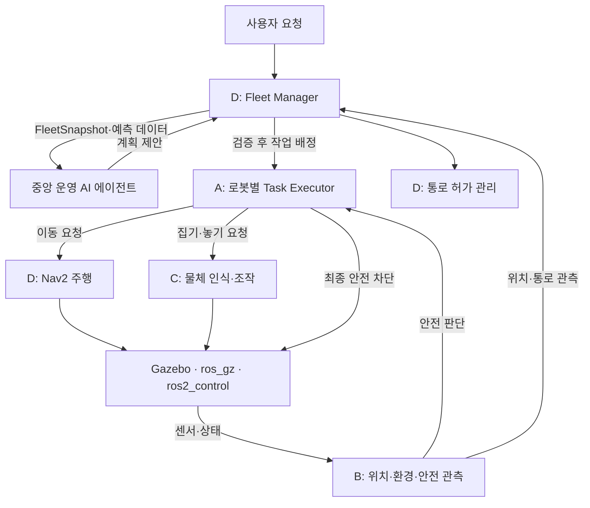

# AX 자동 운반 로봇 통합 상세설계

> 출처: [plan.pdf](plan.pdf), 통합 상세설계서 v1.0, 총 10쪽.
> 원문을 기준으로 내용을 재구성했으며, 프로젝트 표기를 `AX`, 패키지·경로·네임스페이스 표기를 `ax`로 통일했다.
> 이 문서는 목표 설계를 정리한 것으로 현재 코드의 구현 완료 상태를 의미하지 않는다. 인터페이스·수치·토픽 이름은 구현 검토용 초안이며, 실제 모델·센서·로봇 기구 검증 후 확정한다.

현재 팔 형상을 바탕으로 작성한 후속 설계안은 [AX 자체 5축 로봇팔 설계 사양안](AX_5DOF_ARM_SPEC.md)을 참고한다. 해당 문서의 제안값은 현재 코드의 적용값·검증된 정격과 구분한다.

## 1. 목표와 개발 범위

4명이 16주 동안 ROS 2 Jazzy와 Gazebo Harmonic을 사용하여 가상 창고의 로봇 2대 자동 운반 시스템을 개발한다.

- 두 로봇이 작업을 중복 없이 분담한다.
- 물체 인식 → 집기 → 이동 → 놓기의 전체 운반 과정을 수행한다.
- 좁은 통로에서는 배타적 진입 허가를 지킨다.
- 센서 끊김, 집기 실패, 주행 실패에 대해 제한된 복구와 재배정을 수행한다.
- 중앙 AI 에이전트 없이도 규칙 기반으로 두 대의 운반이 가능해야 한다.
- 기본 기능 검증 후 ML과 중앙 AI 에이전트를 단계적으로 적용한다.

PPO/SAC 등 강화학습 기반 주행·배정은 4개월 핵심 범위 밖의 확장 항목이다.

## 2. 핵심 설계 결정

| ID | 설계 항목 | 원칙 |
|---|---|---|
| DEC-01 | 전역 작업 상태 | D가 최종 소유 |
| DEC-02 | 로봇 내부 실행 단계 | A가 최종 소유 |
| DEC-03 | 안전 정지 | B가 위험 판단, A가 실제 정지·차단 |
| DEC-04 | 통로 관리 | B가 진입·이탈 관측, D가 허가 순서 관리 |
| DEC-05 | ID·좌표·단위 | `robot_1`, `robot_2`, `map`, 로봇별 `odom`·`base_link`, SI 단위 |
| DEC-06 | 종료 상태 | 완료·실패·취소·시간초과 구분 |
| DEC-07 | 집기 복구 | C가 제한 재시도, A가 최종 실패 보고 |
| DEC-08 | 구동 명령 | A가 안전 차단, D가 Nav2 주행, C가 조작 |
| DEC-09 | 물체 3D 좌표 | Depth + 카메라 보정 + TF 우선 |
| DEC-10 | 통로 이탈 | B의 완전 이탈 확인 전 허가 해제 금지 |
| DEC-11 | 중앙 에이전트 | D 상위에 단일 운영 판단 에이전트 배치 |
| DEC-12 | AI 조합 | YOLO + XGBoost + Isolation Forest + LLM |
| DEC-13 | AI 실패 | 규칙 기반 기존 운영으로 복귀 |

## 3. 아키텍처와 역할 분담



| 담당 | 소유 영역 | 주요 기능 | 권한 경계 |
|---|---|---|---|
| A | 로봇 실행·최종 구동 차단 | 모델·기본 제어, Task Executor, 취소·오류 처리, 제어 이상 탐지 | 전역 작업 재배정 직접 수행 금지 |
| B | 센서·환경·안전 판단 | SLAM/AMCL, TF, 장애물 인지, 통로 관측, 위치 이상 탐지 | 통로 진입 허가 금지 |
| C | 조작 실행 결과 | YOLO 물체 인식, 깊이·TF 변환, 집기·놓기, 집기 후보 평가 | 전역 작업 상태 직접 변경 금지 |
| D | 전역 운영·주행·허가 | Nav2, 작업 배정, 통로 잠금, ETA 예측, AI 검증 | 센서 관측값 임의 확정 금지 |
| Agent | 비구속적 운영 제안 | 상태 요약, 계획 추천, 원인 설명, 성능 분석 | 속도·관절·안전 해제 명령 금지 |

## 4. 역할별 ML·DL 기능

### 4.1 A: 로봇 제어 이상 탐지

- 모델: Isolation Forest.
- 입력: 목표·실제 속도, 관절 각도 오차, 모터 effort, 명령 지연 등.
- 출력: 이상 점수, 이상 플래그, 모델 가용성.
- 역할: 정상 분포에서 벗어난 동작을 탐지하는 진단 보조.
- 제한: 물리적 안전 한계와 B의 정지 판단을 대체하지 않는다.
- 평가: 바퀴 미끄러짐·관절 떨림·응답 지연을 주입하여 탐지율, 오탐률, 지연 측정.

### 4.2 B: 환경 인지·위치 이상 탐지

- 환경 인지 모델: YOLO11n.
- 검출 대상: 상자·로봇·사람 형태의 이동 장애물.
- 안전 거리는 라이다 등으로 구하며 YOLO 검출 결과만으로 충돌 거리를 결정하지 않는다.
- 위치 이상 모델: Isolation Forest.
- 위치 이상 입력: 위치 분산, 센서·odometry 불일치, TF 지연 등 사용 가능한 특징.
- 실제 위치 추정은 SLAM Toolbox/AMCL이 담당한다.

### 4.3 C: 물체 인식·조작

- 모델: YOLO11n/s + XGBoost.
- YOLO로 운반 대상 검출 후 Depth, 카메라 내참수, TF 변환으로 3D 목표 좌표 계산.
- 집기 후보는 먼저 도달 가능성·충돌 검증을 통과해야 한다.
- XGBoost가 검증된 후보의 성공 확률을 추정하여 비교한다.
- 입력 예: 물체 크기, 상대 거리, 접근각, 집게 벌림, 목표 편차, 물체 종류.
- 평가: Precision/Recall/mAP, 집기 성공률, 평균 재시도 횟수, 집기 시간, 예측 확률 보정 상태.

### 4.4 D: 이동시간 예측

- 모델: XGBoost Regressor.
- 입력: 경로 길이, 회전 수, 적재 상태, 통로 대기열, 이전 대기시간, 장애물 밀도 등.
- 출력: ETA.
- 용도: 예상 운반시간 비교 및 배정 판단 참고.
- 예측 오류·입력 결측 시 기존 방식으로 복귀.
- 평가: MAE, RMSE, 전체 작업 완료시간.

## 5. 중앙 운영 AI 에이전트

로봇별로 나누지 않고 D 상위에 한 개를 배치한다. D가 제공하는 `FleetSnapshot`과 예측 데이터를 바탕으로 우선순위, 배정, 보류, 복구, 재배정을 제안한다. D가 유효성을 검사하고 실제 동작을 결정한다.

| 모드 | 동작 | 적용 시점 |
|---|---|---|
| OFF | AI 비활성, 기본 규칙만 사용 | 핵심 주행·배정 검증 |
| ADVISORY | 계획 생성·기록, 자동 반영 없음 | AI 품질 평가 |
| ASSISTED | D 검증을 통과한 계획만 운영 반영 | 통합 안정화 이후 |

허용 제안:

- `ASSIGN_TASK`
- `DEFER_TASK`
- `RECOMMEND_RETRY`
- `RECOMMEND_REASSIGN`
- `RECOMMEND_PRIORITY_CHANGE`
- `NO_ACTION`

검증 항목은 `schema_version`, `snapshot_id`, `task_id`, `target_robot_id`, 현재 안전·적재·위치 상태, 중복 배정 여부, 유효 배정 세대다. 검증 실패·LLM 지연·모델 오류 시 제안을 폐기하고 규칙 기반 운영으로 복귀한다.

제안 예시:

```json
{
  "proposal_id": "proposal_004",
  "schema_version": 1,
  "snapshot_id": 42,
  "action": "ASSIGN_TASK",
  "task_id": "task_002",
  "target_robot_id": "robot_2",
  "priority": 1,
  "reason_code": "AVAILABLE_ROBOT"
}
```

JSON 예시는 설명용이다. ROS 메시지의 `action`은 `uint8`이므로 enum 매핑을 별도로 확정해야 한다.

## 6. 통신·명명·시간·좌표 규칙

| 방식 | 사용 목적 | 원칙 |
|---|---|---|
| Topic | 주기적인 상태·센서·관측 데이터 | 상태는 Reliable, 센서 QoS는 해당 도구 관례 적용 |
| Action | 수행 시간·취소·결과가 있는 이동·집기·운반 | 목표·피드백·결과·취소 제공 |
| Service | 짧은 요청·응답 | 통로 허가 요청 등 |
| TF | 좌표 프레임 변환 | `map → robot_N/odom → robot_N/base_link` |

- 로봇 ID: `robot_1`, `robot_2`.
- 모든 노드: `use_sim_time=true`, ROS timestamp 사용.
- 거리 m, 속도 m/s, 각도 rad, 각속도 rad/s.
- 오래된 위치·통로 관측값은 유효한 상태로 취급하지 않는다.
- Gazebo 실제 위치는 평가 정답에만 사용한다.

네임스페이스:

```text
/ax/fleet/{tasks,robot_status,corridor,agent}
/ax/robot_1/{executor,safety,localization,navigation,manipulation,ml}
/ax/robot_2/{executor,safety,localization,navigation,manipulation,ml}
```

아래 표는 원문의 주요 인터페이스에 `/ax` 접두사를 적용하여 정리한 것이다. 원문은 접두사 포함·생략 표기가 혼재하므로 실제 절대 경로는 구현 전에 확정한다.

| 인터페이스 | 형태 | 생산자 → 소비자 |
|---|---|---|
| `/ax/fleet/agent/snapshot` | Topic | D → Agent |
| `/ax/fleet/agent/proposal` | Topic | Agent → D |
| `/ax/fleet/agent/decision` | Topic | D → Agent/로그 |
| `/ax/robot_N/executor/execute_task` | Action | D → A |
| `/ax/robot_N/safety/state` | Topic | B → A/D |
| `/ax/robot_N/safety/actuation_state` | Topic | A → B/D |
| `/ax/robot_N/localization/health` | Topic | B → A/D |
| `/ax/robot_N/perception/corridor_observation` | Topic | B → D |
| `/ax/robot_N/manipulation/execute` | Action | A → C |
| `/ax/robot_N/navigation/move` | Action | A → D 주행 |
| `/ax/fleet/corridor/request_entry` | Service | D 서버 / 주행 관리자 클라이언트 |

## 7. 메시지·서비스·액션 계약

다음은 원문의 필드 초안이다. 타입이 생략된 필드, enum 및 pose의 프레임 규칙 등은 구현 전에 구체화한다.

### 7.1 ExecuteTransportTask.action

- 클라이언트 D, 서버 A.
- Goal: `task_id`, `assignment_id`, `robot_id`, `pickup_pose`, `dropoff_pose`, `object_type`, `priority`.
- Result: `success`, `final_status`, `error_code`, `object_held`, `message`.
- Feedback: `phase`, `progress`, `detail`.

`assignment_id`는 재배정마다 새로 발급한다. 이전 배정 결과가 늦게 도착해도 현재 재배정을 덮어쓰지 못하도록 검사한다.

최종 상태: `COMPLETED`, `FAILED`, `CANCELED`, `TIMED_OUT`.

### 7.2 SafetyState.msg

발행자 B.

```text
Header header
string robot_id
uint8 level
string reason_code
bool sensor_valid
bool localization_valid
float32 recommended_max_linear_speed
```

`level`: `CLEAR=0`, `SLOWDOWN_REQUIRED=1`, `STOP_REQUIRED=2`, `UNKNOWN=3`.

### 7.3 CorridorObservation.msg / CorridorState.msg

| 메시지 | 필드 |
|---|---|
| Observation, B 발행 | `header`, `corridor_id`, `robot_id`, `observation`, `position_valid` |
| State, D 관리 | `header`, `corridor_id`, `state`, `owner_robot_id`, `active_grant_id`, `revision` |

- 관측 enum: `OUTSIDE=0`, `APPROACHING=1`, `INSIDE=2`, `UNKNOWN=3`.
- 통로 상태 enum: `FREE=0`, `RESERVED=1`, `OCCUPIED=2`, `BLOCKED_UNKNOWN=3`.

### 7.4 RequestCorridorEntry.srv

- 서버 D.
- Request: `corridor_id`, `robot_id`, `request_id`.
- Response: `granted`, `grant_id`, `reason_code`, `corridor_revision`.

동일한 `request_id` 재전송은 중복 허가를 생성하지 않는다. 취소·시간초과가 발생해도 점유 여부를 확인하지 않은 채 허가를 해제할 수 없다.

### 7.5 ManipulateObject.action

- 클라이언트 A, 서버 C.
- Goal: `task_id`, `object_id`, `operation(PICK/PLACE)`, `target_pose`.
- Result: `success`, `error_code`, `object_held`, `attempt_count`.
- Feedback: `phase`, `progress`.

### 7.6 AgentProposal.msg

```text
Header header
uint32 schema_version
string proposal_id
uint64 snapshot_id
uint8 action
string task_id
string target_robot_id
uint8 priority
string reason_code
string explanation
```

추가로 `AgentDecision`, `FleetSnapshot`, `RobotTaskStatus`, `LocalizationHealth`, `LoadState` 등을 명시적인 타입으로 작성한다. 공개한 enum 숫자는 재사용하지 않고 인터페이스 버전을 관리한다.

## 8. 상태 머신과 소유권

| 계층 | 소유자 | 상태·전이 |
|---|---|---|
| 전역 작업 | D | `QUEUED → ASSIGNED → RUNNING → COMPLETED / FAILED / CANCELED`, `RETRY_PENDING` |
| 로봇 실행 | A | `IDLE → RECEIVED → MOVING_TO_PICKUP → PICKING → MOVING_TO_DROPOFF → PLACING → COMPLETED` |
| 일시 중단 | A | `PAUSED → RECOVERING → 조건 검증 후 재개 가능한 원래 단계` |
| 안전 판단 | B | `CLEAR / SLOWDOWN_REQUIRED / STOP_REQUIRED / UNKNOWN` |
| 안전 실행 | A | `STOP_REQUESTED → STOPPING → STOPPED → 검증 후 재개` |
| 통로 | D | `FREE → RESERVED → OCCUPIED → FREE`, 불확실하면 `BLOCKED_UNKNOWN` |
| 에이전트 | 중앙 | `DISABLED / IDLE / REASONING / VALIDATING / ACCEPTED / REJECTED / FALLBACK` |

전역 작업이 `RUNNING`이어도 로봇 실행은 `PAUSED`일 수 있다. 모든 상태를 하나의 문자열로 합치지 않는다. 적재 여부인 `object_held`는 C의 독립 상태로 보관한다.

재배정 전 확인:

1. 기존 A 액션이 확실히 종료되었는가?
2. 기존 로봇이 물체를 들고 있지 않은가?
3. 물체 위치가 확인되었는가?
4. 새 로봇이 해당 작업에 적합한가?

불확실하면 재배정보다 보류를 선택한다.

## 9. 안전·오류·복구·통로

### 9.1 오류 처리

| 오류코드 | 감지 | 기본 처리 |
|---|---|---|
| `SENSOR_STALE` | B | A 정지 후 센서 복구 검증 |
| `LOCALIZATION_INVALID` | B | A 정지, B 재위치 추정 |
| `OBSTACLE_BLOCKED` / `NAV_TIMEOUT` | B/D | D 주행 복구, A 결과 처리 |
| `OBJECT_NOT_FOUND` / `GRASP_FAILED` | C | C 제한 재시도, A 최종 실패 보고 |
| `OBJECT_DROPPED` | C | A 중단, 물체 상태 재확인 |
| `JOINT_CONTROL_ERROR` | A/C | 제어 중단·진단 |
| `CORRIDOR_BLOCKED` | B/D | 진입 대기·점유 유지 |
| `AGENT_INVALID_PLAN` / `AGENT_TIMEOUT` | D | 제안 폐기, 규칙 기반 복귀 |

### 9.2 재시도 초깃값

| 항목 | 초기 제안 |
|---|---|
| 재인식 | 최대 3회 |
| 집기 추가 시도 | 최대 2회 |
| 주행 재계획 | 최대 2회 |
| AI 판단 요청 | 1회 후 실패 시 규칙 기반 복귀 |

실제 수치는 실행 결과로 조정한다. 센서 불확실 상태에서는 시간초과만으로 자동 재개하지 않는다.

### 9.3 통로 진입 프로토콜

1. 진입 전 안전 대기 지점에 정지한다.
2. D가 `FREE` 상태와 단일 허가 여부를 확인하고 `grant_id`를 발급한다.
3. B의 진입 관측에 따라 통로 상태를 `OCCUPIED`로 전이한다.
4. 다른 로봇의 진입은 점유 동안 금지한다.
5. B가 로봇·적재물의 완전 이탈을 확인한 후에만 D가 `FREE`로 해제한다.
6. 점유·위치가 `UNKNOWN`이면 신규 허가를 금지한다.

불변조건:

- 활성 통로 허가 수는 1 이하.
- `OCCUPIED` 또는 `BLOCKED_UNKNOWN` 상태에서 신규 진입 불가.
- 시간초과만으로 `OCCUPIED → FREE` 전이 금지.

## 10. 학습 데이터와 성능 검증

| 기능 | 데이터 원천 | 대표 지표 |
|---|---|---|
| A 제어 이상 탐지 | 관절·바퀴 제어 로그, 오류 주입 | 탐지율, 오탐률, 지연 |
| B YOLO | Gazebo 카메라 영상·라벨 | Precision/Recall/mAP, 지연 |
| B 위치 이상 탐지 | AMCL/odometry/TF 품질 | 탐지율, 오탐률 |
| C 집기 XGBoost | 상자 크기·자세·집기 시도 | ROC-AUC, 성공률, 재시도 |
| D ETA XGBoost | 경로·대기·적재·주행 이력 | MAE, RMSE, 평균 운반시간 |
| 중앙 에이전트 | FleetSnapshot·운영 결과 | 유효·승인 제안 비율, 완료율 |

데이터별 기록 필드:

```text
dataset_version, scenario_id, episode_id, robot_id, task_id,
simulation_seed, world_version, model_version, timestamp,
input_features, ground_truth, prediction, result
```

같은 에피소드의 연속 샘플이 학습과 시험에 동시에 들어가지 않게 분할한다.

| 비교 조건 | 구성 |
|---|---|
| Baseline | Nav2 + 규칙 기반 배정 + 고정 집기 전략 |
| AI-Assisted | 검증된 ML 모델과 에이전트 개입을 추가 |

동일한 초기 시드·물체 배치·장애물 조건에서 반복 실행하여 완료율, 시간, 충돌, 통로 대기시간, 복구 성공률을 비교한다.

## 11. 패키지와 협업

원문의 패키지 구성을 `ax` 표기로 정리했다. 아래 트리는 목표 구조다.

```text
ax_ws/src/
  ax_interfaces/                 # 공통 msg / srv / action
  ax_description/                # A
  ax_simulation/                 # A
  ax_control/                    # A
  ax_task_executor/              # A
  ax_control_ml/                 # A
  ax_localization/               # B
  ax_environment_perception/     # B
  ax_safety_monitor/             # B
  ax_localization_ml/            # B
  ax_vision/                     # C
  ax_manipulation/               # C
  ax_grasp_ml/                   # C
  ax_navigation/                 # D
  ax_fleet_manager/              # D
  ax_corridor_manager/           # D
  ax_travel_time_ml/             # D
  ax_operations_agent/           # D 주도 / A 지원
  ax_bringup/                    # 공통
  ax_integration_tests/          # 공통
```

인터페이스 수정은 생산자와 소비자가 함께 승인한다. A↔B 안전, A↔C 조작, A↔D 작업, B↔D 통로, D↔Agent 제안·검증에는 코드 리뷰와 계약 테스트가 필요하다.

## 12. 개발 일정

담당 A의 주차별 작업·산출물·완료 기준은 [A 상세 개발 일정](../management/A_DETAILED_SCHEDULE.md)을 참고한다.

| 기간 | 주요 작업 | 통합 완료 조건 |
|---|---|---|
| 1~4주 | 환경·모델·센서·TF·인터페이스·기본 노드 | 두 로봇 명령·센서 분리 |
| 5~8주 | A 상태 머신, B 위치·안전, C 집기, D 한 대 주행 | 한 대 완전 운반 성공 |
| 9~10주 | 두 대 동시 실행, 중복 배정·통로 통제 | 동시 진입·중복 실행 없음 |
| 11~12주 | YOLO·XGBoost·Isolation Forest 데이터·학습 | 모델별 기준선 확보 |
| 13~14주 | 중앙 Agent ADVISORY → 제한적 ASSISTED | D 유효성 검증·규칙 기반 복귀 |
| 15~16주 | 오류 주입·반복 평가·시연·기록 | 테스트·성능 비교 결과 제출 |

## 13. 통합 테스트와 완료 기준

| ID | 시나리오 | 성공 기준 |
|---|---|---|
| TC-01 | 두 대 실행·ROS 분리 | 로봇 간 명령·TF·센서 충돌 없음 |
| TC-02 | 한 대 자동 운반 | 인식 → 집기 → 이동 → 놓기 완료 |
| TC-03 | 두 대 작업 배정 | 동일 작업 중복 실행 0건 |
| TC-04 | 장애물·센서 끊김 | 정지·복구 절차 준수 |
| TC-05 | 집기 실패·물체 낙하 | 재시도 제한·중단·상태 확인 |
| TC-06 | 통로 마주침 | 단일 활성 허가, 동시 진입 0건 |
| TC-07 | 통로 내 위치 상실 | `BLOCKED_UNKNOWN`, 신규 허가 차단 |
| TC-08 | 작업 취소·재배정 | 이전 동작 종료 후 새 배정 |
| TC-09 | AI 정상 제안 | 검증 후 승인·거절 및 기록 |
| TC-10 | AI 오작동·응답 지연 | 기존 규칙 기반 운반 정상 유지 |
| TC-11 | ML 모델 오류 | 기본 규칙·기준선으로 복귀 |
| TC-12 | AI 적용 전후 시험 | 완료율·시간·충돌·원인 정량 기록 |

완료하려면 두 로봇의 안전한 작업 분배·운반, 지정 통로 교행, 실패·취소·센서 이상 복구 검증, 반복 성능 측정을 마쳐야 한다. AI는 기존 안전 불변조건을 훼손하지 않아야 하며, 기준선 대비 실제 개선 여부를 별도로 보고한다.

## 14. 원문에 명시된 미확정 항목

| 항목 | 선행 확정 내용 |
|---|---|
| RGB/Depth 카메라·라이다 | 장착 위치, 해상도, 노이즈, 데이터율 |
| 팔·집게 | 관절 수, 가동 범위, 물체 유지 조건 |
| 통로·대기 지점 | 통로 폭, 외형 경계, 완전 이탈 여유 |
| 최종 속도 제어 경로 | Nav2/ros2_control/안전 게이트 통합 검증 |
| AI 모델 실행 | CPU/GPU 메모리, 응답 지연, 오류, 외부 전송 범위 |
| 시간초과·재시도 수치 | 시뮬레이션 테스트 기반 조정 |
| 모델 채택 기준 | 모델별 기준선, 안전·성능 개선 목표 |

## 15. 추가 검토 사항

다음은 원문의 확정 요구사항이 아니라 문서 검토 과정에서 도출한 보완 의견이다.

| 항목 | 보완할 내용 |
|---|---|
| 네임스페이스 | `/ax` 접두사의 적용·생략 기준과 최종 절대 경로 확정 |
| 종료 상태 | Action의 `TIMED_OUT`과 전역 작업 상태 표의 대응 규칙 정의 |
| 계약 완성 | 생략된 필드 타입, enum, pose 프레임, 추가 메시지 스키마 확정 |
| 배정 세대 | AI 검증에 필요한 유효 배정 세대를 메시지 또는 서버 상태와 연결 |
| 최종 구동 제어 | 주행·조작 명령과 A 안전 차단의 실제 제어 경로·우선순위 확정 |
| 재시작·통신 단절 | D 재시작 시 작업·통로 허가 복원 및 관측 불확실 상태 처리 정의 |
| 정량 완료 기준 | 목표 완료율, 응답 지연, 복구시간, ML 성능, 반복 횟수 설정 |

## 16. 구현 착수 순서

1. 공통 인터페이스와 좌표·상태 소유권 확정.
2. A/B/C/D 가짜 데이터 기반 계약 테스트.
3. 한 대의 전체 운반 구현·검증.
4. 두 대 운영·중복 배정 방지·통로 통제.
5. ML/DL 적용 및 기준선 비교.
6. 중앙 Agent ADVISORY 평가.
7. 충분한 검증 후 ASSISTED 반영.

## 17. 원문과 설계 제안의 구분

원문 설명에 따르면 4인 역할 경계, 한 지도·두 로봇·지정 통로, ROS 2 Jazzy/Gazebo Harmonic 등의 조건은 기존 역할 분담 자료에 근거한다. 중앙 에이전트, ML 모델, 인터페이스 명명, 상태 코드, 초기 횟수와 주차별 일정의 상세값은 후속 협의를 위한 설계 제안이다.

현재 저장소의 실제 연결 인터페이스와 검증 상태는 [INTERFACES.md](../guides/INTERFACES.md), [물리 특성 보완 결과](../validation/PHYSICAL_PROPERTIES_REVIEW.md), [현재 점검 결과](../validation/PREUPLOAD_REVIEW.md)를 별도로 참고한다.
