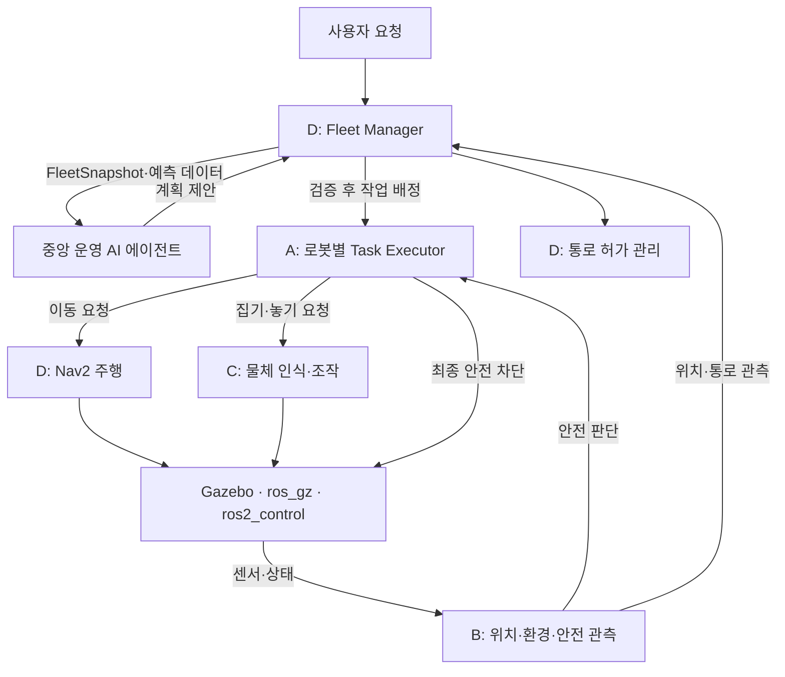

# AX 자동 운반 로봇 통합 상세설계

> 출처: [plan.pdf](plan.pdf), 통합 상세설계서 v1.0, 총 10쪽.
> 원문을 기준으로 내용을 재구성했으며, 프로젝트 표기를 `AX`, 패키지·경로·네임스페이스 표기를 `ax`로 통일했다.
> 이 문서는 목표 설계를 정리한 것으로 현재 코드의 구현 완료 상태를 의미하지 않는다. 인터페이스·수치·토픽 이름은 구현 검토용 초안이며, 실제 모델·센서·로봇 기구 검증 후 확정한다.

> 2026-10-22 설계 보완 결정(역할이 다른 협업 로봇 그룹, 적재 확인, 흡착, ros2_control 전환, 인계 구동 차단)을 반영했다. 각 절의 **결정**은 설계 기준이며 구현·검증 완료를 뜻하지 않는다. 수치·타입·enum 값 중 정하지 않은 것은 14절 미정 항목으로 관리한다.

현재 팔 형상을 바탕으로 작성한 후속 설계안은 [AX 자체 5축 로봇팔 설계 사양안](AX_5DOF_ARM_SPEC.md)을 참고한다. 해당 문서의 제안값은 현재 코드의 적용값·검증된 정격과 구분한다.

## 1. 목표와 개발 범위

4명이 16주 동안 ROS 2 Jazzy와 Gazebo Harmonic을 사용하여 가상 창고의 **역할이 다른 협업 로봇 2대** 자동 운반 시스템을 개발한다. 원문의 동일 로봇 2대 분담 구성은 2026-10-22 결정으로 대체했다.

- 흡착 팔 로봇 `robot_1`과 적재함 운송 로봇 `robot_2`를 하나의 협업 그룹(예: `team_1`)으로 운영한다.
- 출발 작업대 `station_src`에서 도착 작업대 `station_dst`까지 인식 → 집기 → 적재 → 이동 → 하역 → 놓기의 공동 운반을 수행한다.
- 좁은 통로에서는 같은 그룹이어도 로봇별 배타적 진입 허가를 지킨다.
- 센서 끊김, 집기 실패, 주행 실패, 적재 이상에 대해 그룹 보류·복구·재개를 수행한다. 역할이 다르므로 다른 로봇으로 대체하지 않는다.
- 중앙 AI 에이전트 없이도 규칙 기반으로 공동 운반이 가능해야 한다.
- 기본 기능 검증 후 ML과 중앙 AI 에이전트를 단계적으로 적용한다.

PPO/SAC 등 강화학습 기반 주행·배정은 4개월 핵심 범위 밖의 확장 항목이다.

## 2. 핵심 설계 결정

| ID | 설계 항목 | 원칙 |
|---|---|---|
| DEC-01 | 전역 작업 상태 | D가 최종 소유 |
| DEC-02 | 로봇 내부 실행 단계 | A가 최종 소유 |
| DEC-03 | 안전 정지 | B가 위험 판단, A가 실제 정지·차단 |
| DEC-04 | 통로 관리 | B가 진입·이탈 관측, D가 허가 순서 관리 |
| DEC-05 | ID·좌표·단위 | `team_1`, `robot_1`, `robot_2`, `map`, 로봇별 `odom`·`base_link`, SI 단위 |
| DEC-06 | 종료 상태 | 완료·실패·취소·시간초과 구분 |
| DEC-07 | 집기 복구 | C가 제한 재시도, A가 최종 실패 보고 |
| DEC-08 | 구동 명령 | A가 안전 차단, D가 Nav2 주행, C가 조작 |
| DEC-09 | 물체 3D 좌표 | Depth + 카메라 보정 + TF 우선 |
| DEC-10 | 통로 이탈 | B의 완전 이탈 확인 전 허가 해제 금지 |
| DEC-11 | 중앙 에이전트 | D 상위에 단일 운영 판단 에이전트 배치 |
| DEC-12 | AI 조합 | YOLO + XGBoost + Isolation Forest + LLM |
| DEC-13 | AI 실패 | 규칙 기반 기존 운영으로 복귀 |
| DEC-14 | 로봇 구성 | `robot_1` 흡착 팔 로봇, `robot_2` 적재함 운송 로봇의 협업 그룹. 정지·오류·위치는 로봇별로 유지 |
| DEC-15 | 그룹 작업 | D가 그룹 작업·`transfer_id`·인계 상태를 관리하고 로봇별 하위 작업으로 실행 |
| DEC-16 | 적재 확인 | robot_2 접촉 센서 + 적재 영역 판정. robot_2 측 A가 결과 발행 |
| DEC-17 | 흡착 | 기준 공구 Robotiq EPick(컵 구성 미정). 접근 조건 확인 후 Gazebo 연결, 명시적 해제 요청으로 제거. 보유 판정은 지정 물체의 실제 부착 상태. 안전 정지 시 자동 해제 금지 |
| DEC-18 | 제어 프레임워크 | 두 로봇 모두 ros2_control + gz_ros2_control로 전환 결정. 개발 구성에 적용(2026-10-25, 로봇별 controller_manager, 이전 Gazebo 제어 플러그인 제거). effort 정격·안전 정지·최종 구동 차단은 미확정 |
| DEC-19 | 인계 구동 차단 | 인계 중 두 로봇 주행 금지. 상대 상태·허가 만료 시 기본값은 주행 금지 |

## 3. 아키텍처와 역할 분담



| 담당 | 소유 영역 | 주요 기능 | 권한 경계 |
|---|---|---|---|
| A | 로봇별 실행·최종 구동 차단 | 두 로봇 모델·기본 제어, 로봇별 Task Executor, 흡착 실행 허용 검사, robot_2 적재 확인 발행, 취소·오류 처리, 제어 이상 탐지 | 그룹 작업 배정·재배정 직접 수행 금지 |
| B | 센서·환경·안전 판단 | SLAM/AMCL, TF, 장애물 인지, 통로 진입·완전 이탈 관측, 위치 이상 탐지 | 통로 진입 허가 금지 |
| C | robot_1 조작 실행 결과 | YOLO 물체 인식, 깊이·TF 변환, 집기 계획, 흡착·해제 요청, 공구 보유 상태 | 그룹 작업 상태 직접 변경 금지 |
| D | 전역 운영·주행·허가 | Nav2, 그룹 작업 배정, 이동·대기·합류 조정, `transfer_id`·인계 상태, 물체 상태, 통로 허가, ETA 예측, AI 검증 | 센서 관측값 임의 확정 금지 |
| Agent | 비구속적 운영 제안 | 상태 요약, 작업 우선순위·통로 통과 순서·복구 방안 제안, 원인 설명 | 속도·관절·흡착·안전 해제 명령, 점유 중인 통로 허가 회수 금지 |

### 3.1 협업 로봇 구성 — 결정

| 구분 | robot_1 | robot_2 |
|---|---|---|
| 역할 | 흡착 팔로 집기·적재·하역 | 적재함으로 상자 운송 |
| 팔·흡착 공구 | 있음. 기준 공구는 Robotiq EPick, 컵 구성 미정 (7.7절) | 없음 |
| 팔 카메라 | 2개 중 1개 RGB-D | 없음 |
| 흡착 공구 근접 거리 | 흡착 공구 전용 중앙 ToF 1개 (개발용 단일 광선 근사, 실물 미선정) | 없음 |
| 몸통 전방 카메라 | 2개 중 1개 RGB-D | 2개 중 1개 RGB-D |
| 라이다 | 전방 180° 1개, 후방 180° 1개 | 전방 180° 1개, 후방 180° 1개 |
| IMU | 몸통 1개 | 몸통 1개 |
| 적재 확인 | 해당 없음 | 적재함 접촉 센서 + 적재 영역 판정 |
| ros2_control | 바퀴·팔 궤적 제어, 팔·바퀴 관절 상태 발행, 흡착은 별도 구현 | 바퀴 제어, 바퀴 관절 상태 발행 |
| A 최종 구동 관리 | 적용 | 적용 |

RGB-D는 카메라 개수에 포함한다. 흡착 공구 중앙 ToF는 최종 접근 간격 측정용 개발 센서로, Gazebo 단일 광선으로 근사했으며 최종 실물 센서 선정이나 성능 확정이 아니다. 토픽·좌표·측정 범위·구독 계약은 [인터페이스](../guides/INTERFACES.md)를 따른다. ToF 값은 접촉·흡착·보유 판정이 아니며, 이 판정들은 기존 계약대로 별도 구현 대상이다. 현재 개발 모델은 나머지 카메라를 RGB로 두고 `sensor_mounts.yaml`의 임시 장착 좌표·방향과 Xacro의 해상도·시야각·갱신율을 적용한다. 이는 최종 센서 상세 확정이 아니며, 특히 팔 카메라는 작업 자세별 시야·가림 검증 후 위치를 보정한다. robot_2는 AX_2 메시와 별도 가상 질량·관성을 사용하며 최종 차체·적재 공간·허용 하중은 검증 대상이다. 구현 토픽·프레임과 개발 가정은 [인터페이스](../guides/INTERFACES.md)를 따른다.

ros2_control 도입만으로 가속도·TCP 속도 제한, 안전 정지·watchdog, effort 피드백, 궤적 추종·하중 안정성이 완료됐다고 보지 않는다. 전환 시 기존 Gazebo 관절 제어 플러그인과 새 제어기가 같은 관절을 동시에 구동하지 않게 하고, 센서 브리지 전환과 구동 제어 전환을 구분한다.

### 3.2 공동 운반 흐름 — 결정

```text
station_src에서 두 로봇 정차
→ robot_1이 상자를 집어 robot_2 적재함에 적재
→ 적재 확인 · 흡착 해제 · 팔 후퇴
→ 두 로봇이 station_dst로 이동
→ 두 로봇 정차 · 하역 준비 확인
→ robot_1이 robot_2의 상자를 집음
→ station_dst에 내려놓기
→ 공동 작업 완료
```

이동 중 상자는 robot_2 적재함이 지지하며 robot_1이 상자를 흡착한 채 주행하지 않는다. 초기에는 개별 경로로 이동해 지정 위치에서 합류하는 방식을 우선 검토하며, 대형 유지 이동 여부는 미정이다.

| 관리 단위 | 관리 내용 |
|---|---|
| 그룹 | 공동 작업 배정·우선순위·진행 단계·합류·복구·최종 완료 |
| 로봇 | 위치·경로·센서·안전·구동·오류·통로 점유 |
| 물체 | 현재 위치·공구 보유·적재함 적재·최종 배치 상태 |

그룹으로 묶어도 두 로봇의 정지·오류·위치를 하나로 합치지 않는다.

## 4. 역할별 ML·DL 기능

### 4.1 A: 로봇 제어 이상 탐지

- 모델: Isolation Forest.
- 입력: 목표·실제 속도, 관절 각도 오차, 명령 지연 등. 모터 effort는 실제 제공 여부·단위·유효성이 확인된 경우에만 사용한다.
- 출력: 이상 점수, 이상 플래그, 모델 가용성.
- 역할: 정상 분포에서 벗어난 동작을 탐지하는 진단 보조.
- 제한: 물리적 안전 한계와 B의 정지 판단을 대체하지 않는다.
- 평가: 바퀴 미끄러짐·관절 떨림·응답 지연을 주입하여 탐지율, 오탐률, 지연 측정.

### 4.2 B: 환경 인지·위치 이상 탐지

- 환경 인지 모델: YOLO11n.
- 검출 대상: 상자·로봇·사람 형태의 이동 장애물.
- 안전 거리는 라이다 등으로 구하며 YOLO 검출 결과만으로 충돌 거리를 결정하지 않는다.
- 위치 이상 모델: Isolation Forest.
- 위치 이상 입력: 위치 분산, 센서·odometry 불일치, TF 지연 등 사용 가능한 특징.
- 실제 위치 추정은 SLAM Toolbox/AMCL이 담당한다.

### 4.3 C: 물체 인식·조작

- 모델: YOLO11n/s + XGBoost.
- YOLO로 운반 대상 검출 후 Depth, 카메라 내참수, TF 변환으로 3D 목표 좌표 계산.
- 집기 후보는 먼저 도달 가능성·충돌 검증을 통과해야 한다.
- XGBoost가 검증된 후보의 성공 확률을 추정하여 비교한다.
- 입력 예: 물체 크기, 상대 거리, 접근각, 집게 벌림, 목표 편차, 물체 종류.
- 평가: Precision/Recall/mAP, 집기 성공률, 평균 재시도 횟수, 집기 시간, 예측 확률 보정 상태.

### 4.4 D: 이동시간 예측

- 모델: XGBoost Regressor.
- 입력: 경로 길이, 회전 수, 적재 상태, 통로 대기열, 이전 대기시간, 장애물 밀도 등.
- 출력: ETA.
- 용도: 예상 운반시간 비교 및 배정 판단 참고.
- 예측 오류·입력 결측 시 기존 방식으로 복귀.
- 평가: MAE, RMSE, 전체 작업 완료시간.

## 5. 중앙 운영 AI 에이전트

로봇별로 나누지 않고 D 상위에 한 개를 배치한다. D가 제공하는 `FleetSnapshot`과 예측 데이터를 바탕으로 작업 우선순위, 통로 통과 순서, 보류, 복구 방안을 제안한다. D가 유효성을 검사하고 실제 동작을 결정한다. 현재 협업 그룹이 하나이므로 초기 기능은 그룹 간 경쟁보다 robot_1과 robot_2 중 누가 먼저 통과해야 공동 작업이 빨리 끝나는지 제안하는 데 초점을 둔다. 이미 진입한 로봇의 통로 허가는 새 제안으로 회수하지 않는다.

| 모드 | 동작 | 적용 시점 |
|---|---|---|
| OFF | AI 비활성, 기본 규칙만 사용 | 핵심 주행·배정 검증 |
| ADVISORY | 계획 생성·기록, 자동 반영 없음 | AI 품질 평가 |
| ASSISTED | D 검증을 통과한 계획만 운영 반영 | 통합 안정화 이후 |

허용 제안:

- `ASSIGN_TASK`
- `DEFER_TASK`
- `RECOMMEND_RETRY`
- `RECOMMEND_REASSIGN` (역할이 다른 협업 구성에서는 그룹 간 재배정에만 해당. 다른 로봇으로의 역할 대체는 제안하지 않는다)
- `RECOMMEND_PRIORITY_CHANGE`
- `NO_ACTION`

검증 항목은 `schema_version`, `snapshot_id`, `task_id`, `target_robot_id`, 현재 안전·적재·위치 상태, 중복 배정 여부, 유효 배정 세대다. 검증 실패·LLM 지연·모델 오류 시 제안을 폐기하고 규칙 기반 운영으로 복귀한다.

제안 예시:

```json
{
  "proposal_id": "proposal_004",
  "schema_version": 1,
  "snapshot_id": 42,
  "action": "ASSIGN_TASK",
  "task_id": "task_002",
  "target_robot_id": "robot_2",
  "priority": 1,
  "reason_code": "AVAILABLE_ROBOT"
}
```

JSON 예시는 설명용이다. ROS 메시지의 `action`은 `uint8`이므로 enum 매핑을 별도로 확정해야 한다.

## 6. 통신·명명·시간·좌표 규칙

| 방식 | 사용 목적 | 원칙 |
|---|---|---|
| Topic | 주기적인 상태·센서·관측 데이터 | 상태는 Reliable, 센서 QoS는 해당 도구 관례 적용 |
| Action | 수행 시간·취소·결과가 있는 이동·집기·운반 | 목표·피드백·결과·취소 제공 |
| Service | 짧은 요청·응답 | 통로 허가 요청 등 |
| TF | 좌표 프레임 변환 | `map → robot_N/odom → robot_N/base_link` |

- 로봇 ID: `robot_1`, `robot_2`.
- 모든 노드: `use_sim_time=true`, ROS timestamp 사용.
- 거리 m, 속도 m/s, 각도 rad, 각속도 rad/s.
- 오래된 위치·통로 관측값은 유효한 상태로 취급하지 않는다.
- Gazebo 실제 위치는 평가 정답에만 사용한다. 단, 아래 예외를 둔다.
- 공유 작업 위치는 `map` 기준으로 표현한다. 정차 pose(로봇 차체), 물체 pose(상자), 공구 목표 pose(흡착 공구 `epick_tcp` 기준)를 구분한다. C가 센서 관측을 TF로 변환해 실제 집기 목표를 계산하는 방식을 권장한다.

> **제한적 예외:** 초기 가상 시스템에서는 robot_2의 적재 영역 판정에 한해 Gazebo 객체 위치 사용을 허용한다. 이는 시뮬레이터 정답 기반 상태 확인이며, 카메라 기반 인식 성능으로 평가하지 않는다.

- robot_2 측 A가 접촉·영역 판정을 결합한 적재 확인 결과를 발행한다.
- D는 이 결과를 이용해 그룹 물체 상태와 작업 단계를 관리한다.
- 센서 기반 관측과 정답 기반 판정을 구분할 수 있도록 결과에 출처를 표시한다.
- 이 예외를 C의 일반 물체 위치 계산이나 주행 위치 추정으로 확대하지 않는다.

네임스페이스:

```text
/ax/fleet/{tasks,teams,robot_status,corridor,agent}
/ax/robot_1/{executor,safety,localization,navigation,manipulation,ml}
/ax/robot_2/{executor,safety,localization,navigation,manipulation,ml}
```

아래 표는 원문의 주요 인터페이스에 `/ax` 접두사를 적용하여 정리한 것이다. 원문은 접두사 포함·생략 표기가 혼재하므로 실제 절대 경로는 구현 전에 확정한다.

| 인터페이스 | 형태 | 생산자 → 소비자 |
|---|---|---|
| `/ax/fleet/agent/snapshot` | Topic | D → Agent |
| `/ax/fleet/agent/proposal` | Topic | Agent → D |
| `/ax/fleet/agent/decision` | Topic | D → Agent/로그 |
| `/ax/robot_N/executor/...` 역할별 하위 Action | Action | D → A |
| `/ax/robot_N/safety/state` | Topic | B → A/D |
| `/ax/robot_N/safety/actuation_state` | Topic | A → B/D |
| `/ax/robot_N/localization/health` | Topic | B → A/D |
| `/ax/robot_N/perception/corridor_observation` | Topic | B → D |
| `/ax/robot_N/manipulation/execute` | Action | A → C |
| `/ax/robot_N/navigation/move` | Action | A → D 주행 |
| `/ax/fleet/corridor/request_entry` | Service | D 서버 / 주행 관리자 클라이언트 |

## 7. 메시지·서비스·액션 계약

다음은 원문의 필드 초안이다. 타입이 생략된 필드, enum 및 pose의 프레임 규칙 등은 구현 전에 구체화한다.

### 7.1 그룹 작업과 역할별 하위 Action

원문의 `ExecuteTransportTask`(한 로봇이 집기부터 놓기까지 수행)는 협업 구성에 맞지 않아 **그룹 작업 + 역할별 하위 Action** 구조로 대체한다. 그룹 작업 상태는 D가 관리하고, 각 로봇의 A는 하위 Action 서버로 자기 로봇의 단계만 실행한다. Action 이름·필드 타입·enum은 미정이다.

| 식별자 | 의미 |
|---|---|
| `team_id` | 협업 그룹 |
| `task_id` | `station_src` → `station_dst` 공동 운반 작업 |
| `robot_id` | 실제 실행 로봇 |
| `assignment_id` | 재배정·재시작을 구분하는 실행 배정. 이전 배정 결과가 현재 배정을 덮어쓰지 못하게 검사 |
| `object_id` | 운반 물체 |
| `transfer_id` | 특정 적재·하역 인계 작업 |

하위 작업 예: robot_1의 이동·적재 인계·하역 인계·작업대 배치, robot_2의 이동·적재 수령·하역 제공. 하위 Action 결과는 완료·실패·취소·시간초과를 구분한다. 액션 `TIMED_OUT`과 그룹 작업 상태의 대응은 미정이다.

### 7.2 SafetyState.msg

발행자 B.

```text
Header header
string robot_id
uint8 level
string reason_code
bool sensor_valid
bool localization_valid
float32 recommended_max_linear_speed
```

`level`: `CLEAR=0`, `SLOWDOWN_REQUIRED=1`, `STOP_REQUIRED=2`, `UNKNOWN=3`.

보완 결정: 위 원문 필드에 더해 전진·후진·회전 허용 여부, 선속도·각속도 상한, 전방·후방 센서 유효성을 표현한다. 전체 정지(`STOP_REQUIRED`·`UNKNOWN`)와 상태 만료는 방향별 허가보다 우선한다. 후방 센서 이상 시 해당 로봇의 후진을 금지한다. 필드 이름·타입·만료 시간은 미정이다.

### 7.3 CorridorObservation.msg / CorridorState.msg

| 메시지 | 필드 |
|---|---|
| Observation, B 발행 | `header`, `corridor_id`, `robot_id`, `observation`, `position_valid` |
| State, D 관리 | `header`, `corridor_id`, `state`, `owner_robot_id`, `active_grant_id`, `revision` |

- 관측 enum: `OUTSIDE=0`, `APPROACHING=1`, `INSIDE=2`, `UNKNOWN=3`.
- 통로 상태 enum: `FREE=0`, `RESERVED=1`, `OCCUPIED=2`, `BLOCKED_UNKNOWN=3`.

### 7.4 RequestCorridorEntry.srv

- 서버 D.
- Request: `corridor_id`, `robot_id`, `request_id`.
- Response: `granted`, `grant_id`, `reason_code`, `corridor_revision`.

동일한 `request_id` 재전송은 중복 허가를 생성하지 않는다. 취소·시간초과가 발생해도 점유 여부를 확인하지 않은 채 허가를 해제할 수 없다.

### 7.5 ManipulateObject.action

- 클라이언트 A(robot_1), 서버 C.
- Goal: `task_id`, `object_id`, `operation(PICK/PLACE)`, `target_pose`.
- Result: `success`, `error_code`, `object_held`, `attempt_count`.
- Feedback: `phase`, `progress`.

`target_pose`는 6절의 pose 구분(정차·물체·공구 목표)에 맞춰 의미를 확정한다. 결과의 `object_held`는 C가 제공하는 공구 보유 상태이며 전체 적재 상태를 대신하지 않는다.

흡착 실행 흐름: C의 흡착·해제 요청 → A의 실행 허용 검사 → 흡착 제어 노드 → Gazebo 플러그인 연결·해제 실행 → 실제 부착 상태 확인 → 결과 반환. 흡착 ON 요청, 실제 부착 완료, 유지, 실제 해제 완료를 구분한다. 안전 정지 시 흡착을 자동 해제하지 않으며 내려놓기 조건을 확인한 해제 절차를 사용한다.

### 7.6 AgentProposal.msg

```text
Header header
uint32 schema_version
string proposal_id
uint64 snapshot_id
uint8 action
string task_id
string target_robot_id
uint8 priority
string reason_code
string explanation
```

추가로 `AgentDecision`, `FleetSnapshot`, `RobotTaskStatus`, `LocalizationHealth`, `LoadState` 등을 명시적인 타입으로 작성한다. 공개한 enum 숫자는 재사용하지 않고 인터페이스 버전을 관리한다.

### 7.7 흡착 공구와 제어 — 결정

- 기준 공구는 **Robotiq EPick**이다. 최종 컵 구성(컵 수·크기·배치)은 미정이다. 기존 가상 4컵 헤드(`suction`)는 비교용으로 유지한다.
- 초기 도입 범위는 [ros2_epick_gripper](https://github.com/PickNikRobotics/ros2_epick_gripper)의 `epick_description` 선별 도입이다. 고정 commit·LICENSE(BSD-3-Clause)·파일 해시를 보존한다. 제품 질량 특성은 원본 description에 없으므로 별도로 확정한다.
- 원본의 `epick_controllers`·`epick_driver` 직접 사용은 초기 범위에서 제외한다. 압력 모델 없이 생성한 fake 압력·감지값(예: 드라이버 `use_dummy`의 물체 감지 상태)을 실제 집기 성공으로 사용하지 않는다.
- 흡착 제어는 A의 허용 경로를 거치는 별도 노드와 Gazebo 플러그인으로 구현한다.
- **보유 판정**은 지정 물체의 실제 부착 상태로 정의한다. 원본 `ObjectDetectionStatus` 같은 압력 기반 상태와 구분해 기록한다. 향후 검증된 압력 모델이나 실물 피드백은 보유 판정의 보조 근거로 추가할 수 있다.
- C의 공구 목표 pose 기준은 `epick_tcp`로 통일한다. TCP 보정값(`tcp_stroke_compensation`)은 접촉 모델 검증 후 확정한다.
- 원본 description의 MoveIt용 가상 진공 관절(`gripper`, revolute 0~1)은 Gazebo에서 실제 관절로 변환되므로 도입 시 제외 또는 이름 변경 여부를 정한다.
- Jazzy 호환성은 필요한 패키지를 고정 commit으로 빌드·검증한 뒤 확정한다. 2026-10-22 확인 시 원본 `main`(`d073913`)에는 Jazzy 수정이 병합되지 않았고 별도 브랜치에만 있었다.

### 7.8 물체·적재 상태 — 권장 계약

`object_held` 하나로 전체 적재 상태를 표현하지 않는다. 아래 이름은 개념 상태이며 실제 enum 값은 미정이다.

| 그룹 물체 상태 (D) | 의미 |
|---|---|
| `AT_SOURCE` | `station_src`에 있음 |
| `HELD_BY_ROBOT_1` | robot_1이 흡착해 들고 있음 |
| `STOWED_ON_ROBOT_2` | robot_2 적재함에 놓여 있음 |
| `AT_DESTINATION` | `station_dst`에 배치됨 |
| `UNKNOWN` | 위치·보유 상태를 확인할 수 없음 |
| `LOST` | 운반 중 이탈·낙하가 확인됨 |

| robot_2 적재 판정 (A) | 의미 |
|---|---|
| `STOWED` | 지정 상자가 허용 영역 안에서 적재함에 지지됨 |
| `EMPTY` | 유효한 관측으로 비어 있음이 확인됨 |
| `UNKNOWN` | 센서 만료·관측 모순·일시적 접촉 해제 |
| `LOST` | 운송 중 상자가 적재 영역을 벗어났다고 확인됨 |

- 적재 판정은 접촉, 허용 영역, 상태 최신성을 조합하며 적재 후 이동 중에도 계속 감시한다. 접촉이 순간적으로 끊겼다고 바로 낙하로 판정하지 않는다. 유지 시간·허용 영역·임계값은 시험 후 확정한다.
- C는 공구 보유·해제 상태, A는 로봇별 실행·적재 확인 결과, D는 그룹 물체 상태와 진행 단계를 관리한다. 오래되거나 모순되는 상태를 성공으로 처리하지 않는다.

## 8. 상태 머신과 소유권

| 계층 | 소유자 | 상태·전이 |
|---|---|---|
| 그룹 작업 | D | `QUEUED → ASSIGNED → RUNNING → COMPLETED / FAILED / CANCELED`, `RETRY_PENDING`, 보류. 인계 상태·`transfer_id` 포함 |
| 로봇 실행 | A | 역할별 하위 작업 단계. 원문 `IDLE → RECEIVED → MOVING_TO_PICKUP → PICKING → MOVING_TO_DROPOFF → PLACING → COMPLETED`는 협업 구성에 맞게 역할별로 재정의 (미정) |
| 일시 중단 | A | `PAUSED → RECOVERING → 조건 검증 후 재개 가능한 원래 단계` |
| 안전 판단 | B | `CLEAR / SLOWDOWN_REQUIRED / STOP_REQUIRED / UNKNOWN` |
| 안전 실행 | A | `STOP_REQUESTED → STOPPING → STOPPED → 검증 후 재개` |
| 통로 | D | `FREE → RESERVED → OCCUPIED → FREE`, 불확실하면 `BLOCKED_UNKNOWN` |
| 에이전트 | 중앙 | `DISABLED / IDLE / REASONING / VALIDATING / ACCEPTED / REJECTED / FALLBACK` |

그룹 작업이 `RUNNING`이어도 로봇 실행은 `PAUSED`일 수 있다. 모든 상태를 하나의 문자열로 합치지 않는다. 공구 보유(C), 적재 판정(A), 그룹 물체 상태(D)를 7.8처럼 구분한다.

한쪽 로봇에 오류가 발생하면 D가 그룹 작업을 보류하고 복구를 조정한다. 역할이 달라 다른 로봇으로 대체하지 않는다. 재개 전 확인:

1. 관련 A 하위 Action이 확실히 종료되었는가?
2. 물체 상태(공구 보유·적재 판정)가 최신이고 서로 모순되지 않는가?
3. 두 로봇의 실제 정지와 인계 잠금 상태가 확인되었는가?

통신 끊김이나 시간초과만으로 물체를 비었다고 판단하거나 통로 허가를 해제하지 않는다. 불확실하면 보류를 유지한다.

그룹 완료 조건: `station_dst` 배치 확인, robot_1의 흡착 해제·팔 후퇴, robot_2 적재함 `EMPTY` 확인.

## 9. 안전·오류·복구·통로

### 9.1 오류 처리

| 오류코드 | 감지 | 기본 처리 |
|---|---|---|
| `SENSOR_STALE` | B | A 정지 후 센서 복구 검증 |
| `LOCALIZATION_INVALID` | B | A 정지, B 재위치 추정 |
| `OBSTACLE_BLOCKED` / `NAV_TIMEOUT` | B/D | D 주행 복구, A 결과 처리 |
| `OBJECT_NOT_FOUND` / `GRASP_FAILED` | C | C 제한 재시도, A 최종 실패 보고 |
| `OBJECT_DROPPED` | C | A 중단, 물체 상태 재확인 |
| `JOINT_CONTROL_ERROR` | A/C | 제어 중단·진단 |
| 적재 `UNKNOWN` / `LOST` (코드 이름 미정) | A(robot_2) | 그룹 보류, D가 물체 상태 재확인 조정 |
| 인계 상대 상태 만료 (코드 이름 미정) | A | 주행 금지 유지, D에 보고 |
| `CORRIDOR_BLOCKED` | B/D | 진입 대기·점유 유지 |
| `AGENT_INVALID_PLAN` / `AGENT_TIMEOUT` | D | 제안 폐기, 규칙 기반 복귀 |

### 9.2 재시도 초깃값

| 항목 | 초기 제안 |
|---|---|
| 재인식 | 최대 3회 |
| 집기 추가 시도 | 최대 2회 |
| 주행 재계획 | 최대 2회 |
| AI 판단 요청 | 1회 후 실패 시 규칙 기반 복귀 |

실제 수치는 실행 결과로 조정한다. 센서 불확실 상태에서는 시간초과만으로 자동 재개하지 않는다.

### 9.3 인계와 구동 상호 배제 — 결정

인계 상태와 `transfer_id`는 D가 관리하고 각 로봇의 A가 로컬 구동 차단을 강제한다. Task Executor가 순서를 관리하고 A의 최종 구동 경로에서 실제 허용 여부를 강제한다.

- 인계 시작 전 두 로봇의 실제 정지를 확인한다. 정지 요청과 실제 정지 확인을 구분한다.
- 팔 동작 중 robot_1 주행 금지, 적재·하역 중 robot_2 주행 금지.
- 적재 확인·흡착 해제·팔 후퇴가 확인된 후에만 robot_2 주행을 허용한다.
- `station_dst`에서는 두 로봇의 정차 위치·방향·상태를 확인한 뒤 하역을 허용한다.
- 필요한 상대 상태나 허가가 오래되면 기본값은 주행 금지다.
- 취소·실패·시간초과를 자동 잠금 해제로 취급하지 않는다. 한쪽만 이동을 재개하지 않는다.
- 후방 센서 이상 시 해당 로봇의 후진을 금지한다.
- 안전 정지 중 물체를 들고 있다면 흡착을 유지한다.

A의 최종 구동 차단 구현 방식(바퀴 명령 게이트, 팔 궤적 차단 방법)과 실제 정지 확인의 속도 임계값·지속 시간은 미정이다. 정지 시 팔 컨트롤러 비활성화는 하중 유지와 실제 정지 동작을 검증한 뒤 채택 여부를 결정하며 기본 해법으로 확정하지 않는다.

### 9.4 통로 진입 프로토콜

1. 진입 전 안전 대기 지점에 정지한다.
2. D가 `FREE` 상태와 단일 허가 여부를 확인하고 `grant_id`를 발급한다.
3. B의 진입 관측에 따라 통로 상태를 `OCCUPIED`로 전이한다.
4. 다른 로봇의 진입은 점유 동안 금지한다.
5. B가 로봇·적재물의 완전 이탈을 확인한 후에만 D가 `FREE`로 해제한다.
6. 점유·위치가 `UNKNOWN`이면 신규 허가를 금지한다.

그룹 우선순위와 로봇별 진입 허가는 분리한다. 그룹 우선순위가 높아도 점유 중인 통로에 진입할 수 없고, 같은 그룹도 한 대만 통과 가능한 통로에서는 순차 통과한다. 이미 진입한 로봇의 허가는 AI 제안으로 회수하지 않는다. 안전 정지는 작업·통로 우선순위보다 우선한다. 통로 외형과 완전 이탈 판정에는 robot_1의 접힌 팔과 robot_2의 적재물까지 포함한다.

불변조건:

- 활성 통로 허가 수는 1 이하.
- `OCCUPIED` 또는 `BLOCKED_UNKNOWN` 상태에서 신규 진입 불가.
- 점유 불확실·통신 만료·시간초과만으로 `OCCUPIED → FREE` 전이 금지.

## 10. 학습 데이터와 성능 검증

| 기능 | 데이터 원천 | 대표 지표 |
|---|---|---|
| A 제어 이상 탐지 | 관절·바퀴 제어 로그, 오류 주입 | 탐지율, 오탐률, 지연 |
| B YOLO | Gazebo 카메라 영상·라벨 | Precision/Recall/mAP, 지연 |
| B 위치 이상 탐지 | AMCL/odometry/TF 품질 | 탐지율, 오탐률 |
| C 집기 XGBoost | 상자 크기·자세·집기 시도 | ROC-AUC, 성공률, 재시도 |
| D ETA XGBoost | 경로·대기·적재·주행 이력 | MAE, RMSE, 평균 운반시간 |
| 중앙 에이전트 | FleetSnapshot·운영 결과 | 유효·승인 제안 비율, 완료율 |

데이터별 기록 필드:

```text
dataset_version, scenario_id, episode_id, robot_id, task_id,
simulation_seed, world_version, model_version, timestamp,
input_features, ground_truth, prediction, result
```

같은 에피소드의 연속 샘플이 학습과 시험에 동시에 들어가지 않게 분할한다.

| 비교 조건 | 구성 |
|---|---|
| Baseline | Nav2 + 규칙 기반 배정 + 고정 집기 전략 |
| AI-Assisted | 검증된 ML 모델과 에이전트 개입을 추가 |

동일한 초기 시드·물체 배치·장애물 조건에서 반복 실행하여 완료율, 시간, 충돌, 통로 대기시간, 복구 성공률을 비교한다. 시험 횟수는 개발 확인 3회와 최종 조건별 평가 10회를 구분한다.

## 11. 패키지와 협업

원문의 패키지 구성을 `ax` 표기로 정리했다. 아래 트리는 목표 구조다.

```text
ax_ws/src/
  ax_interfaces/                 # 공통 msg / srv / action
  ax_description/                # A
  ax_simulation/                 # A
  ax_control/                    # A
  ax_task_executor/              # A
  ax_control_ml/                 # A
  ax_localization/               # B
  ax_environment_perception/     # B
  ax_safety_monitor/             # B
  ax_localization_ml/            # B
  ax_vision/                     # C
  ax_manipulation/               # C
  ax_grasp_ml/                   # C
  ax_navigation/                 # D
  ax_fleet_manager/              # D
  ax_corridor_manager/           # D
  ax_travel_time_ml/             # D
  ax_operations_agent/           # D 주도 / A 지원
  ax_bringup/                    # 공통
  ax_integration_tests/          # 공통
```

인터페이스 수정은 생산자와 소비자가 함께 승인한다. A↔B 안전, A↔C 조작, A↔D 작업, B↔D 통로, D↔Agent 제안·검증에는 코드 리뷰와 계약 테스트가 필요하다.

## 12. 개발 일정

담당 A의 주차별 작업·산출물·완료 기준은 [A 상세 개발 일정](../management/A_DETAILED_SCHEDULE.md)을 참고한다.

| 기간 | 주요 작업 | 통합 완료 조건 |
|---|---|---|
| 1~4주 | 환경·모델·센서·TF·인터페이스·기본 노드 | 두 로봇 명령·센서 분리 |
| 5~8주 | A 역할별 실행기·인계 차단, B 위치·안전, C 흡착 집기, D 그룹 작업·주행 | 그룹 1회 운반 완료 |
| 9~10주 | 그룹 보류·복구·재개, 통로 순차 통과 | 동시 진입·한쪽 단독 재개 없음 |
| 11~12주 | YOLO·XGBoost·Isolation Forest 데이터·학습 | 모델별 기준선 확보 |
| 13~14주 | 중앙 Agent ADVISORY → 제한적 ASSISTED | D 유효성 검증·규칙 기반 복귀 |
| 15~16주 | 오류 주입·반복 평가·시연·기록 | 테스트·성능 비교 결과 제출 |

## 13. 통합 테스트와 완료 기준

| ID | 시나리오 | 성공 기준 |
|---|---|---|
| TC-01 | 두 로봇 실행·ROS 분리 | 로봇 간 명령·TF·센서 충돌 없음 |
| TC-02 | 그룹 1회 운반 | `station_src` 집기 → robot_2 적재 → 이동 → 하역 → `station_dst` 배치, 그룹 완료 조건 충족 |
| TC-03 | 그룹 작업 배정 | 동일 작업·인계 중복 실행 0건, 이전 배정 결과 차단 |
| TC-04 | 장애물·센서 끊김 | 정지·복구 절차 준수 |
| TC-05 | 집기 실패·물체 낙하 | 재시도 제한·중단·상태 확인 |
| TC-06 | 통로 마주침 | 단일 활성 허가, 동시 진입 0건 |
| TC-07 | 통로 내 위치 상실 | `BLOCKED_UNKNOWN`, 신규 허가 차단 |
| TC-08 | 작업 취소·보류·재개 | 이전 동작 종료·정지 확인 후 재개, 한쪽 단독 재개 없음 |
| TC-09 | AI 정상 제안 | 검증 후 승인·거절 및 기록 |
| TC-10 | AI 오작동·응답 지연 | 기존 규칙 기반 운반 정상 유지 |
| TC-11 | ML 모델 오류 | 기본 규칙·기준선으로 복귀 |
| TC-12 | AI 적용 전후 시험 | 완료율·시간·충돌·원인 정량 기록 |
| TC-13 | 인계 구동 상호 배제 | 적재·하역 중 두 로봇 주행 0건, 상대 상태 만료 시 주행 금지 유지 |
| TC-14 | 적재 감시 | 이동 중 접촉 일시 해제를 낙하로 오판하지 않고, 영역 이탈은 `LOST`로 보고 |

완료하려면 두 로봇의 안전한 공동 운반, 지정 통로 교행, 실패·취소·센서 이상 복구 검증, 반복 성능 측정을 마쳐야 한다. AI는 기존 안전 불변조건을 훼손하지 않아야 하며, 기준선 대비 실제 개선 여부를 별도로 보고한다.

## 14. 미확정 항목

| 항목 | 선행 확정 내용 |
|---|---|
| 센서 상세 | 개발용 RGB/RGB-D·장착 좌표·해상도·시야각·주기는 적용. 최종 종류·보정값·노이즈·시야 가림·실제 갱신율은 미확정 |
| 팔·흡착 | 수정 메시·부품 배치, 관절 범위, 필요 토크, 제어 이득, 흡착·적재 판정 임계값 |
| EPick | 최종 컵 구성, 제품 질량 특성, `epick_tcp` 보정값, 가상 진공 관절 처리, Jazzy 빌드 결과 |
| 작업 환경 | `station_src`·`station_dst` 높이·위치, 상자 크기·질량·배치 조건 |
| robot_2 | AX_2 개발 형상·별도 가상 물리 특성은 적용. 최종 적재함 크기·높이·유지 구조·허용 하중은 미확정 |
| 인계 | 두 로봇의 상대 위치·허용 오차 |
| 이동 방식 | 개별 이동·합류 또는 대형 유지 |
| 최종 구동 차단 | A의 구현 방식(바퀴 게이트, 팔 궤적 차단), 실제 정지 확인 속도 임계값·지속 시간 |
| 인터페이스 | 하위 Action 이름, 필드 타입, enum 값, 상태 만료 시간 |
| 통로·대기 지점 | 통로 폭, 외형 경계, 완전 이탈 여유 |
| 최종 속도 제어 경로 | Nav2/ros2_control/안전 게이트 통합 검증 |
| AI 모델 실행 | CPU/GPU 메모리, 응답 지연, 오류, 외부 전송 범위 |
| 시간초과·재시도 수치 | 시뮬레이션 테스트 기반 조정 |
| 모델 채택 기준 | 모델별 기준선, 안전·성능 개선 목표 |

## 15. 추가 검토 사항

다음은 원문의 확정 요구사항이 아니라 문서 검토 과정에서 도출한 보완 의견이다.

| 항목 | 보완할 내용 |
|---|---|
| 네임스페이스 | `/ax` 접두사의 적용·생략 기준과 최종 절대 경로 확정 |
| 종료 상태 | Action의 `TIMED_OUT`과 전역 작업 상태 표의 대응 규칙 정의 |
| 계약 완성 | 생략된 필드 타입, enum, 정차·물체·공구 목표 pose의 프레임, 추가 메시지 스키마 확정 |
| 배정 세대 | AI 검증에 필요한 유효 배정 세대를 메시지 또는 서버 상태와 연결 |
| 최종 구동 제어 | ros2_control 전환 후 주행·조작 명령과 A 안전 차단의 실제 제어 경로·우선순위 확정 |
| 재시작·통신 단절 | D 재시작 시 작업·통로 허가 복원 및 관측 불확실 상태 처리 정의 |
| 정량 완료 기준 | 목표 완료율, 응답 지연, 복구시간, ML 성능, 반복 횟수 설정 |

## 16. 구현 착수 순서

1. 공통 인터페이스와 좌표·상태 소유권 확정.
2. A/B/C/D 가짜 데이터 기반 계약 테스트.
3. 그룹 1회 공동 운반 구현·검증.
4. 그룹 보류·복구·재개, 통로 순차 통과.
5. ML/DL 적용 및 기준선 비교.
6. 중앙 Agent ADVISORY 평가.
7. 충분한 검증 후 ASSISTED 반영.

## 17. 원문과 설계 제안의 구분

역할이 다른 협업 로봇 구성, 작업대 이름, 적재 확인·흡착·ros2_control·인계 차단 방식은 2026-10-22 팀 결정이다. 원문 설명에 따르면 4인 역할 경계, 한 지도·두 로봇·지정 통로, ROS 2 Jazzy/Gazebo Harmonic 등의 조건은 기존 역할 분담 자료에 근거한다. 중앙 에이전트, ML 모델, 인터페이스 명명, 상태 코드, 초기 횟수와 주차별 일정의 상세값은 후속 협의를 위한 설계 제안이다.

현재 저장소의 실제 연결 인터페이스와 검증 상태는 [INTERFACES.md](../guides/INTERFACES.md), [물리 특성 보완 결과](../validation/PHYSICAL_PROPERTIES_REVIEW.md), [현재 점검 결과](../validation/PREUPLOAD_REVIEW.md)를 별도로 참고한다.
