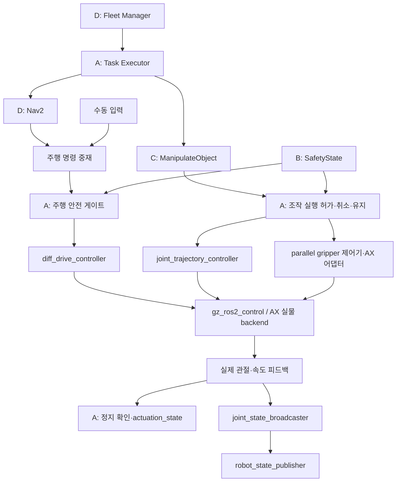

# 외부 로봇 저장소의 AX 적용 검토

> 이 문서는 최초 도입 검토 기록이다. 이후 Robotiq 모델 전용 부분을 도입·빌드했으며 현재 범위는 [Robotiq 패키지 안내](../../src/robotiq_description/README.md), [집게 비교](../guides/GRIPPER_COMPARISON.md)를 참고한다.

검토일: 2026-10-21. 대상 환경: ROS 2 Jazzy / Gazebo Harmonic / 로봇 2대 / AX 자체 팔·집게.

세 저장소의 공개 문서·핵심 설정·일부 소스와 현재 AX 소스를 비교했다. 외부 패키지의 설치·빌드·시뮬레이션 시험은 수행하지 않았다. 아래 도입 구조와 일정은 제안이며, 기존 실행 코드는 변경하지 않았다. 원격 브랜치는 변할 수 있으므로 실제 도입 시 검증한 commit SHA와 의존성 버전을 고정한다.

기준 설계: [통합 상세설계](DETAILED_DESIGN.md), [A 상세 일정](../management/A_DETAILED_SCHEDULE.md).

## 1. 권고 결론

| 저장소 | 검토 브랜치 | AX 활용 판단 | 우선순위 |
|---|---|---|---|
| PickNikRobotics/ros2_robotiq_gripper | main | 드라이버·제어기·모델 분리와 그리퍼 Action 구조 참고. AX 자체 집게에는 전용 실물 드라이버를 연결하지 않음 | 2 |
| danielstankw/UR5e-robot-control | master | 부드러운 궤적·반복 실험 설계 참고. UR 통신·접촉 삽입 제어의 직접 이식은 보류 | 3 |
| husarion/rosbot_ros | jazzy | ros2_control 기반 이동로봇, 시뮬레이션 분리, namespace·bringup 구조를 가장 먼저 참고 | 1 |

권고안은 AX 모델·작업 실행기를 유지하면서 표준 ros2_control 제어기로 저수준 제어를 정리하는 것이다. 외부 로봇 전체 패키지를 AX로 이름만 바꾸어 가져오는 방식은 기구·통신·센서 차이를 해결하지 못한다. 이 우선순위는 소스 비교에 따른 설계 판단이다.

## 2. 현재 AX와 적용 출발점

이번 검토에서 확인한 실제 소스:

| 파일 | 확인 내용 | 적용에 주는 의미 |
|---|---|---|
| [ax.urdf.xacro](../../src/ax_description/urdf/ax.urdf.xacro) | Gazebo DiffDrive와 관절별 JointPositionController 사용, ros2_control 태그 없음 | controller_manager 기반으로 전환할 구간을 분리해야 함 |
| [simulation.launch.py](../../src/ax_control/launch/simulation.launch.py) | 카메라·라이다·Twist 주행 명령 브리지 존재 | 과거 문서의 주행 명령 미연결 상태와 현재 소스를 구분해야 함 |
| 같은 launch | `/clock`, 실제 `/joint_states`, ROS odometry·주행 TF 연결 구성 없음 | 상태 피드백·시간 동기화가 우선 |
| 같은 launch | 모델명 `ax`, `/tmp/ax.urdf` 고정 | 두 대 실행 전 모델·파일·namespace 매개변수화 필요 |
| [gripper_controller.py](../../src/ax_control/ax_control/gripper_controller.py) | Float64 하나를 두 손가락에 그대로 전달, 절대 토픽 사용 | 범위·유효값 검사, 실행 결과·취소·로봇별 분리 필요 |
| 집게 관절 | 좌우 prismatic, 같은 양의 변위로 벌어짐, mimic 비활성 | Robotiq 회전 링크 관절과 직접 호환되지 않음 |

카메라·주행 브리지가 소스에 있다는 사실은 실제 수신·이동 성공을 의미하지 않는다. 현재 소스·빌드·모델 검사 결과는 [업로드 전 점검](../validation/PREUPLOAD_REVIEW.md)을 참고한다. 이 외부 저장소 검토 당시에는 코드 구조를 비교했다.

## 3. Robotiq 저장소

### 3.1 확인한 구조

`robotiq_driver`, `robotiq_controllers`, `robotiq_description`으로 실물 통신·제어·모델이 분리되어 있다. README의 지원 표는 Humble/Iron/Rolling 중심이지만, 확인한 컨트롤러 YAML에는 Jazzy 이후용 parallel gripper 설정이 들어 있다. README만으로 Jazzy 빌드 성공을 단정할 수 없다. [저장소 README](https://github.com/PickNikRobotics/ros2_robotiq_gripper/blob/main/README.md), [컨트롤러 설정](https://github.com/PickNikRobotics/ros2_robotiq_gripper/blob/main/robotiq_description/config/robotiq_controllers.yaml).

2F-85의 ros2_control 매크로는 Gazebo, mock, 실물 backend를 선택한다. Gazebo는 `gz_ros2_control/GazeboSimSystem`, 실물은 Robotiq 전용 hardware interface와 직렬 포트를 사용한다. AX 시뮬레이션에는 backend 분리 패턴을 적용할 수 있다. [2F-85 ros2_control 매크로](https://github.com/PickNikRobotics/ros2_robotiq_gripper/blob/main/robotiq_description/urdf/2f_85.ros2_control.xacro).

### 3.2 AX에 적용할 방안

1. 모델·제어 설정·실물 통신 계층을 분리하는 구조를 따른다.
2. C의 `ManipulateObject` 아래에 AX용 그리퍼 어댑터를 둔다. 기존 작업 Action은 유지한다.
3. 저수준 집게 명령은 Float64 발행에서 목표·피드백·결과·취소가 있는 Action으로 전환한다.
4. 현재 대칭 집게를 단일 구동축으로 취급할지, 양쪽 독립 구동으로 유지할지 기구 기준으로 결정한다.
5. 단일 구동축 + mimic을 선택하면 현재 양쪽 독립 명령 분배를 제거하고 좌우 실제 변위를 검증한다.

Jazzy 공식 문서의 권장 제어기는 `parallel_gripper_action_controller/GripperActionController`이며 Action 타입은 `control_msgs/action/ParallelGripperCommand`다. 기존 `GripperCommand`와 같은 타입으로 가정하지 않는다. 실제 설치 버전과 C/MoveIt 어댑터가 사용하는 타입을 맞춘다. [Parallel Gripper 공식 문서](https://control.ros.org/jazzy/doc/ros2_controllers/parallel_gripper_controller/doc/userdoc.html).

현재 AX 명령값은 전체 개구 폭이 아니라 손가락 각각의 변위다. 상위 인터페이스를 개구 폭 m로 정의한다면 실제 메시·패드 형상과 영점을 기준으로 변환을 보정해야 한다. Robotiq의 회전 관절값·닫힘 위치를 AX prismatic 값에 복사하지 않는다.

### 3.3 그대로 가져오면 생기는 문제

| 확인 사항 | AX 대응 |
|---|---|
| 예제 YAML은 effort·velocity command interface를 요구하지만 확인한 Gazebo 매크로의 구동 관절은 position command만 선언 | 실제 export 인터페이스를 확인하고 지원되지 않는 선택 인터페이스 설정 제거 또는 backend 구현 |
| Gazebo 매크로는 재활성화 GPIO를 제외하지만 YAML에는 Robotiq activation controller가 있음 | AX 시뮬레이션에 실물 activation controller를 함께 로드하지 않음 |
| 예제는 `allow_stalling: true` | 멈춤을 물체 보유 성공과 동일시하지 않음. C가 접촉·물체 상태를 별도로 검증 |
| 전용 회전 링크·기구 치수·실물 통신 | AX 메시·관절·단위·통신 유지, 구조만 참고 |

앞의 인터페이스 차이는 확인한 파일 조합에 대한 정적 검토 결과다. 실행 실패를 재현한 것은 아니며 실제 선택 launch·버전에서 확인해야 한다. [YAML](https://github.com/PickNikRobotics/ros2_robotiq_gripper/blob/main/robotiq_description/config/robotiq_controllers.yaml), [Xacro](https://github.com/PickNikRobotics/ros2_robotiq_gripper/blob/main/robotiq_description/urdf/2f_85.ros2_control.xacro).

실제 Robotiq 집게를 채택할 때에만 전용 드라이버의 사용을 재검토한다. 현재 AX 자체 집게에는 필요하지 않다.

## 4. UR5e 저장소

### 4.1 확인한 목적과 제약

이 저장소는 UR5e와 125 Hz로 통신하는 Python 실험 코드다. 최소 jerk 궤적, PD·임피던스 기반 peg-in-hole, 나선 탐색을 포함하고, TensorFlow 기반 겹침 탐지는 README에서 미완성으로 설명한다. ROS 2 Jazzy용 패키지로 바로 사용하는 구조는 아니다. [README](https://github.com/danielstankw/UR5e-robot-control/blob/master/readme.md).

`main.py`는 URBasic, OnRobot 힘·토크 센서, 실물 IP와 실험 pose에 의존한다. `Controller.py`에는 사용자 PC의 절대 CSV 경로가 있고, 힘·모멘트 피드백과 6차원 제어 상태를 사용한다. [main.py](https://github.com/danielstankw/UR5e-robot-control/blob/master/main.py), [Controller.py](https://github.com/danielstankw/UR5e-robot-control/blob/master/Controller.py).

### 4.2 활용할 부분

- `minimum_jerk_planner.py`의 시작·끝 속도/가속도를 부드럽게 만드는 궤적 아이디어를 검토한다. [궤적 소스](https://github.com/danielstankw/UR5e-robot-control/blob/master/minimum_jerk_planner.py).
- AX에서는 먼저 관절 공간의 시간 지정 궤적으로 적용한다. Cartesian 궤적을 쓰려면 C의 IK·충돌 검사·도달 가능성 검증이 선행되어야 한다.
- 반복 trial, 초기 오차 주입, 성공률 기록 구조는 AX 집기·이상 탐지 데이터 수집 방식에 참고한다.
- 기존 위치 명령과 부드러운 궤적의 목표 오차·진동·시간을 같은 조건에서 비교한다.

팔 실행은 `joint_trajectory_controller`의 `FollowJointTrajectory`를 사용하는 방향을 권고한다. 이 제어기는 관절 궤적 실행·결과 감시를 제공하지만 자체적으로 AX의 IK나 충돌 회피를 해결하지 않는다. [Jazzy 궤적 제어기 문서](https://control.ros.org/jazzy/doc/ros2_controllers/joint_trajectory_controller/doc/userdoc.html).

### 4.3 보류할 부분

- URBasic/RTDE/URScript 통신: AX 제어 하드웨어와 다름.
- 원본 임피던스 이득·힘 임계값·실험 pose: AX 질량·기구·센서에 맞지 않음.
- 접촉 상태 나선 탐색: 현재 창고 운반의 핵심 요구가 아님.
- 미완성 ML 코드: AX의 Isolation Forest·집기 XGBoost를 대신하는 기능이 아님.
- 원본 125 Hz 실행 주기: WSL·Python·시뮬레이션에서 실시간 성능을 보장하는 근거로 사용하지 않음.

향후 힘 제어가 필요하면 AX 센서·제어 모드·접촉 모델부터 확인한다. 현재 팔의 자유도·가동 범위에서 임의의 6차원 pose를 모두 달성할 수 있다고 가정하지 않는다.

## 5. ROSbot 저장소

### 5.1 확인한 구조

검토 대상은 `jazzy` 브랜치다. 모델, 제어, Gazebo, bringup, localization, 실물 hardware interface를 나누고, 시뮬레이션에서는 Gazebo의 gz_ros2_control이 controller_manager를 호스팅하는 구조다. [아키텍처](https://github.com/husarion/rosbot_ros/blob/jazzy/ARCHITECTURE.md).

실제 컨트롤러 설정에는 좌우 바퀴 2개씩의 diff drive, joint state broadcaster, 명령 timeout·제한과 명령 중재가 포함된다. 바퀴 치수·보정계수·공분산은 ROSbot용이므로 AX에서 다시 정한다. [controllers.yaml](https://github.com/husarion/rosbot_ros/blob/jazzy/rosbot_controller/config/rosbot/controllers.yaml).

spawn 설정은 namespace·초기 pose·로봇명, 시뮬레이션 시간, 로봇별 브리지 설정을 처리한다. AX의 단일 모델명·고정 임시 파일 문제를 해결할 참고 구조다. [spawn_robot.yaml](https://github.com/husarion/rosbot_ros/blob/jazzy/rosbot_gazebo/launch/spawn_robot.yaml).

### 5.2 AX에 적용할 방안

| ROSbot 참고 영역 | AX 적용 |
|---|---|
| 모델·제어·시뮬레이션 분리 | `ax_description`, `ax_control`, `ax_simulation`, `ax_bringup`으로 책임 분리 |
| diff drive | 현재 AX의 네 바퀴를 좌우 2개씩 설정, 실제 축 방향·반지름·간격 검증 |
| joint state broadcaster | 실제 관절 위치·속도 → TF·C 조작·A 제어 이상 탐지에 제공 |
| namespace 기반 spawn | `robot_1`, `robot_2`의 manager·센서·명령·파일 분리 |
| localization 분리 | B가 odom·센서 입력을 받아 위치 추정, TF 발행 소유권 명시 |
| 설정 파일 중심 구성 | 로봇별 제어 설정·제한·브리지 구성을 코드와 분리 |

ROSbot은 manual/autonomous 등의 우선순위로 속도 입력을 중재한다. AX에도 입력 중재는 유용하지만 **우선순위 중재가 A의 안전 정지를 대체하지는 않는다**. manual을 포함한 모든 정상 명령이 최종 안전 차단을 거치도록 설계한다. [ROS API의 명령 중재](https://github.com/husarion/rosbot_ros/blob/jazzy/ROS_API.md).

ROSbot 실물용 MAVLink·STM32·Dynamixel·배터리·LED 기능은 AX 하드웨어를 채택하지 않는 한 도입 대상에서 제외한다. 이동로봇 패키지를 참고해도 AX의 Fleet Manager·통로 잠금·중앙 Agent는 별도 구현이 필요하다.

## 6. 권고 제어 구조

아래는 AX 적용 제안이며 외부 저장소의 완성 기능을 나타내는 그림이 아니다.

- C는 조작 목표·집기 결과를 소유한다. A는 실행 허가·중단·구동 차단을 소유한다.
- Action 요청을 거절하는 것만으로 이미 실행 중인 궤적이 정지하지는 않는다. 활성 goal 취소·유지·실측 정지 확인까지 구현한다.
- 정상 클라이언트가 안전 계층을 우회해 제어기 Action·Topic에 명령하지 않도록 연결을 정리한다. 더 낮은 계층의 watchdog·실물 비상정지는 backend 별로 검증한다.
- 팔·집게를 무조건 비활성화하면 낙하·적재물 이탈이 생길 수 있으므로 이동 차단과 자세·파지 유지 정책을 C와 합의한다.
- ML은 진단 보조이며 안전 해제나 최종 구동 권한을 갖지 않는다.

## 7. 전환 시 반드시 처리할 차이

### 7.1 제어기 중복 제거

같은 관절에 기존 Gazebo JointPositionController와 ros2_control 제어기를 동시에 적용하지 않는다. 바퀴를 전환할 때도 기존 Gazebo DiffDrive를 비활성화한다. launch 인자로 기존 방식·새 방식 중 하나만 선택하도록 제안한다.

### 7.2 Gazebo 연결

Jazzy의 gz_ros2_control은 Harmonic 조합을 지원하며 `<ros2_control>`의 command/state interface와 Gazebo 플러그인이 필요하다. mimic 종속 관절에는 command interface를 선언하지 않는 것이 공식 지침이다. AX가 mimic을 선택할 때 기존 두 손가락 명령 경로를 함께 바꾼다. [공식 연결·mimic 문서](https://control.ros.org/jazzy/doc/gz_ros2_control/doc/index.html).

Gazebo가 호스팅하는 manager와 같은 관절을 대상으로 별도 ros2_control_node를 중복 기동하지 않는다. mock 성공과 물리 접촉·파지 성공은 별도로 검증한다.

### 7.3 주행 메시지·TF

AX의 현 브리지는 `Twist`를 사용한다. Jazzy diff_drive_controller 문서의 입력은 `TwistStamped`이므로 Nav2·수동 입력·중재·안전 게이트의 타입과 timestamp를 일치시킨다. odom TF는 제어기 또는 B의 필터 중 한 곳만 발행하게 한다. [공식 diff drive 인터페이스](https://control.ros.org/jazzy/doc/ros2_controllers/diff_drive_controller/doc/userdoc.html).

토픽 namespace와 `frame_id`는 별도다. `/ax/robot_1` 아래 노드를 띄워도 `base_link` 문자열이 자동으로 `robot_1/base_link`가 된다고 가정하지 않는다. AX의 `map → robot_N/odom → robot_N/base_link` 규칙으로 TF·메시지를 일관되게 맞춘다.

### 7.4 모델링과 피드백

OBJ 외형 교체와 제어 구조 전환은 별도 작업이다. AX 전체 메시를 한 링크에 넣어도 관절·mimic·질량·관성은 생성되지 않는다. 실제 기구 링크별 메시, 관절 원점·축·제한, 단순 충돌 형상을 준비해야 한다.

제어 목표를 그대로 되돌려주는 mock state는 제어 이상 탐지 학습이나 정지 증거로 사용하지 않는다. Gazebo 실제 상태와 향후 실물 센서 피드백을 사용하고, effort가 없는 경우 가짜 값으로 보충하지 않는다.

## 8. 파일별 변경 제안

아래 신규 파일명은 계획용이며 이번 검토에서 생성하지 않았다.

| 파일·패키지 | 제안 변경 | 담당 |
|---|---|---|
| `ax_description/urdf/ax.urdf.xacro` | 기구 모델과 제어 매크로 분리, 기존·새 backend 선택 | A |
| `ax_description/urdf/ax.ros2_control.xacro` | AX 관절별 command/state 선언, sim/mock/실물 선택 | A |
| `ax_control/config/controllers.yaml` | broadcaster·diff drive·팔·그리퍼 설정 | A, D/C 검토 |
| `ax_control/launch/controllers.launch.py` | manager 준비 확인 후 제어기 로드·활성화 | A |
| `ax_simulation/launch/spawn_robot.launch.py` | 로봇명·namespace·초기 pose·시뮬레이션 시간 | A |
| `ax_bringup/launch/two_robots.launch.py` | 두 로봇 독립 실행 | 공통, A 주도 |
| `ax_control` 그리퍼 어댑터 | 기존 변위 API 변환, Action·피드백·제한 | A/C |
| `ax_control` 안전 계층 | 입력 중재 뒤 최종 차단, 조작 취소·유지·정지 확인 | A/B/C/D |
| `ax_manipulation` | 조작 Action에서 팔·그리퍼 Action 연결 | C |
| `ax_control_ml` | 실제 피드백 기반 특징 수집 | A |

현재 `ax_control/package.xml`에는 로봇 제어 프레임워크 의존성이 선언되어 있지 않다. 실제 선택 패키지에 맞춰 `controller_manager`, `joint_state_broadcaster`, `diff_drive_controller`, `joint_trajectory_controller`, parallel gripper, `control_msgs`, `trajectory_msgs`, `gz_ros2_control` 등 필요한 의존성을 정확히 선언한다. 배포판별 패키지 이름·설치 버전은 도입 시 확인한다.

## 9. 적용 순서와 예상 작업량

다음은 A의 순수 작업일 추정이다. 실물 장비, 기구 재설계, 외부 팀 대기·장기 튜닝은 포함하지 않는다. 기존 [A 일정](../management/A_DETAILED_SCHEDULE.md)의 해당 작업을 구체화하는 안이며 전체 기간에 일괄 추가하는 일정이 아니다.

| 순서 | 작업 | 예상 | 기존 A 일정 대응 | 완료 기준 |
|---|---|---|---|---|
| 1 | 관절·명령·상태 계약, 버전·의존성 확정 | 1~2일 | 1~2주 | 가용 인터페이스·관절 소유권·단위 표 |
| 2 | 한 대 gz_ros2_control·broadcaster·시간 연결 | 2~3일 | 3주 | manager 활성, 실제 joint state·TF·clock |
| 3 | diff drive·안전 입력·odom 인계 | 1~2일 | 3~4주 | 전진·회전·timeout·정지 확인 |
| 4 | 팔 trajectory와 AX 그리퍼 Action | 2~3일 | 5~7주 | 목표·오차·취소·유지 검증 |
| 5 | 두 대 namespace·TF·파일 분리 | 1~2일 | 4주 기반, 9주 실행기 | 상대 로봇에 명령·상태 영향 없음 |
| 6 | C/D 실제 연결·회귀 검증 | 2~3일 | 7~10주 | 한 대 운반·두 대 교행·오류 복구 |

기본 전환 합계는 약 9~15 작업일이다. UR5e의 부드러운 궤적 아이디어 검증은 기본 전환 후 1~2일의 선택 실험으로 둔다. 목표 추종·충돌·파지 문제는 별도 측정 후 재산정한다.

첫 구현 단위는 **한 대의 실제 joint state + diff drive + 주행 정지 확인**으로 제안한다. 이를 통과한 뒤 팔·집게를 전환하고 마지막에 두 대를 연결한다.

## 10. 도입 검증 항목

| 항목 | 확인 내용 | 기존 테스트 연결 |
|---|---|---|
| 인터페이스 | 제어기 요구 인터페이스가 실제 export 목록과 일치 | 계약 테스트 |
| 활성화 | 상태·제어기 준비 후 활성화, 실패 시 실행 시작 금지 | TC-01/02 |
| 관절 피드백 | 목표값과 실제값 구분, 프레임·시간·갱신 주기 확인 | TC-02/11 |
| 기본 주행 | 전진·회전·제한·명령 timeout 후 실측 정지 | TC-04 |
| 팔 궤적 | 목표 추종·허용 오차·취소·적재 유지 | TC-02/05/08 |
| 집게 | 좌우 대칭·개구 폭 변환·stall·물체 보유 구분 | TC-05 |
| 안전 우회 | 수동·주행·팔·집게 명령 유입 중 위험 상태에서도 차단 유지 | TC-04/05 |
| 두 대 분리 | manager·센서·Action·TF·임시 파일 충돌 없음 | TC-01/03 |
| odom 소유권 | 중복 TF 없음, B 추정·D 주행 정상 연결 | TC-06/07 |
| 재배정 | 취소 미확인·이전 결과·적재 불확실 시 새 실행 차단 | TC-08 |
| 모델 오류 | 제어 ML 실패가 기본 제어·안전 기능을 막지 않음 | TC-11 |

## 11. 라이선스와 재사용 범위

| 저장소 | 확인 결과 | 도입 기록 |
|---|---|---|
| Robotiq | BSD-3-Clause | 복사 파일의 저작권·조건·고지 보존. [LICENSE](https://github.com/PickNikRobotics/ros2_robotiq_gripper/blob/main/LICENSE) |
| ROSbot | Apache-2.0 | 라이선스·관련 고지 보존, 수정 파일에 변경 표시, NOTICE가 있으면 해당 조건 반영. [LICENSE](https://github.com/husarion/rosbot_ros/blob/jazzy/LICENSE) |
| UR5e | 확인한 루트 목록·README에서 저장소 전체 라이선스를 확인하지 못함 | 코드 복사·배포 전 파일별·상위 원저작물 조건 확인. 현재 권고는 개념 참고와 AX용 독립 구현. [저장소](https://github.com/danielstankw/UR5e-robot-control) |

직접 도입 시 출처 URL·commit SHA·복사 경로·수정 내용·라이선스를 기록한다. 외부 메시·모델·하위 의존성의 조건도 각각 확인한다. 현재 AX `ax_control`의 라이선스 선언은 TODO 상태이므로 재배포 전에 프로젝트 선언도 정리해야 한다.

## 12. 적용 판단

- 채택 제안: ROSbot의 패키지 분리·namespace·시뮬레이션/실물 분리 패턴과 Jazzy 표준 제어기 활용.
- 조건부 채택: Robotiq의 그리퍼 구조. AX 집게에는 AX 관절·단위·backend·Action 어댑터를 작성한다.
- 선택 실험: UR5e의 부드러운 궤적·반복 오차 주입. 접촉 힘 제어·전용 통신·미완성 ML은 현재 범위에서 보류한다.
- 별도 구현 유지: A 실행기·안전 정지, B 위험 판단, C 물체 보유 판정, D 배정·통로·중앙 Agent 검증.

현재 결론은 정적 검토에 근거한다. 실제 채택 여부는 한 대 제어기 전환 시험과 기존 기능 회귀 결과로 확정한다.
