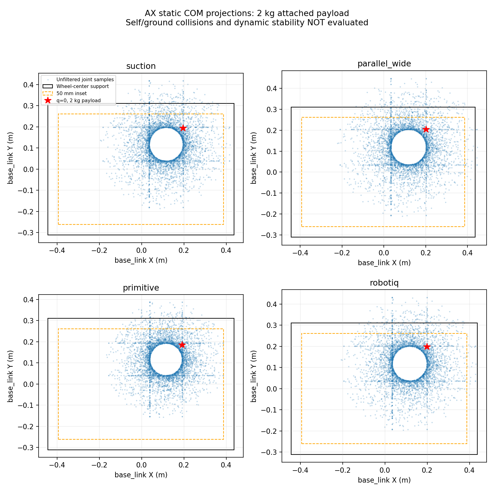

# AX 충돌 형상·질량 특성 보완 결과

작성일: 2026-10-21. 몸통 충돌 형상 → 팔 충돌 형상 → 가상 질량 분포·관성 → 전체 무게중심·정적 지지 여유 순서로 적용했다. 메시 외형·관절 배치·범위·속도·effort·PID는 이번 작업에서 변경하지 않았다.

## 1. 몸통 충돌 형상 수정

기존 몸통 collision은 0.50×0.35×0.20 m였지만 OBJ 외곽은 약 1.366×0.774×0.606 m다. 기존 상자 하나를 제거하고, 메시의 연결된 부품별로 방향을 맞춘 상자를 생성했다. 몸통에는 58개 상자가 적용된다.

모든 대상 메시 정점이 충돌 상자 안에 들어오는지 설치된 URDF 기준으로 검사했다. 각 부품을 통째로 감싸므로 삼각형 내부도 포함한다. 상자 각 면에 1 mm 여유를 주며, 다른 상자 안에 완전히 포함된 상자는 제거했다.

이는 정밀한 볼록 분해가 아니다. 부품 자체의 구멍·홈·휠하우스 안쪽 공간은 상자 안에서 메워질 수 있다. 작은 장식 부품도 포함되어 충돌 계산 비용이 증가하므로 실제 Gazebo 성능은 후속 측정이 필요하다.

## 2. 팔 충돌 형상 세분화

메시 정점을 연결 관계로 분류하고, 부품마다 축 정렬 상자와 PCA 방향 상자를 비교해 더 작은 상자를 선택했다. 단일 부품 내부의 빈 공간까지 정밀하게 복원한 것은 아니다.

| 링크 | 이전 충돌 형상 수 | 적용 충돌 상자 수 |
|---|---:|---:|
| `base_link` | 1 | 58 |
| `arm_mount_link` | 1 | 14 |
| `column_link` | 1 | 4 |
| `arm_rotating_base_link` | 1 | 4 |
| `upper_arm_link` | 1 | 8 |
| `forearm_link` | 1 | 7 |
| `wrist_link` | 1 | 4 |

특히 비스듬한 전완은 부품 방향을 따르는 상자로 변경했다. 부품 간 중첩이 있어 상자 부피 합계를 실제 물체 체적이나 정확한 충돌 영역 체적으로 해석하면 안 된다. 바퀴·공통 어댑터·각 집게는 기존 collision을 유지했다.

## 3. 가상 질량 분포와 관성

질량 합계는 기존 사양을 유지했다. 차체 8 kg, 받침·기둥·팔·공통 어댑터 16.2 kg, 바퀴 합계 2 kg이며 센서·공구는 별도다.

기존에는 링크 전체를 균일한 상자·원통으로 취급했다. 이번에는 아래 **가상 내부 배치 가정**을 적용했다. 실제 CAD 내부 구조나 제조사 링크 질량을 측정한 값이 아니다.

- 차체: 기존 8 kg 중 5.6 kg을 하부 배터리·밸러스트 예산으로 배치하고, 2.4 kg을 프레임·외장에 배분했다. 총질량을 추가한 것은 아니다.
- 고정 받침: 1.8 kg을 하단 받침, 나머지 1.2 kg을 지지 구조에 배분했다.
- 회전 기둥: 하단 모터 1.6 kg, 두께 5 mm의 가상 중공 튜브 2.4 kg으로 가정했다.
- 상단 연결부·상완·전완·손목: 각각 0.6 / 1.6 / 1.05 / 0.45 kg의 모터 질량을 관절 근처에 배치했다. 나머지는 부품 상자의 부피 비율로 배분했다.

부품 부피 비율은 질량 배분의 근사 가중치다. 상자 중첩과 내부 빈 공간이 있으므로 실제 균일 재질 밀도나 제조 가능성을 뜻하지 않는다. 가정한 내부 배치는 형상과 질량을 함께 검토하며 조정할 수 있다.

| 링크 | 이전 무게중심 (m) | 변경 무게중심 (m) |
|---|---|---|
| 몸통 | (0, 0, 0) | (0.0065, 0, -0.1159) |
| 고정 받침 | (-0.0125, -0.0070, 0.4340) | (-0.0189, -0.0106, 0.1959) |
| 회전 기둥 | (0, 0, 0.3600) | (0, 0, 0.2360) |
| 상단 연결부 | (0, 0, 0.0850) | (-0.0038, 0, 0.0894) |
| 상완 | (0.0620, 0, 0.2780) | (0.0531, 0, 0.1980) |
| 전완 | (0.0870, 0.2165, -0.2090) | (0.0787, 0.1585, -0.1533) |
| 손목 | (0, 0, -0.1445) | (0.0001, 0, -0.1277) |

좌표는 각각 해당 링크 좌표계 기준이다. 각 부품의 회전된 관성과 평행축 정리를 사용해 링크 무게중심 기준의 **전체 관성 텐서**를 계산했다. 비대각 항도 URDF에 반영했다. 질량만 변경하고 관성을 그대로 둔 방식이 아니다.

## 4. 전체 무게중심·정적 지지 여유 검사

수평 바닥에서 네 바퀴 접촉점의 중심을 이은 직사각형을 지지 영역으로 가정했다. `base_link` 기준 X는 -0.443~0.437 m, Y는 -0.311~0.311 m다. 타이어 폭에 따른 추가 접촉 면적은 사용하지 않았다. 네 바퀴가 접지한다는 가정이며 경사면·타이어 변형·가감속 효과는 포함하지 않는다.

집게마다 무부하와 2 kg 상자 부착 가정을 계산했다. 5축 각도 격자 3,125개, 난수 20,000개(seed 42), 기본 자세 1개로 모델당 23,126개 자세를 검사했다. 자기 충돌·바닥 충돌·IK 접근 경로를 걸러내지 않은 샘플이므로 통과율이나 작업 성공률로 사용하지 않는다.

2 kg 하중의 위치는 흡착 헤드에서는 컵 접촉면의 로컬 +Z 방향 150 mm 지점, 넓은 집게에서는 `wide_grasp_frame`으로 가정했다. primitive·Robotiq도 보고서에 명시한 말단 위치에 이상적으로 부착한 것으로 계산했다. 실제 상자 형상·파지력·개구 폭과의 적합성은 이 계산에 포함하지 않았다.

### 기본 자세: 모든 팔 관절각 0, 상자 2 kg 가정

| 공구 | 상자 포함 전체 질량 | 무게중심 지상 높이 | 가장 가까운 지지 경계까지 여유 |
|---|---:|---:|---:|
| 흡착 헤드 | 29.110 kg | 1.006 m | 117.8 mm |
| 넓은 평행 집게 | 29.850 kg | 1.017 m | 106.7 mm |
| 기존 임시 집게 | 28.650 kg | 1.011 m | 124.9 mm |
| Robotiq | 29.471 kg | 1.013 m | 112.3 mm |

이 자세의 무게중심 투영점은 계산상 지지 영역 안쪽이며, 초기 목표인 50 mm 정적 여유를 넘는다. 이는 해당 자세·가상 질량 배분·이상적 하중 부착 가정에 한정된 결과다. 이 상태에서 실제 상자를 집을 수 있다는 판정은 아니다.

### 관절 범위 샘플 결과: 상자 2 kg 가정

| 공구 | 최소 정적 여유 | 지지 영역 밖인 샘플 |
|---|---:|---:|
| 흡착 헤드 | -117.4 mm | 665 / 23,126 |
| 넓은 평행 집게 | -147.0 mm | 961 / 23,126 |
| 기존 임시 집게 | -86.7 mm | 483 / 23,126 |
| Robotiq | -130.6 mm | 800 / 23,126 |

음수는 가정한 지지 영역 밖을 뜻한다. 충돌하지 않고 실제 도달할 수 있는 자세인지 추가 확인이 필요하므로 실제 운용 중 전도 횟수로 해석하지 않는다. 반대로 샘플 검사에서 양수라고 전 가동 범위의 안정성이 증명되는 것도 아니다. **현재 전 관절 범위에 대해 2 kg 운반을 승인할 수 없다.** 무부하에서도 일부 공구 구성의 샘플은 지지 영역 밖으로 나간다.



## 5. 확인한 내용과 남은 검증

확인 완료:

- 집게 4종의 Xacro 변환·`check_urdf` 통과.
- 대상 메시 정점 전부가 새 collision 안에 포함되는지 설치 URDF 기준 검사.
- 각 링크 질량, 무게중심, 관성 양의 정부호 및 관성 주축의 삼각 부등식 검사.
- 독립적인 두 상자 예제로 무게중심·비대각 관성·평행축 계산 확인.
- 변경 전후 관절·시각 외형 동일 확인.
- 집게 4종 URDF→SDF 변환, 고정 관절 병합 전후 전체 질량 보존과 SDF 관성 양의 정부호 확인.

SDF 변환에서는 기존 센서 `gz_frame_id` 확장에 대한 경고가 나왔으며 변환은 성공했다. 플러그인 실행·렌더링·Gazebo 접촉 시험 완료를 뜻하지 않는다.

남은 항목은 자기 충돌과 지면 간섭을 반영한 작업 영역, 명령 실행 전 하중별 자세 제한, 동적 전도·바퀴 들림, 새 질량 특성에 대한 토크·PID·추종, 충돌 계산 성능이다. 이번 정적 계산 결과로 기둥 높이·팔 길이·차체 질량을 임의로 변경하거나, 사용 관절 범위를 자동으로 줄이지 않았다. 실제 목표 작업 자세를 기준으로 필요한 변경을 결정해야 한다.

## 6. 파일과 재현 방법

| 파일 | 역할 |
|---|---|
| `tools/generate_physical_properties.py` | 메시 연결 부품 분석, 충돌 상자·가상 질량 특성 생성 |
| `src/ax_description/urdf/physical_properties.xacro` | 생성된 충돌 형상·관성 매크로. 주 URDF에서 사용 |
| `src/ax_description/config/physical_properties.json` | 질량 배분 가정, 부품별 형상, 정확한 무게중심·관성 기록 |
| `tools/check_static_stability.py` | 모델 검사와 정적 무게중심 샘플 계산 |
| [static_stability.json](../evidence/physical_properties/static_stability.json) | 자세·하중별 정적 계산 수치와 최악 샘플 각도 |
| [sdf_checks.json](../evidence/physical_properties/sdf_checks.json) | 집게별 SDF 변환 검사 결과 |

메시나 가상 질량 배분을 수정한 경우 생성기를 다시 실행한다. 실행에는 numpy·scipy·matplotlib와 ROS 환경이 필요하다.

```bash
cd ~/ax_ws
source /opt/ros/jazzy/setup.bash
python3 tools/generate_physical_properties.py
colcon build --symlink-install --packages-up-to ax_description ax_control
source install/setup.bash
python3 tools/check_static_stability.py
```

RViz에서는 `RobotModel`의 `Collision Enabled`를 켜고 `Visual Enabled`를 꺼 충돌 형상만 확인할 수 있다. RViz 표시는 접촉·전도 검증을 대신하지 않는다.
