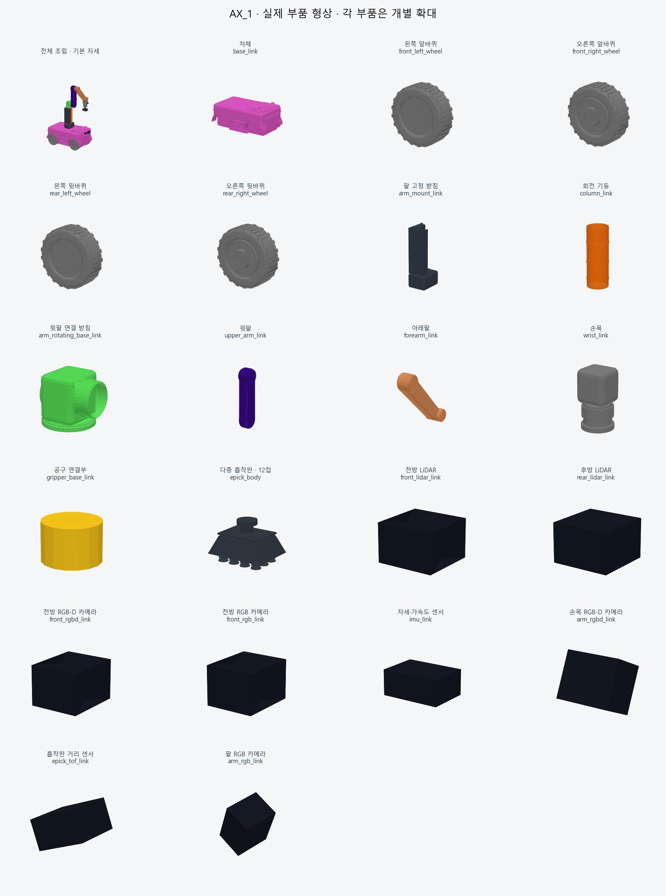
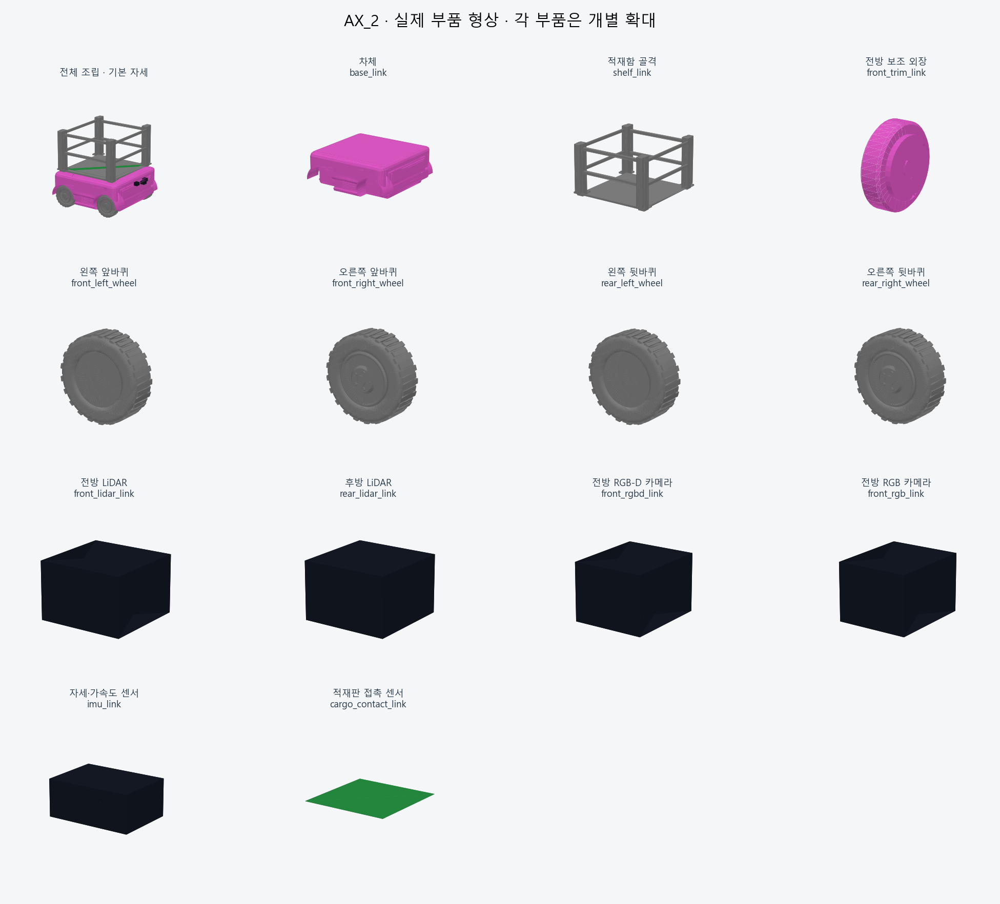

# 로봇 부품 미리보기

실제 URDF의 visual 형상에서 생성한 부품 모음입니다. PNG를 클릭하거나 이 README에서 **Ctrl+Shift+V**를 누르면 VS Code에서 볼 수 있습니다. GitHub에서도 표시됩니다.

각 부품은 보기 좋게 개별 확대했습니다. 그림 사이의 크기는 실물 비율이 아니며, 전체 조립 모습은 기본 관절 자세입니다. 재질과 조명 표현은 Gazebo와 다를 수 있습니다.

## AX_1 · robot_1 계열



[원본 모델 설정](../urdf/ax.urdf.xacro)

| 부품 설명 | 실제 링크 이름 | 형상 파일·설정 |
|---|---|---|
| 차체 | `base_link` | [base_link.obj](versions/AX_1_v2/base_link.obj) |
| 왼쪽 앞바퀴 | `front_left_wheel` | [front_left_wheel.obj](versions/AX_1_v2/front_left_wheel.obj) |
| 오른쪽 앞바퀴 | `front_right_wheel` | [front_right_wheel.obj](versions/AX_1_v2/front_right_wheel.obj) |
| 왼쪽 뒷바퀴 | `rear_left_wheel` | [rear_left_wheel.obj](versions/AX_1_v2/rear_left_wheel.obj) |
| 오른쪽 뒷바퀴 | `rear_right_wheel` | [rear_right_wheel.obj](versions/AX_1_v2/rear_right_wheel.obj) |
| 팔 고정 받침 | `arm_mount_link` | [arm_mount_link.obj](versions/AX_1_v2/arm_mount_link.obj) |
| 회전 기둥 | `column_link` | [column_link.obj](versions/AX_1_v2/column_link.obj) |
| 윗팔 연결 받침 | `arm_rotating_base_link` | [arm_rotating_base_link.obj](versions/AX_1_v2/arm_rotating_base_link.obj) |
| 윗팔 | `upper_arm_link` | [upper_arm_link.obj](versions/AX_1_v2/upper_arm_link.obj) |
| 아래팔 | `forearm_link` | [forearm_link.obj](versions/AX_1_v2/forearm_link.obj) |
| 손목 | `wrist_link` | [wrist_link.obj](versions/AX_1_v2/wrist_link.obj) |
| 공구 연결부 | `gripper_base_link` | 기본 도형: URDF visual |
| 다중 흡착판 · 12컵 | `epick_body` | [parcel_suction_head.stl](tools/parcel_suction_head.stl) |
| 전방 LiDAR | `front_lidar_link` | 기본 도형: URDF visual |
| 후방 LiDAR | `rear_lidar_link` | 기본 도형: URDF visual |
| 전방 RGB-D 카메라 | `front_rgbd_link` | 기본 도형: URDF visual |
| 전방 RGB 카메라 | `front_rgb_link` | 기본 도형: URDF visual |
| 자세·가속도 센서 | `imu_link` | 기본 도형: URDF visual |
| 손목 RGB-D 카메라 | `arm_rgbd_link` | 기본 도형: URDF visual |
| 흡착판 거리 센서 | `epick_tof_link` | 기본 도형: URDF visual |
| 팔 RGB 카메라 | `arm_rgb_link` | 기본 도형: URDF visual |

## AX_2 · robot_2 계열



[원본 모델 설정](../urdf/ax_2.urdf.xacro)

| 부품 설명 | 실제 링크 이름 | 형상 파일·설정 |
|---|---|---|
| 차체 | `base_link` | [ax_body.obj](parts/AX_2/ax_body.obj) |
| 적재함 골격 | `shelf_link` | [ax_shelf.obj](parts/AX_2/ax_shelf.obj) |
| 전방 보조 외장 | `front_trim_link` | [ax_right.obj](parts/AX_2/ax_right.obj) |
| 왼쪽 앞바퀴 | `front_left_wheel` | [ax_tire_left_front.obj](parts/AX_2/ax_tire_left_front.obj) |
| 오른쪽 앞바퀴 | `front_right_wheel` | [ax_tire_right_front.obj](parts/AX_2/ax_tire_right_front.obj) |
| 왼쪽 뒷바퀴 | `rear_left_wheel` | [ax_tire_left_rear.obj](parts/AX_2/ax_tire_left_rear.obj) |
| 오른쪽 뒷바퀴 | `rear_right_wheel` | [ax_tire_right_rear.obj](parts/AX_2/ax_tire_right_rear.obj) |
| 전방 LiDAR | `front_lidar_link` | 기본 도형: URDF visual |
| 후방 LiDAR | `rear_lidar_link` | 기본 도형: URDF visual |
| 전방 RGB-D 카메라 | `front_rgbd_link` | 기본 도형: URDF visual |
| 전방 RGB 카메라 | `front_rgb_link` | 기본 도형: URDF visual |
| 자세·가속도 센서 | `imu_link` | 기본 도형: URDF visual |
| 적재판 접촉 센서 | `cargo_contact_link` | 기본 도형: URDF visual |

## 공구·좌표 기준

로봇1 그림은 다중 흡착판 · 12컵을 장착한 모습입니다. 손가락 집게 · Robotiq 2F-85는 교체 공구이며 동시에 장착하지 않습니다.
[흡착판 상세 미리보기](tools/README.md) · [교체 집게 모델](../../robotiq_description/README.md)

`epick_tcp`, `epick_tip`, `tool_tof_link`, 카메라의 `*_optical_frame`처럼 visual이 없는 좌표 기준은 독립 부품 이미지가 없습니다. 흡착컵 배열 외형은 `epick_body`의 STL에 포함됩니다.

| 사용자 표시 이름 | 실행 선택값 | 링크·좌표 기준 |
|---|---|---|
| 다중 흡착판 · 12컵 | `tool:=epick` | `epick_body`(전체 외형), `epick_suction_cup`(컵 배열 충돌·질량), `epick_tcp`(파지 기준점) |
| 손가락 집게 · Robotiq 2F-85 | `tool:=robotiq` | `robotiq_85_*` 링크 |

`epick`은 기존 실행·센서·TCP 연결을 유지하기 위한 호환 이름입니다. 현재 다중 흡착판이 실제 EPick 제품이라는 뜻은 아닙니다.

## 갱신 방법

모델·센서·공구 형상을 변경하면 Ubuntu에서 ROS 환경과 빌드된 작업공간을 source한 뒤 저장소 루트에서 실행합니다. NumPy·SciPy·Matplotlib·Xacro·PyYAML이 필요합니다.

```bash
python3 tools/generate_parts_preview.py
```

이 도구는 미리보기 PNG 두 장과 이 안내만 갱신하며 로봇 모델·질량·관절 설정은 변경하지 않습니다.
