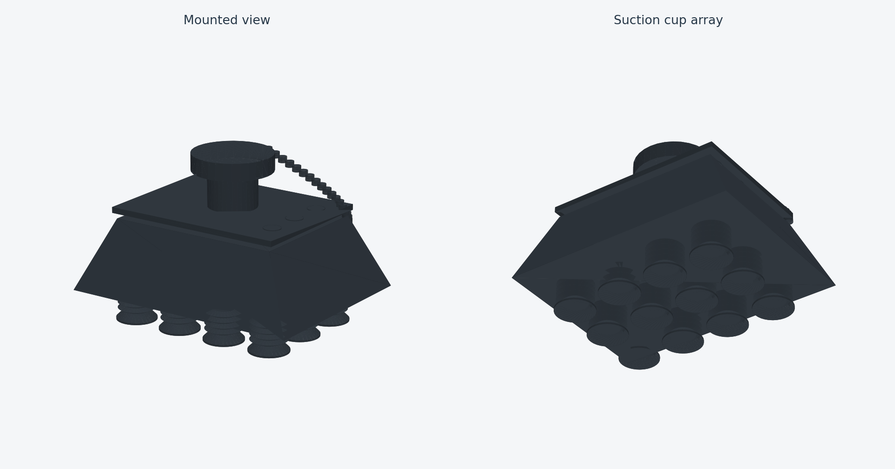

# 로봇1 다중 흡착판 · 12컵

[로봇1·로봇2 전체 부품 모음](../README.md)

표시 이름은 **다중 흡착판 · 12컵**입니다. 실행 선택값 `tool:=epick`과 `epick_*` 링크는 기존 코드 연결을 유지하는 호환 이름이며 실제 EPick 제품 모델이라는 뜻은 아닙니다. 교체 공구 이름은 **손가락 집게 · Robotiq 2F-85**입니다.

STL은 바이너리 3D 파일이라 VS Code의 텍스트 편집기에서 바로 표시되지 않습니다.
아래 PNG는 실제 STL에서 생성한 미리보기이며 VS Code와 GitHub에서 별도 3D 확장 없이 볼 수 있습니다.



## 파일과 사용법

| 파일 | 용도 |
|---|---|
| [parcel_suction_head_preview.png](parcel_suction_head_preview.png) | 모양 확인용 이미지. VS Code에서 클릭하면 바로 표시됩니다. |
| [parcel_suction_head.stl](parcel_suction_head.stl) | Gazebo가 사용하는 원본 3D 형상. 회전·확대하려면 STL 미리보기 확장이나 3D 프로그램이 필요합니다. |
| [epick.yaml](../../config/epick.yaml) | 임시 치수·컵 배열·가상 질량 설정 |
| [epick_adapter.xacro](../../urdf/epick_adapter.xacro) | 팔 장착·단일 회색 재질·충돌 형상·TCP |
| [generate_parcel_suction_head.py](../../../../tools/generate_parcel_suction_head.py) | 모델 생성과 미리보기 갱신 도구 |

현재 임시 치수는 폭 170mm × 깊이 130mm, 장착 기준에서 접촉면까지 117.3mm입니다.
흡착컵은 4×3개이며 컵 하나의 지름은 28mm입니다. 참고 사진을 바탕으로 한 개발용 모델로 실제 제품 치수나 성능을 뜻하지 않습니다.

## VS Code에서 보기

1. `parcel_suction_head_preview.png`를 클릭하면 이미지로 볼 수 있습니다.
2. 이 README를 열고 **Ctrl+Shift+V**를 누르면 이미지가 포함된 설명이 표시됩니다.
3. GitHub에서는 이 폴더를 열면 README와 이미지가 함께 표시됩니다. Git에 올릴 때 PNG도 함께 포함해야 합니다.

## 미리보기 갱신

형상이나 색상을 바꾸면 저장소 루트에서 아래 명령으로 PNG도 갱신합니다.
이 명령은 기존 STL과 Xacro 색상을 읽으며 로봇 형상·질량 설정을 바꾸지 않습니다.
Python에 NumPy·Matplotlib·PyYAML이 필요합니다.

```bash
python3 tools/generate_parcel_suction_head.py --preview-only
```

PNG는 형상 확인용 렌더링이며 Gazebo 화면 캡처가 아닙니다. 조명에 따라 실제 화면의 밝기는 달라질 수 있습니다.
